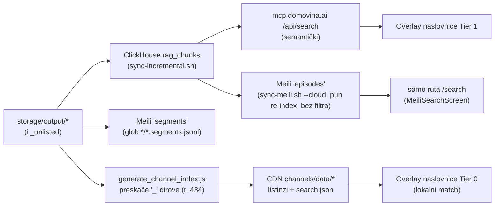

# Pretraživost ad-hoc (`_unlisted`) epizoda: koji sloj ih vidi

13.10.2026. Simptom: epizode puštene kroz pipeline.domovina.ai izvan praćenih kanala
(npr. „Nedjeljom u 2: Damir Sabol“ `pNSblshqEuU`, „Nedjeljom u 2: Jo Nesbø“
`UUKPkDRfPMo`) nalaze se semantičkom pretragom, ali ne i full-text pretragom na
naslovnici domovina.ai.

**Zaključak: indeksi su ispravni. Rupa je u frontendu** — overlay pretrage na naslovnici
ne zove Meili, a lokalni korpus po dizajnu nema `_`-kanale.

## Tok podataka

## Mjerenja (13.10.2026.)

| Sloj | Sabol | Nesbø | Napomena |
|---|---|---|---|
| ClickHouse `rag_chunks` | ✅ 59 chunkova | ✅ | 59 `_unlisted` epizoda ukupno, sve imaju `article_summary` i 11-znakovni ID |
| `/api/search` | ✅ 5/5 | ✅ 5/5 | |
| Meili cloud `episodes` | ✅ 1. mjesto | ✅ 1. mjesto | 3374 dok. = broj epizoda u CH |
| CDN `search.json` | ❌ | ❌ | 3326 epizoda, nijedna `_unlisted` |

## Zamke

- Lokalni Meili (`localhost:7700`) nije gore → `sync-cron` svaku noć javlja WARN
  „lokalni Meili re-index pao“. Bezopasno; cloud re-index prolazi.
- Testiranje cloud Meilija preko `ssh` u `while read` petlji: bez `ssh -n` ssh pojede
  stdin petlje i obradi se samo prvi red.
- `search.json` samo **nadopunjuje** epizode koje već postoje u učitanim listinzima —
  dodavanje `_unlisted` u `search.json` samo po sebi ništa ne bi dodalo u rezultate.

## Odluka / otvoreno

Odbačeno: pseudo-kanal `_unlisted` u `generate_channel_index.js` (dira `channels/data/`
ugovor i ETag, a i dalje traži frontend promjenu). Odabrano: overlay naslovnice zove
Meili `episodes` (search-only ključ `frontend-search`) i spaja tri izvora — „pametni
search“, radi se u repou `domovina.ai`. Producer se ne mijenja.

Vezano: [2026-10-09-home-json-search-json.md](2026-10-09-home-json-search-json.md),
`../domovina-rag/scripts/meili-poc-index.py`.
