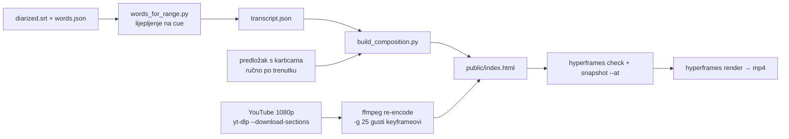

# HyperFrames za reelse — proba (21.10.2026.)

Pitanje: ima li smisla [HyperFrames](https://hyperframes.dev) (HTML → video, GSAP timeline,
render u headless Chromeu) za reelse iz epizode, uz postojeći `tools/render_reel.py`
(Pillow + ffmpeg pipe)?

**Kratko: da, kao nadogradnja, ne zamjena.** HyperFrames donosi animirane podatkovne
kartice vezane uz izgovoreno (brojač, kupon, kvačica koja se crta, punch-in kamere), što
Pillow pipe realno ne može. Cijena nije render nego **dizajn kartica po trenutku**.

Vezani dokumenti: `docs/2026-10-08-reels-poc.md` (render_reel.py),
`docs/2026-10-08-reels-layout-best-practices.md` (sigurne zone),
`docs/2026-10-06-words-json-titlovi.md` (vrijeme po riječi).

## Proba

re:DEFINICIJA ep. 10 (Muževni budite), p. Božidar Nagy SJ, `DOfcONrRyDY`, 2339–2403 s
(„lutrijska srećka platila mu je grob"). Isti trenutak je renderiran i s
`render_reel.py --layout social`, za izravnu usporedbu.

Kartice: hook (riječ po riječ) → „Prvi grob: Mirogoj / Merz umire 10. 5. 1928." →
lower-third gosta → novčanik → kupon srećke (+ datum izvlačenja) → brojač do **750** s
pečatom „DOBITAK" i punch-inom → „750 din = cijena groba na Mirogoju" + kvačica.
Titl riječ po riječ (≤3 riječi, aktivna zlatna) iz našeg `words.json`.

Datoteke: `tools/hyperframes_reel/` (`words_for_range.py`, `build_composition.py`,
`DOfcONrRyDY_srecka.template.html`). Radni dir (`public/` s `input-video.mp4`,
`vendor/gsap.min.js` iz skilla `talking-head-recut`, fontovi iz `data/branding/fonts/`,
`domovina_logo.png`) nije u repou.

## Mjerenja

| | render_reel.py (social) | HyperFrames |
|---|---|---|
| render 62–65 s videa | ~2 min (s YT skidanjem) | **50 s** (+ skidanje ~15 s) |
| datoteka | 49 MB | 40 MB |
| praćenje lica | YuNet, deadzone + EMA, rez kamere | **nema** — statičan izrez, rez ručno |
| grafike | statični tekst (hook, ime, izvor) | animirane kartice, brojači, SVG |
| rad po reelu | 0 (samo raspon + naslov) | ~30 min ručnog dizajna kartica |

`npx hyperframes check`: 0 grešaka, 10 upozorenja (samo „nested structure → sub-composition",
tiče se Studija), 27/27 WCAG AA kontrast.

## Zamke

- **Whisper iz skilla ne treba.** `talking-head-recut` transkribira s `small.en`
  (engleski). Imamo bolja vremena u `words.json` → `words_for_range.py`.
- **Fontovi iz skilla su `*-latin.woff2`, bez č/ć/đ.** Koristi Montserrat/Fira Sans iz
  `data/branding/fonts/` (OFL).
- **Statičan izrez.** 16:9 razvučen na visinu 1920 (širina 3413 px), `left` tako da lice
  bude na x 540. Na rezu kamere treba `tl.set("#video-wrap", {left, transformOrigin})`
  — ovdje 59.0 s prelazi na široki kadar (lice s 64.5 % na 69 % širine). Rez se nađe s
  `ffmpeg -vf "select='gt(scene,0.2)',showinfo"`.
- ~~Pojas kartica y 770–1100~~ — **krivo izmjereno**: YuNet kaže da je lice u ovom kadru
  y 387–879 (krupni plan), pa su kartice prekrivale bradu. Riješeno rasporedom ispod (v2).
- **Početak raspona** se lijepi na cue koji može početi ostatkom prethodne rečenice
  („…svoj grob."). Ovdje je odrezano 2.9 s (`OFF`). `render_reel.py` ima istu manu.
- **Slojevi u vremenu, ne u prostoru** (povratna informacija na v4): kartice se
  smjenjuju, nikad dvije istovremeno.

## Otvoreno

- Presuda korisnika na probu (poslana uz 7 reelova iste epizode).
- Ako se prihvati: `select_reels.js` uz raspon i naslov vraća i **kartice kao JSON**
  (tip, vrijeme, tekst, broj), a generator piše HTML — umjesto ručnog predloška.
- Praćenje lica u HyperFrames: izvesti putanju iz YuNeta (render_reel.py) kao keyframeove
  za `#video-wrap`.

## v2 (22.10.2026.): raspored koji ne piše preko lica

Povratna informacija na v1: potpis „Napravljeno s domovina.ai“ je stajao preko glave;
HyperFrames se svidio, ali raspored mora sam paziti da (1) ništa ne ide preko lica i
(2) sav tekst ostane izvan kontrola TikToka/Reelsa/Shortsa/Facebooka.

- **Potpis** je trajno dolje desno, malen (22 px). Namjerno je IZVAN sigurne zone: neka
  ga UI mreže smije prekriti, ali ostaje upečen u video.
- `face_track.py` → `faces.json`: YuNet na 5 fps, rezovi kamere, kadriranje po snimci
  (medijan lica, skok samo na rezu). Za 62 s videa treba ~3 s.
- `reel_layout.js` radi raspored u pregledniku, unutar `document.fonts.ready` i PRIJE
  tweenova kartica. Kartica je `.slot` (njime upravlja raspored); animacije ciljaju
  unutarnje elemente. Prioriteti:
  1. lice + kosa/brada (YuNet okvir proširen gore 30 %, dolje 14 %, bočno 16 %) je zabranjeno za tekst,
  2. sav tekst je u x 120–888, y 288–1248,
  3. kartica ne stane → `#cam` se glatko pomakne gore (tjeme ostaje u kadru),
  4. ni to ne stane → `#cam` se odzumira do 0.78; rub prekrije zamućena kopija kadra (`#bg-blur`),
  5. tek onda se kartica smanji; ispod 0.72 piše upozorenje u `window.__reelLayout`.
  Titl stoji na stalnoj liniji na dnu sigurne zone i seli se samo kad bi dirnuo lice ili karticu.
  Zoom kamere iz predloška (`camera:` callback) ulazi u izračun veličine lica.
- `build_composition.py ... --debug` iscrta sigurnu zonu, zabranjenu zonu lica i izvještaj
  rasporeda u sam kadar → `npx hyperframes snapshot --at ... --describe false` je QA.
- Rezultat na srećki: svih 7 kartica pune veličine. Kamera se pomakne −35 do −157 px, a
  srećka/dobitak/jednadžba se i odzumiraju (0.86–0.93). Render 49.9 s.
- Punch-in na dobitku je maknut: povećano lice ne ostavlja mjesta brojaču.
- Zamka: `snapshot` po defaultu zove Gemini vision ako je `GEMINI_API_KEY` postavljen —
  uvijek `--describe false`.
- Mana: dok je kamera odzumirana, na dnu se vidi zamućena traka (~150 px). Ta traka pada u
  donju zonu UI-ja mreža.

## v3 (22.10.2026.): branding kanala

`build_composition.py ... --brand muzevni_budite` čita `data/branding/<ime>/brand.json`
(lokalno, gitignored) i prepiše CSS varijable predloška: `--paper` = pozadina kanala,
`--edge` = zlatni rub, `--wine` / `--gold` = primarna boja / boja aktivne riječi,
`--f-head` / `--f-body` / `--f-cap` = fontovi kanala. Logo kanala stoji na prvoj i zadnjoj kartici.
Fontovi i logo se kopiraju u `public/brand/`. Bez `--brand` izgled ostaje kao u v2.

- Predmeti unutar kartica (srećka) imaju **fiksne** boje: zlatni naslov na krem kuponu je
  bio nečitljiv kad je pratio boju kanala.
- Muževni budite brand je izveden s portala (muzevnibudite.com), NE iz `projekt-41`:
  to je zaseban znak programa (cijan, štit).
- Libre Baskerville je širi od Montserrata, ali raspored je i dalje dao sve kartice pune veličine.
