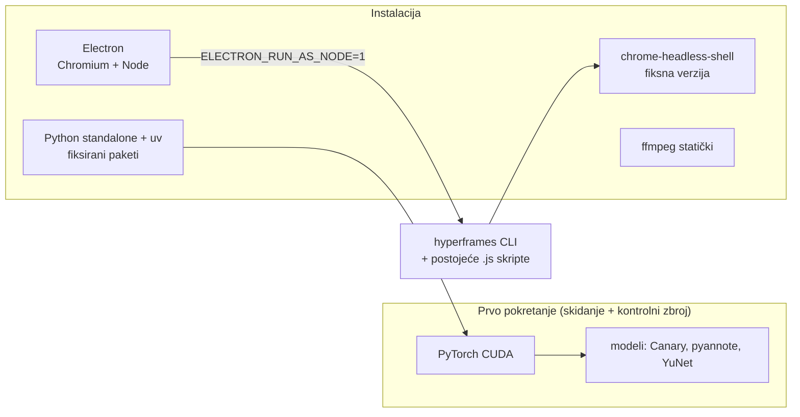

# Reel Studio — desktop aplikacija za reelse (23.10.2026.)

Ideja je Windows desktop aplikacija koja od video datoteke epizode napravi reelse.
Razvoj bi išao na macOS-u, a isti kod bi se pakirao za Windows. Tok:
**video → ASR + diarizacija → LLM prijedlozi reelova → uređivač 9:16 → HyperFrames projekt → render.**

Stanje: **samo UI prototip, kod aplikacije se još ne piše.** Stack je odlučen: **Electron**.

Vezani dokumenti: `docs/2026-10-21-hyperframes-reel-proba.md` (HyperFrames reel, skripte u
`tools/hyperframes_reel/`), `docs/2026-10-08-reels-poc.md` (`tools/render_reel.py`),
`docs/2026-10-08-reels-layout-best-practices.md` (sigurne zone).

## Prototip

`tools/reel_studio/prototype.html` je jedna HTML datoteka bez ovisnosti. Otvori se
izravno u pregledniku. Izgleda kao Windows 11 aplikacija, s tamnom i svijetlom temom.
Obrada, LLM i render su glumljeni animacijama. Stvarno radi samo učitavanje lokalnog
videa (`URL.createObjectURL`), pa uređivač pušta pravi raspon.

| Korak | Sadržaj |
|---|---|
| 1 Uvoz | odabir ili drag & drop; ASR motor (Canary lokalno / Modal / Speechmatics / Whisper), diarizacija, LLM (Gemini Vertex / Claude pretplata), broj i duljina reelova, brand kanala, procjena vremena i troška. Postojeći `.diarized.srt` + `words.json` → ASR se preskače |
| 2 Obrada | WAV → Canary → pyannote → words.json → LLM prijedlozi → YuNet lica; trake napretka, log, metrike |
| 3 Prijedlozi | ocjena, raspon, oznake, hook, citat iz prijepisa, položaj u epizodi, „zašto“, predložene kartice |
| 4 Uređivač | pregled 9:16 (sigurne zone / zona lica / ikone mreža), kartice koje se mogu uređivati, timeline (video / titl / kartice) s ručkama za rez, provjera rasporeda |
| 5 Render | red za `hyperframes render`, izlazna mapa (projekt + `.mp4` + `prijedlozi.json`) |

Podaci u prototipu su iz re:DEFINICIJA ep. 10 (`DOfcONrRyDY`). Poglavlja i vremena su
stvarna (outline). Ocjene i hookovi su izmišljeni, osim prijedloga „srećka“, koji je
prava proba.

## Odluka: Electron

Razmotreno, s presudom:

| Opcija | Presuda |
|---|---|
| **Electron** | ✅ **izabran** |
| Tauri (Rust + sistemski webview) | ❌ na macOS-u je webview WebKit, a HyperFrames renderira u Chromiumu → razvoj na Macu ne vidi što izađe u renderu. Rust bi bio treći jezik. Prednost male instalacije nestaje uz PyTorch od nekoliko GB |
| Flutter desktop | ozbiljan kandidat (tim zna Dart iz domovina.ai, prevodi se u nativni kod, malo RAM-a). Ipak za pregled treba WebView2 plugin, a desktop pluginovi za video i webview su tanji |
| Avalonia UI (.NET) | Win/Mac/Linux, crta sve sam (Skia). U studenom 2025. objavljena suradnja s Flutterovim timom na Impelleru za .NET. Za ovu aplikaciju je C# treći jezik, a webview ide preko dodatnih paketa |
| .NET MAUI | nema Linuxa, a desktop mu je slabija strana |
| Qt / PySide6 | Python kao pipeline, QtWebEngine je Chromium; licenca LGPL/komercijalna |
| SwiftUI | samo macOS, za Windows bi trebala druga aplikacija |
| WinUI 3 / WPF | samo Windows |

Zašto Electron:

1. **Prijenosni runtime s fiksnim verzijama.** To je glavni razlog po korisniku.
   Aplikacija nosi svoj Chromium i Node, pa klijent ne instalira ništa skriptom i
   „kod mene radi“ vrijedi i kod njega.
2. **Pregled je vjeran renderu.** Isti Chromium kao HyperFrames, pa GSAP, fontovi i
   raspored kartica izgledaju jednako.
3. **Nema trećeg jezika.** Codebase je Node + Python. JS skripte i `hyperframes` CLI
   idu izravno, a Python kao zasebni procesi.

Ranije sporost Slacka uglavnom nije bila zbog Electrona nego zbog arhitekture
(zaseban webview po workspaceu, stari jQuery kod). Slack je 2019. prepisao klijent u
React i ostao na Electronu. VS Code je primjer brzog Electrona. Danas je osnovni trošak
~100–200 MB RAM-a i više procesa. Ostalo ovisi o aplikaciji.

## Pakiranje: prijenosno sve, ne samo Chromium i Node

Kontrola verzija koju Electron daje pokriva samo Chromium i Node. Ostatak treba isto
načelo:

- **HyperFrames render koristi svoj Chromium.** Puppeteer bi skinuo zaseban headless
  Chrome, a mi ga želimo fiksnog: upakirati `chrome-headless-shell` u resurse i
  HyperFramesu dati tu putanju.
- **Sistemski Node ne treba.** Electron binarka uz `ELECTRON_RUN_AS_NODE=1` radi kao Node.
- **Python** je najveći dio: python-build-standalone + `uv`. PyTorch/CUDA i modeli se
  skidaju pri prvom pokretanju, ne idu u instalaciju.
- Teški posao (ASR, diarizacija, YuNet, ffmpeg, render) ide u child procese. UI je jedan
  prozor i jedan renderer, bez webviewa po prijedlogu.
- Windows build ide na GitHub Actions `windows-latest`. Križno prevođenje s Maca ne
  koristimo.

## Otvoreno

- **Gdje radi ASR.** Lokalni Canary na Windowsima traži NVIDIA karticu s dovoljno VRAM-a.
  Batch bez rezanja već na T4 (16 GB) ruši memoriju, vidi CLAUDE.md. Druga opcija je
  oblak (Modal / Speechmatics): mala instalacija i jednako ponašanje svugdje. Moguće je i
  oboje, lokalno samo za one s GPU-om.
- **`select_reels.js` (ili ekvivalent):** LLM vraća raspon, hook i kartice kao JSON, a
  generator piše HyperFrames HTML umjesto ručnog predloška
  (`docs/2026-10-21-hyperframes-reel-proba.md` §Otvoreno).
- Praćenje lica u HyperFramesu (YuNet putanja kao keyframeovi) još nije napravljeno.
- Elektron skelet: ne piše se dok korisnik ne kaže.

## 18.11.2026.: obećano Zvonimiru Žulju (Muževni budite)

Zvonimir je tražio „cijelu aplikaciju da ju doma slobodno koristi”. Odgovor (dogovor s Matijom): reelove
zasad radimo iz skripti u Claude Code sesiji. Kad nekoliko epizoda prođe bez ručnih popravaka, radimo mu
Windows aplikaciju u kojoj klikne i dobije reelove. Ručni popravci koje Reel Studio mora raditi sam,
naučeni na re:DEFINICIJI 11: bez ikakvog „domovina.ai” za kanal koji to traži (`--no-credit`), ime
govornika na kartici citata (ne `SPEAKER_00`), glasanje titla iz više ASR-a
(`experiments/2026-11-17-reelsi-ep11-bez-potpisa/`). Pregled skripti koji je dobio kao PDF:
[`2026-11-18-kako-nastaje-reel.md`](2026-11-18-kako-nastaje-reel.md).

## 18.11.2026.: prototip svih ekrana u Claude Designu

Interaktivni prototip (18.11. navečer dijeljen kao „Anyone with the link”, ne privatan; mijenja se iz Share izbornika):
<https://claude.ai/artifact/7NmaccPh2txVZCyoxtGQZe>. Platno tipa „Design”, 12 ekrana kao
artboardi (Windows 11 izgled, tamna tema, hrvatski UI). Lijeva navigacija vodi s ekrana na ekran
u Play načinu. Podaci su stvarni: re:DEFINICIJA 11 (`RdEN7Ny1bV8`, 1:12:56, 369 rečenica,
10 214 riječi, Ante Lučić 91 % / Krunoslav Puškar 9 % govora), svih 7 prijedloga od 12.11. s
rasponima, isporučeni reelovi 1, 2, 4, 6. Video, logo i boje kanala su sivi okviri (brand je
gitignored i nije potvrđen za objavu). Iteracija ide kroz komentare na artifactu.

| Ekran | Što pokazuje (i koji ručni korak s ep. 11 zamjenjuje) |
|---|---|
| 0 Projekti | nova epizoda (YouTube link / datoteka + kanal), popis epizoda, 5 koraka iz PDF-a |
| 1 Uvoz | izvor, gotov prijepis s domovina.ai (0 €), što napraviti, procjena vremena i troška |
| 2 Obrada | koraci u oblaku s napretkom; „imenuj govornike dok čekaš” |
| 3 Govornici | SPEAKER_00 → ime + uloga, uzorak glasa; kartica citata uživo pokazuje „— SPEAKER_00” dok ime fali (`build_root.py` NAMES) |
| 4 Prijepis i titl | glasanje 6 izvora: zeleno = većina ≥ 4/6 (npr. „uređenom” → „uvriježenom”), žuto = klikni i odaberi („šokiram”/„šokiran” 3:3) (`vote_reels.py`) |
| 5 Prijedlozi | 7 prijedloga na traci epizode, kvačice, hook/zašto/citat, opis + hashtagovi, cold open |
| 6 Uređivač 9:16 | kartice reela 1, pregled s sigurnim zonama / licem / gumbima mreža, provjera rasporeda, vremenska crta s granicama rečenica |
| 7 Isječak 16:9 | titl zaobilazi ugrađene trake (0:05, 3:19) i „Podupri naš rad” (4:30), oznaka govornika (v4) |
| 8 Storyboard i render | storyboard prije rendera s provjerama, red za render |
| 9 Izvoz | mapa s .mp4 + opis, kopiraj opis, WhatsApp, link za pregled |
| Kanal i brand | logo/boje/font, prekidači potpisa i linka domovina.ai (isključeno za Muževni budite), završna kartica uživo |
| Postavke obrade | ASR oblak / lokalno / oboje (otvoreno), glasanje titla, trošak po epizodi |

Otvorena pitanja za Zvonimira (i na platnu kao bilješka):

1. Tko imenuje govornike i piše uloge: on pri svakoj epizodi ili jednom za stalne goste?
2. Glasanje titla: birati samo gdje se izvori ne slažu ili pregledati cijeli titl reela?
3. Koliko reelova po epizodi stvarno objavi i tko piše opis (model pa on dorađuje)?
4. Gdje objavljuje (Instagram, TikTok, Shorts, WhatsApp)? O tome ovise sigurne zone i opis.
5. Ima li NVIDIA karticu? Ako ne, prijepis ide u oblak (~1,13 € po epizodi); tko plaća oblak i LLM?

## 18.11.2026.: provjera rendera svih 12 ekrana i šest popravaka (verzije 18 i 19)

Svih 12 ekrana prođeno u Braveu u Play načinu („Fit”). Rizici iz prve verzije nisu se ostvarili:
interpolirani `style="left:{{ x }}%"` (traka Prijedloga, položaj titla na Isječku 16:9) i vezanja
`value=`/`checked=` (ime govornika, kvačice prijedloga, prekidači domovina.ai) rade.

Popravljeno:

| # | Ekran | Bilo | Sad |
|---|---|---|---|
| 1 | Uređivač 9:16 | kartice na vrhu prekrivale lice i logo, a provjera je tvrdila „ne prekrivaju lice ✓” | lice manje i gore, logo lijevo od ruba sigurne zone, sve kartice ispod lica (y 282 od 640), titl ispod kartica (y 378), sve unutar sigurne zone 120–888 × 288–1248 |
| 2 | Storyboard | u kadru 0:05 traka s imenom prekrivala titl; kartice preko loga | isti raspored kao Uređivač u mjerilu 0,35; nova kvačica „kartice i titl ispod lica” |
| 3 | Postavke obrade | „Lokalno” nije mijenjalo tablicu troška | tablica ovisi o odabiru (lokalno: Canary + pyannote, 0 €), dodan red „Ukupno oblak” |
| 4 | Postavke, Uvoz, Obrada | $ i € pomiješani, 1,20 € | sve u eurima: USD × ~0,90 → Soniox 0,13 + pyannoteAI 0,13 + Speechmatics 0,87 = **~1,13 € po epizodi od 1:13 h**; Obrada „do sad” 1,13 € (svi ASR-ovi gotovi) |
| 5 | Izvoz | „4 reela + isječak gotovi”, a reelovi 4 i 6 bez veličine | isto stanje kao Storyboard: gotovo 2 od 5, reel 4 se renderira, 6 i isječak čekaju |
| 6 | Prijedlozi | „Uredi odabrane ( 5 )” | tekst gumba slaže JS (`editLabel`); `({{ n }})` u markupu runtime okruži razmacima |

Zamke pri uređivanju platna:

- Publish na platno se odbije („You haven't viewed the latest version”) i kad su se promijenile
  samo datoteke **tipa** (`artifact-type/*`, `index.html`), a naši `project/*` imaju isti hash.
  Čitanje jedne datoteke s `path` nije dovoljno; treba `Artifact read` samog `url`-a, pa ponovni publish.
- `<sc-for>` ne stavljati u `<table>`/`<tbody>`: HTML parser izbaci nepoznati element iz tablice.
  Tablica troška je zato `display:grid` s divovima.
- U Play načinu svaki prelazak na drugi ekran vrati „Fill”; za cijeli ekran treba ponovno kliknuti „Fit”.

