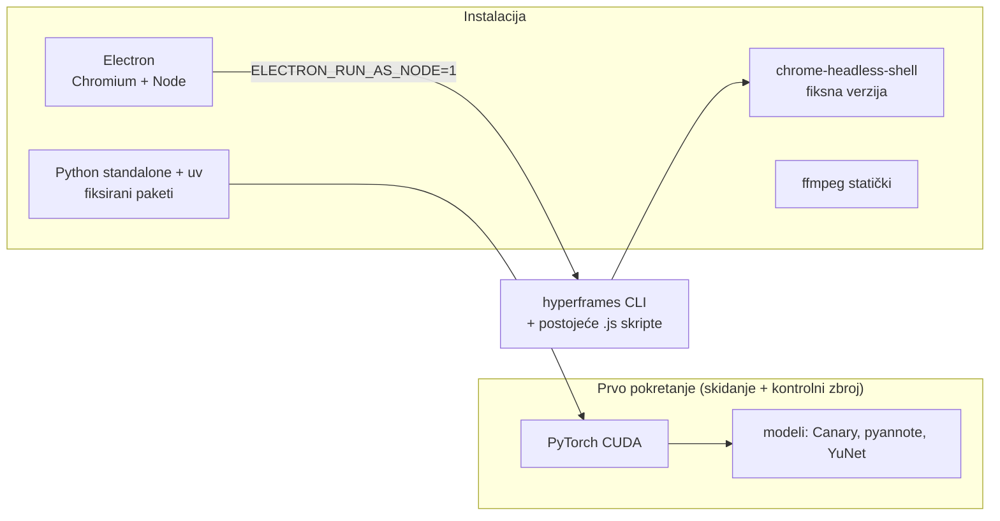

# Reel Studio — desktop aplikacija za reelse (23.10.2026.)

Ideja je Windows desktop aplikacija koja od video datoteke epizode napravi reelse.
Razvoj bi išao na macOS-u, a isti kod bi se pakirao za Windows. Tok:
**video → ASR + diarizacija → LLM prijedlozi reelova → uređivač 9:16 → HyperFrames projekt → render.**

Stanje: **samo UI prototip, kod aplikacije se još ne piše.** Stack je odlučen: **Electron**.

Vezani dokumenti: `docs/2026-10-21-hyperframes-reel-proba.md` (HyperFrames reel, skripte u
`tools/hyperframes_reel/`), `docs/2026-10-08-reels-poc.md` (`tools/render_reel.py`),
`docs/2026-10-08-reels-layout-best-practices.md` (sigurne zone).

## Prototip

`tools/reel_studio/prototype.html` je jedna HTML datoteka bez ovisnosti. Otvori se
izravno u pregledniku. Izgleda kao Windows 11 aplikacija, s tamnom i svijetlom temom.
Obrada, LLM i render su glumljeni animacijama. Stvarno radi samo učitavanje lokalnog
videa (`URL.createObjectURL`), pa uređivač pušta pravi raspon.

| Korak | Sadržaj |
|---|---|
| 1 Uvoz | odabir ili drag & drop; ASR motor (Canary lokalno / Modal / Speechmatics / Whisper), diarizacija, LLM (Gemini Vertex / Claude pretplata), broj i duljina reelova, brand kanala, procjena vremena i troška. Postojeći `.diarized.srt` + `words.json` → ASR se preskače |
| 2 Obrada | WAV → Canary → pyannote → words.json → LLM prijedlozi → YuNet lica; trake napretka, log, metrike |
| 3 Prijedlozi | ocjena, raspon, oznake, hook, citat iz prijepisa, položaj u epizodi, „zašto“, predložene kartice |
| 4 Uređivač | pregled 9:16 (sigurne zone / zona lica / ikone mreža), kartice koje se mogu uređivati, timeline (video / titl / kartice) s ručkama za rez, provjera rasporeda |
| 5 Render | red za `hyperframes render`, izlazna mapa (projekt + `.mp4` + `prijedlozi.json`) |

Podaci u prototipu su iz re:DEFINICIJA ep. 10 (`DOfcONrRyDY`). Poglavlja i vremena su
stvarna (outline). Ocjene i hookovi su izmišljeni, osim prijedloga „srećka“, koji je
prava proba.

## Odluka: Electron

Razmotreno, s presudom:

| Opcija | Presuda |
|---|---|
| **Electron** | ✅ **izabran** |
| Tauri (Rust + sistemski webview) | ❌ na macOS-u je webview WebKit, a HyperFrames renderira u Chromiumu → razvoj na Macu ne vidi što izađe u renderu. Rust bi bio treći jezik. Prednost male instalacije nestaje uz PyTorch od nekoliko GB |
| Flutter desktop | ozbiljan kandidat (tim zna Dart iz domovina.ai, prevodi se u nativni kod, malo RAM-a). Ipak za pregled treba WebView2 plugin, a desktop pluginovi za video i webview su tanji |
| Avalonia UI (.NET) | Win/Mac/Linux, crta sve sam (Skia). U studenom 2025. objavljena suradnja s Flutterovim timom na Impelleru za .NET. Za ovu aplikaciju je C# treći jezik, a webview ide preko dodatnih paketa |
| .NET MAUI | nema Linuxa, a desktop mu je slabija strana |
| Qt / PySide6 | Python kao pipeline, QtWebEngine je Chromium; licenca LGPL/komercijalna |
| SwiftUI | samo macOS, za Windows bi trebala druga aplikacija |
| WinUI 3 / WPF | samo Windows |

Zašto Electron:

1. **Prijenosni runtime s fiksnim verzijama.** To je glavni razlog po korisniku.
   Aplikacija nosi svoj Chromium i Node, pa klijent ne instalira ništa skriptom i
   „kod mene radi“ vrijedi i kod njega.
2. **Pregled je vjeran renderu.** Isti Chromium kao HyperFrames, pa GSAP, fontovi i
   raspored kartica izgledaju jednako.
3. **Nema trećeg jezika.** Codebase je Node + Python. JS skripte i `hyperframes` CLI
   idu izravno, a Python kao zasebni procesi.

Ranije sporost Slacka uglavnom nije bila zbog Electrona nego zbog arhitekture
(zaseban webview po workspaceu, stari jQuery kod). Slack je 2019. prepisao klijent u
React i ostao na Electronu. VS Code je primjer brzog Electrona. Danas je osnovni trošak
~100–200 MB RAM-a i više procesa. Ostalo ovisi o aplikaciji.

## Pakiranje: prijenosno sve, ne samo Chromium i Node

Kontrola verzija koju Electron daje pokriva samo Chromium i Node. Ostatak treba isto
načelo:

- **HyperFrames render koristi svoj Chromium.** Puppeteer bi skinuo zaseban headless
  Chrome, a mi ga želimo fiksnog: upakirati `chrome-headless-shell` u resurse i
  HyperFramesu dati tu putanju.
- **Sistemski Node ne treba.** Electron binarka uz `ELECTRON_RUN_AS_NODE=1` radi kao Node.
- **Python** je najveći dio: python-build-standalone + `uv`. PyTorch/CUDA i modeli se
  skidaju pri prvom pokretanju, ne idu u instalaciju.
- Teški posao (ASR, diarizacija, YuNet, ffmpeg, render) ide u child procese. UI je jedan
  prozor i jedan renderer, bez webviewa po prijedlogu.
- Windows build ide na GitHub Actions `windows-latest`. Križno prevođenje s Maca ne
  koristimo.

## Otvoreno

- **Gdje radi ASR.** Lokalni Canary na Windowsima traži NVIDIA karticu s dovoljno VRAM-a.
  Batch bez rezanja već na T4 (16 GB) ruši memoriju, vidi CLAUDE.md. Druga opcija je
  oblak (Modal / Speechmatics): mala instalacija i jednako ponašanje svugdje. Moguće je i
  oboje, lokalno samo za one s GPU-om.
- **`select_reels.js` (ili ekvivalent):** LLM vraća raspon, hook i kartice kao JSON, a
  generator piše HyperFrames HTML umjesto ručnog predloška
  (`docs/2026-10-21-hyperframes-reel-proba.md` §Otvoreno).
- Praćenje lica u HyperFramesu (YuNet putanja kao keyframeovi) još nije napravljeno.
- Elektron skelet: ne piše se dok korisnik ne kaže.
