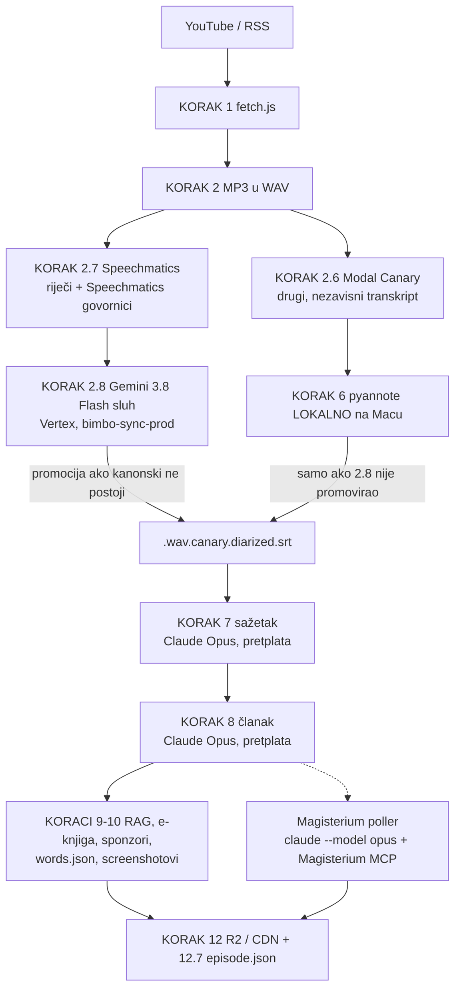
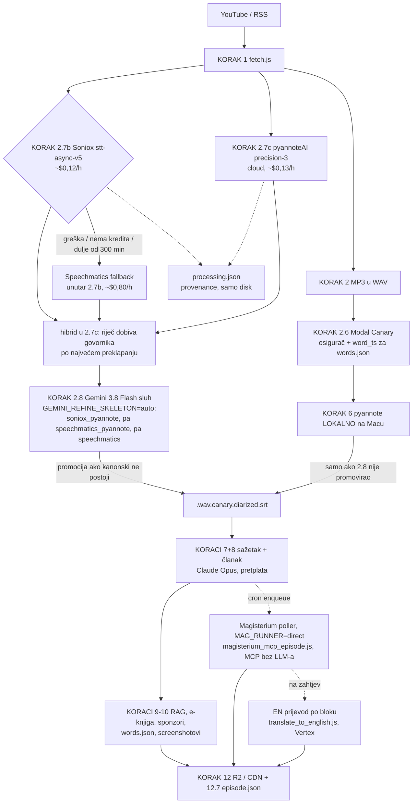

# Pipeline danas (24.10.2026.): što nightly stvarno radi i što fali do Soniox puta

> **Ažurirano 24.10. navečer: prebačeno, i nightly i ad-hoc.** Od nightlyja 25.10. vrijedi
> stanje iz §2. Nightly linija je sada `GEMINI_REFINE_SKELETON=auto … --with-soniox
> --with-pyannote-ai --gemini-refine-promote` (§5 točke 1–2 izvedene). Prioritetni fast-path
> šalje isto (`pipeline.domovina.ai` commit `1052cf8`, `bridge/plan.js`: izbor `soniox` je
> default, `speechmatics` je zastarjela vrijednost starih D1 redaka). §1 opisuje put do 24.10.
> i ostaje kao povijest i put za povratak.
>
> Isti dan su se promijenila još dva koraka koja nisu transkripcija:
> - **Magisterium HR bez Claudea.** `magisterium_poller.js` po defaultu (`MAG_RUNNER=direct`,
>   commit `10d424f` u pipeline.domovina.ai) pokreće `tools/magisterium_mcp_episode.js`, koji
>   Magisterium MCP zove izravno (OAuth token na Pro pretplati). Claude kvota se ne troši;
>   `MAG_RUNNER=claude` je stari runbook i fallback. `docs/2026-10-24-magisterium-mcp-bez-llm-a.md`.
> - **EN prijevod po bloku** (`cf926987`): jedan Vertex poziv po bloku (sažetak, sekcija +
>   njena Magisterium prosudba) umjesto po polju, sekcije paralelno (`TRANSLATE_CONCURRENCY=4`).
>   ~1000 → ~30–50 poziva po epizodi, ~7 min umjesto >1 h. `docs/2026-09-15-en-prijevod-mjerenja.md`.

**Kratko (stanje do 24.10.): Soniox + pyannoteAI još NIJE bio u nightlyju.** Alati postoje od danas
(`transcribe_soniox.js`, `diarize_pyannote_ai.js`, `refine_diarized_gemini.js --skeleton`),
ali nijedan launchd job ih ne poziva. Nightly i dalje radi kao od 19.09.:
Speechmatics + Gemini sluh, s Canaryjem i lokalnim pyannoteom kao fallbackom. Članke piše
**Claude Opus kroz pretplatu**, ne Gemini na Vertexu.

Izvor istine za ovaj dokument je linija u `automatic/nightly_pipeline.sh` (`run_step
"run_pipeline.sh (faza A + faza B)"`), ne planovi. Do 24.10. je glasila:

```
env CLAUDE_MODEL=opus CLAUDE_WINDOW_GUARD=1 run_pipeline.sh \
  --with-local-canary-diarize --with-screenshots --with-r2-upload \
  --gemini-backend claude --with-modal-transcribe --modal-scope channels \
  --with-speechmatics --gemini-refine-promote
```

Od 25.10.:

```
env CLAUDE_MODEL=opus CLAUDE_WINDOW_GUARD=1 GEMINI_REFINE_SKELETON=auto run_pipeline.sh \
  --with-local-canary-diarize --with-screenshots --with-r2-upload \
  --gemini-backend claude --with-modal-transcribe --modal-scope channels \
  --with-soniox --with-pyannote-ai --gemini-refine-promote
```

## 1. Što se do 24.10. događalo s novom epizodom (povijest)

Tri launchd joba: `tv.domovina.fetch.nightly` (03:00, sve epizode), `tv.domovina.fetch.priority`
(svakih ~90 s, narudžbe s pipeline.domovina.ai) i `tv.domovina.fetch.magisterium` (svakih 10 min).



| Korak | Što | Gdje / tko | Trošak |
|---|---|---|---|
| 2.6 | Canary 1B v2 transkript | Modal (cloud) | ~$0,01/ep |
| 2.7 | Speechmatics riječi + govornici | Speechmatics API | ~$0,80/h zvuka |
| 2.8 | Gemini sluh nad Speechmatics kosturom, promocija u kanonski SRT | Vertex `gemini-3.8-flash` | ~$0,2–0,45/ep |
| 6 | pyannote, samo kad 2.8 nije promovirao | lokalni Mac | 0 |
| 7+8 | sažetak + članak | `claude -p --model opus` (pretplata), uz `CLAUDE_WINDOW_GUARD` | kvota pretplate |
| Magisterium | ocjena članka | `magisterium_poller.js`, `claude --model opus` + Magisterium MCP (nikad API); od 24.10. izravni MCP klijent, v. §2 | kvota pretplate (do 24.10.) |

Ograde u 2.7/2.8: prozor svježine 3 dana, najviše 5 epizoda po noći.

**Govornici su do 24.10. dolazili od Speechmaticsa** (koji ih razbija, 5 → 17 na adria mjerenju), a ne
od pyannoteAI. Na našim epizodama to prolazi jer su razgovori 2–3 osobe.

## 2. Stanje od 25.10. (Matijina presuda, 24.10.)

Soniox + pyannoteAI = super, Speechmatics + pyannoteAI = vrlo dobro, bilo koje od ta dva +
Gemini prepis = vrhunski. Isti tok vrti nightly (prozor 3 dana, najviše 5 epizoda po koraku) i
prioritetni fast-path (jedna epizoda, `--fresh-days 0`, `PRIORITY_SCOPE_ARGS`).



Dvije stvari na dijagramu nisu očite:

- **Modal Canary (2.6) se i dalje vrti** za svaku epizodu praćenog kanala. On je osigurač kad
  2.8 ne promovira (pa lokalni pyannote u KORAKU 6 diarizira Canary) i tercijarni izvor vremena
  za words.json.
- **words.json (9.87) od 25.10. bira izvor po prioritetu** Soniox → Speechmatics → Canary
  (prvi iznad praga od 60 %). Do tada je Soniox bio opt-in, pa je nightly vidio samo Canary.
  Odluka i mjerenja: [`2026-10-25-asr-prioritet-soniox.md`](./2026-10-25-asr-prioritet-soniox.md).

## 3. Što postoji, a što fali

| Dio | Stanje | Gdje |
|---|---|---|
| Soniox klijent + brisanje posla i datoteke | ✅ gotovo | `lib/asr/soniox.js` |
| Fallback Soniox → Speechmatics | ✅ u skripti: svaka Soniox greška (i 4xx na kreditu) ide na Speechmatics, kao i zvuk dulji od 300 min | `transcribe_soniox.js` |
| KORAK 2.7b u run_pipeline | ✅ flag `--with-soniox`, default OFF | `run_pipeline.sh` |
| pyannoteAI + hibrid | ✅ skripta | `diarize_pyannote_ai.js` |
| pyannoteAI kao KORAK u run_pipeline | ✅ KORAK 2.7c `--with-pyannote-ai` (24.10.) | `run_pipeline.sh` |
| Gemini sluh nad Soniox/pyannote kosturom | ✅ `--skeleton soniox_pyannote` | `refine_diarized_gemini.js` |
| 2.8 u run_pipeline bira kostur | ✅ `GEMINI_REFINE_SKELETON=auto`: po epizodi `soniox_pyannote` → `speechmatics_pyannote` → `speechmatics` | `run_pipeline.sh`, `refine_diarized_gemini.js` |
| Nightly linija | ✅ `--with-soniox --with-pyannote-ai --gemini-refine-promote` (24.10.) | `automatic/nightly_pipeline.sh` |
| Prioritetni fast-path | ✅ izbor `soniox` (default): `--with-soniox --with-pyannote-ai --gemini-refine-promote` + `GEMINI_REFINE_SKELETON=auto` (24.10., `1052cf8`) | `../pipeline.domovina.ai/bridge/plan.js` |
| Speechmatics u fallbacku dobiva pyannoteAI govornike | ✅ `diarize_pyannote_ai.js --words-from speechmatics` | ručno, ne u pipelineu |
| words.json iz Sonioxa | ✅ primarni izvor od 25.10. (Soniox → Speechmatics → Canary), backfill 5 epizoda na CDN | `generate_words_json.js`, `docs/2026-10-25-asr-prioritet-soniox.md` |
| Magisterium HR bez Claudea | ✅ `MAG_RUNNER=direct` (default), `magisterium_mcp_episode.js` | `../pipeline.domovina.ai/bridge/magisterium_poller.js` |
| EN prijevod po bloku | ✅ ~30–50 Vertex poziva/ep umjesto ~1000 | `translate_to_english.js` |
| Provenance po epizodi | ✅ `{base}.processing.json`, samo disk | `lib/processing_manifest.js`, data_contract §16 |
| Članak na Gemini Vertexu | ⚠️ **nije tako**: nightly piše Opusom (`--gemini-backend claude`) od 29.07. | vidi §4 |

Kad Soniox ostane bez kredita, `transcribe_soniox.js` svaku epizodu pokuša prvo na Sonioxu (jedan
odbijeni HTTP poziv), pa ide na Speechmatics. Ne postoji „prekidač” koji bi pamtio da kredita
nema. Kod 1–5 epizoda po noći to je nekoliko sekundi.

## 4. Otvoreno pitanje: tko piše članak

Od 29.07.2026. koraci 7+8 u nightlyju idu kroz **Claude Opus pod pretplatom**. Razlog je incident
s atribucijom imena: Flash je imenovao voditelja iz općeg znanja, a Opus i Haiku nisu
(`automatic/nightly_pipeline.sh`, komentar uz `--gemini-backend claude`). Vertex/Gemini je
default u `run_pipeline.sh` i ostaje rezerva. Ako članak treba prebaciti na Gemini 3.8 Flash na
Vertexu, to je jedan flag (`--gemini-backend vertex`). Prije toga treba odlučiti što s tim
incidentom.

## 5. Prebacivanje nightlyja (točke 1–2 izvedene 24.10.)

1. `run_pipeline.sh`: KORAK 2.7c `--with-pyannote-ai` (`diarize_pyannote_ai.js`, iste ograde
   3 dana / 5 epizoda) i `GEMINI_REFINE_SKELETON=auto`. To je `soniox_pyannote` kad postoji, inače
   `speechmatics_pyannote`.
2. Nightly linija: `--with-speechmatics` → `--with-soniox --with-pyannote-ai`, uz zadržan
   `--gemini-refine-promote`. Speechmatics tada radi samo kao fallback unutar 2.7b.
3. Prva noć: usporediti `{base}.processing.json` i `tools/compare_asr.js` na novim epizodama.
4. Povratak = vratiti staru nightly liniju. Ništa drugo se ne mijenja, kanonsko ime ostaje isto.

## 6. Stanje mjerenja (re:DEFINICIJA, `muzevni_budite`)

| | ep. 9 | ep. 10 |
|---|---|---|
| Soniox, 51 / 62 min zvuka | 66 s, $0,10 | 87 s, $0,12 |
| pyannoteAI precision-3 | $0,11, 3 govornika | 3 govornika |
| slaganje govornika, Soniox+pyannote prema kanonskom | 99,5 % | 99,7 % |
| razlika teksta prema kanonskom | 21,9 % (canary) | 5,6 % (Speechmatics + Gemini) |
| slijepo, Gemini 3.8 Flash, soniox ↔ canary | Soniox 475, canary 53, nijedno 124 → **90 %** | — |

Soniox piše doslovno (poštapalice, „reko”, „kaj”), a Canary normalizira i ponekad izobliči. Zato
je razlika na ep. 9 tako velika. Ep. 1–8 dobivaju Soniox + pyannoteAI 24.10. (~$2), za
words.json backfill nakon OK-a. Ništa od toga nije promovirano u kanonski SRT ni na CDN.

Slijepi sudac (`tools/judge_asr_diffs.js`) se više ne pokreće automatski: presuda je zadana
(memory `asr_quality_verdict_no_auto_judge`).

## 7. Prvi nightly sa Soniox putom (25.10.2026.): provjereno

Log `automatic/logs/nightly_2026-10-25.log`, 03:00–04:23, status samo audit exit 1.

| Korak | Rezultat |
|---|---|
| 2.7b Soniox | 4/4, nijedan Speechmatics fallback, ~50× realtime, ≈$0,46 ukupno |
| 2.7c pyannoteAI precision-3 | 4/4, hibrid `soniox_pyannote` napravljen, ≈$0,50 |
| 2.8 Gemini sluh (`auto`) | 4/4 na kosturu Soniox+pyannote, pokrivenost 100–104 %, 0–10 ispravaka po epizodi, jedan 429 riješen retryjem, ≈$0,69 |
| promocija u kanonski SRT | 3 epizode; `kmVTa8OjHpc` je već imao kanonski (Speechmatics+Gemini iz ranijeg prolaza) i bez `--force-promote` nije diran |
| 7 + 8 (Opus) | 3 sažetka, 3 članka, 0 grešaka; članci na CDN-u |
| 9.87 words.json | izvor `soniox` za sve 4 |

Što je prvi run otkrio (popravljeno istog dana):

1. **Natpis „Speechmatics + Gemini sluh” bio je hardkodiran** u pet kopija (`summarize_gemini.js`,
   `generate_article_gemini.js`, `prepare_rag{,_import,_combined}.js`). Log zato nije mogao
   potvrditi Soniox put. Sad `isPromotedRefine` vraća kostur (commit 444fa58c).
2. **`processing.json` je ostao na stanju iz 2.7c** (`canonical_srt`, `gemini_ear`, `words_json`
   = null), jer manifest pišu samo 2.7b/2.7c. Sad ga pišu i 2.8 i 9.87 (commit b63cec19).
   Za provjeru jedne epizode i dalje vrijedi `node tools/build_processing_manifest.js --video-id <ID> --print`.

Usput nađeno i otvoreno:

- **KORAK 6 (lokalni pyannote, mreža za Canary put) nije se pokrenuo**: 11,3 GB slobodno na `/`,
  prag 12 GB. Te noći nije trebao, ali dok je disk ovako pun mreža ne postoji.
- Iznos „≈$” uz svaku epizodu u 2.8 je kumulativ runa, ne trošak epizode.
- 9.9 reels: 5 gotovo, 15 odgođeno ogradom claude-window (prozor kvote) — očekivano.

### Magisterium na CDN-u nije pripadao članku na CDN-u

Audit je javio drift `article.magisterium.json` za `MGLq9v3AtvE` i `oxq1U0xypu8` (disk veći od R2).
Smjer nije bio „CDN bogatiji”: CDN je posluživao članak iz verzije `2026-03-20_gemini-2.5-flash`,
a Magisterium iz verzije `2026-03-17_gemini-3-flash-preview`, dakle prosudbu drugog članka.

Uzrok je poznata podjela strategija (memory `article_json_dedup_latest_per_video`):
`upload_to_r2.js` bira **po mtime-u**, a Magisterium za sve tri verzije pisan je 30.03. obrnutim
redom (03-20 u 14:56, 03-17 u 15:06), pa je najstarija verzija dobila najnoviji mtime. Članci su
pisani kronološki, pa kod njih nije bilo razlike.

Popravak: `node force_upload.js --video-id <ID> --channel domovina_tv --targets magisterium`
(`force_upload` bira leksikografski = 03-20), CDN md5 = disk md5, audit 3476/3477.
Isti obrazac može postojati drugdje gdje je Magisterium rađen za više verzija članka odjednom;
audit ga hvata samo kad se veličine razlikuju.

## Vezano

- Plan i izvori brojki: `docs/2026-10-24-soniox-pyannote-roadmap.md`
- Speechmatics + Gemini sluh: `docs/2026-09-19-speechmatics-kostur-gemini-sluh.md`
- Claude kao backend 7+8: `docs/claude_code_backend_2026-07.md`
- Cijeli pipeline, koraci 0–13: `docs/PIPELINE_FULL.md` (§1 usklađen 24.10.)
