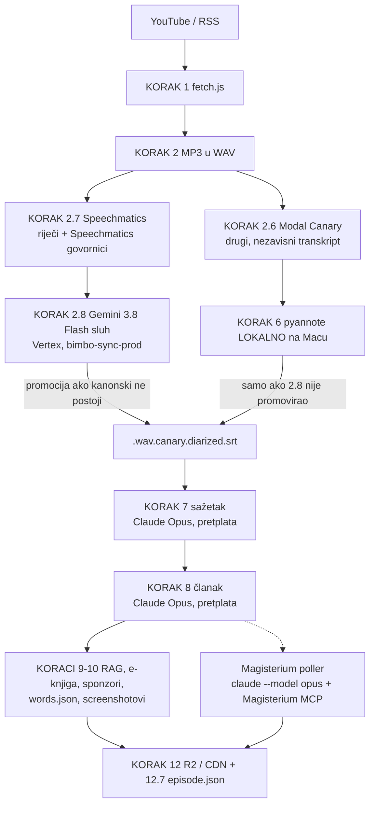
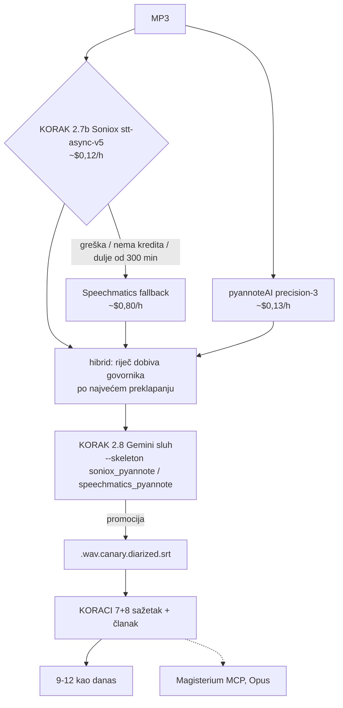

# Pipeline danas (24.10.2026.): što nightly stvarno radi i što fali do Soniox puta

**Kratko: Soniox + pyannoteAI još NIJE u nightlyju.** Alati postoje od danas
(`transcribe_soniox.js`, `diarize_pyannote_ai.js`, `refine_diarized_gemini.js --skeleton`),
ali nijedan launchd job ih ne poziva. Nightly i dalje radi kao od 19.09.:
Speechmatics + Gemini sluh, s Canaryjem i lokalnim pyannoteom kao fallbackom. Članke piše
**Claude Opus kroz pretplatu**, ne Gemini na Vertexu.

Izvor istine za ovaj dokument je linija u `automatic/nightly_pipeline.sh` (`run_step
"run_pipeline.sh (faza A + faza B)"`), ne planovi:

```
env CLAUDE_MODEL=opus CLAUDE_WINDOW_GUARD=1 run_pipeline.sh \
  --with-local-canary-diarize --with-screenshots --with-r2-upload \
  --gemini-backend claude --with-modal-transcribe --modal-scope channels \
  --with-speechmatics --gemini-refine-promote
```

## 1. Što se danas događa s novom epizodom

Tri launchd joba: `tv.domovina.fetch.nightly` (01:00, sve epizode), `tv.domovina.fetch.priority`
(svakih ~90 s, narudžbe s pipeline.domovina.ai) i `tv.domovina.fetch.magisterium` (svakih 10 min).



| Korak | Što | Gdje / tko | Trošak |
|---|---|---|---|
| 2.6 | Canary 1B v2 transkript | Modal (cloud) | ~$0,01/ep |
| 2.7 | Speechmatics riječi + govornici | Speechmatics API | ~$0,80/h zvuka |
| 2.8 | Gemini sluh nad Speechmatics kosturom, promocija u kanonski SRT | Vertex `gemini-3.8-flash` | ~$0,2–0,45/ep |
| 6 | pyannote, samo kad 2.8 nije promovirao | lokalni Mac | 0 |
| 7+8 | sažetak + članak | `claude -p --model opus` (pretplata), uz `CLAUDE_WINDOW_GUARD` | kvota pretplate |
| Magisterium | ocjena članka | `magisterium_poller.js`, `claude --model opus` + Magisterium MCP (nikad API) | kvota pretplate |

Ograde u 2.7/2.8: prozor svježine 3 dana, najviše 5 epizoda po noći.

**Govornici danas dolaze od Speechmaticsa** (koji ih razbija, 5 → 17 na adria mjerenju), a ne
od pyannoteAI. Na našim epizodama to prolazi jer su razgovori 2–3 osobe.

## 2. Ciljno stanje (Matijina presuda, 24.10.)

Soniox + pyannoteAI = super, Speechmatics + pyannoteAI = vrlo dobro, bilo koje od ta dva +
Gemini prepis = vrhunski.



## 3. Što postoji, a što fali

| Dio | Stanje | Gdje |
|---|---|---|
| Soniox klijent + brisanje posla i datoteke | ✅ gotovo | `lib/asr/soniox.js` |
| Fallback Soniox → Speechmatics | ✅ u skripti: svaka Soniox greška (i 4xx na kreditu) ide na Speechmatics, kao i zvuk dulji od 300 min | `transcribe_soniox.js` |
| KORAK 2.7b u run_pipeline | ✅ flag `--with-soniox`, default OFF | `run_pipeline.sh` |
| pyannoteAI + hibrid | ✅ skripta | `diarize_pyannote_ai.js` |
| pyannoteAI kao KORAK u run_pipeline | ❌ **nema flaga** | treba `--with-pyannote-ai` iza 2.7b |
| Gemini sluh nad Soniox/pyannote kosturom | ✅ `--skeleton soniox_pyannote` | `refine_diarized_gemini.js` |
| 2.8 u run_pipeline bira kostur | ❌ uvijek `speechmatics` | treba `GEMINI_REFINE_SKELETON` (s automatskim padom na `speechmatics_pyannote` kad Sonioxa nema) |
| Nightly linija | ❌ i dalje `--with-speechmatics --gemini-refine-promote` | `automatic/nightly_pipeline.sh` |
| Speechmatics u fallbacku dobiva pyannoteAI govornike | ✅ `diarize_pyannote_ai.js --words-from speechmatics` | ručno, ne u pipelineu |
| words.json iz Sonioxa | ✅ uz `--with-soniox` (opt-in) | `generate_words_json.js` |
| Provenance po epizodi | ✅ `{base}.processing.json`, samo disk | `lib/processing_manifest.js`, data_contract §16 |
| Članak na Gemini Vertexu | ⚠️ **nije tako**: nightly piše Opusom (`--gemini-backend claude`) od 29.07. | vidi §4 |

Kad Soniox ostane bez kredita, `transcribe_soniox.js` svaku epizodu pokuša prvo na Sonioxu (jedan
odbijeni HTTP poziv), pa ide na Speechmatics. Ne postoji „prekidač” koji bi pamtio da kredita
nema. Kod 1–5 epizoda po noći to je nekoliko sekundi.

## 4. Otvoreno pitanje: tko piše članak

Od 29.07.2026. koraci 7+8 u nightlyju idu kroz **Claude Opus pod pretplatom**. Razlog je incident
s atribucijom imena: Flash je imenovao voditelja iz općeg znanja, a Opus i Haiku nisu
(`automatic/nightly_pipeline.sh`, komentar uz `--gemini-backend claude`). Vertex/Gemini je
default u `run_pipeline.sh` i ostaje rezerva. Ako članak treba prebaciti na Gemini 3.8 Flash na
Vertexu, to je jedan flag (`--gemini-backend vertex`). Prije toga treba odlučiti što s tim
incidentom.

## 5. Prebacivanje nightlyja (prijedlog, NIJE izvedeno)

1. `run_pipeline.sh`: KORAK 2.7c `--with-pyannote-ai` (`diarize_pyannote_ai.js`, iste ograde
   3 dana / 5 epizoda) i `GEMINI_REFINE_SKELETON=auto`. To je `soniox_pyannote` kad postoji, inače
   `speechmatics_pyannote`.
2. Nightly linija: `--with-speechmatics` → `--with-soniox --with-pyannote-ai`, uz zadržan
   `--gemini-refine-promote`. Speechmatics tada radi samo kao fallback unutar 2.7b.
3. Prva noć: usporediti `{base}.processing.json` i `tools/compare_asr.js` na novim epizodama.
4. Povratak = vratiti staru nightly liniju. Ništa drugo se ne mijenja, kanonsko ime ostaje isto.

## 6. Stanje mjerenja (re:DEFINICIJA, `muzevni_budite`)

| | ep. 9 | ep. 10 |
|---|---|---|
| Soniox, 51 / 62 min zvuka | 66 s, $0,10 | 87 s, $0,12 |
| pyannoteAI precision-3 | $0,11, 3 govornika | 3 govornika |
| slaganje govornika, Soniox+pyannote prema kanonskom | 99,5 % | 99,7 % |
| razlika teksta prema kanonskom | 21,9 % (canary) | 5,6 % (Speechmatics + Gemini) |
| slijepo, Gemini 3.8 Flash, soniox ↔ canary | Soniox 475, canary 53, nijedno 124 → **90 %** | — |

Soniox piše doslovno (poštapalice, „reko”, „kaj”), a Canary normalizira i ponekad izobliči. Zato
je razlika na ep. 9 tako velika. Ep. 1–8 dobivaju Soniox + pyannoteAI 24.10. (~$2), za
words.json backfill nakon OK-a. Ništa od toga nije promovirano u kanonski SRT ni na CDN.

Slijepi sudac (`tools/judge_asr_diffs.js`) se više ne pokreće automatski: presuda je zadana
(memory `asr_quality_verdict_no_auto_judge`).

## Vezano

- Plan i izvori brojki: `docs/2026-10-24-soniox-pyannote-roadmap.md`
- Speechmatics + Gemini sluh: `docs/2026-09-19-speechmatics-kostur-gemini-sluh.md`
- Claude kao backend 7+8: `docs/claude_code_backend_2026-07.md`
- Cijeli pipeline, koraci 0–13: `docs/PIPELINE_FULL.md` (stanje prije Sonioxa)
