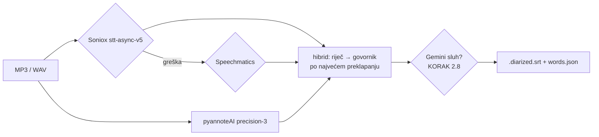

# Roadmap: Soniox primarno + pyannoteAI, Speechmatics fallback (24.10.2026.)

**Status: plan, nije implementirano.** Cilj je da cloud ASR u pipelineu (KORAK 2.7/2.8) i u
Reel Studiju (`tools/reel_studio/prototype-v2.html`) preuzme obrazac koji je u adria-analytics
izmjeren i ugrađen u newsroom-be (NEWS-971 live, NEWS-1034 batch).

## Odluka koju preuzimamo

**ASR daje riječi, pyannote daje govornike.** Odluka između Sonioxa i Speechmaticsa je samo
odluka o tekstu i cijeni, a tu vodi Soniox:

| | Speechmatics | Soniox | izvor (adria-analytics) |
|---|---|---|---|
| cijena | $0,45–0,80/h | ~$0,12/h | `live-transcription-island/docs/odluke/2026-10-19-dobavljac-soniox.md` |
| tekst, hrvatski | | **86 % pobjeda** u slijepom preslušavanju 2037 mjesta razlike (sudac Gemini 3.8 Flash) | `katalog/docs/2026-10-21-soniox-vs-speechmatics-audio-transkripcija.md` §5.3 |
| govornici bez pyannotea | **razbija** (5 glumaca → 17 oznaka) | **spaja** (26 → 6) | isto, §1 i §5.1 |
| s pyannoteAI | referenca | 98,2 % riječi isto kao Speechmatics + pyannote (5,2 h, 19 snimki) | isto, §5.1 |
| jezici | bez sr/bs/mk | svih 26, i sr/bs/mk | isto, §5.2 |

pyannoteAI `precision-3` batch je ~€0,11/h. Ključ je u `.env` kao `PYANNOTE_API_KEY` od 24.10.

Wispr Flow (Notetaker) za hrvatski gotovo sigurno koristi Soniox ili isti model: 3,0 % i 4,7 %
razlike prema Sonioxu, a 14 % prema Speechmaticsu. Wispr je automatiziran Hammerspoonom
(`~/.hammerspoon/wispr.lua`, AXPress). Izvor:
`live-transcription-island/docs/istrazivanje/2026-10-14-wispr-flow-kao-provjera.md`.

## Kako je to izvedeno u newsroom-be (uzor)

Grana `NEWS-1034-soniox-primary-asr` (be#2840), `clients/transcription/soniox_client.py`:

- `model: stt-async-v5`, `language_hints: [jezik]`, `enable_speaker_diarization: true`,
  `audio_url` (potpisani URL) ili upload na `/v1/files`, webhook s `X-API-Key`.
- Redoslijed po jeziku: hr/en/ostali **Soniox → Speechmatics → AWS**, sr/bs/mk Soniox → AWS.
- Soniox `error` (webhook ili poll) ide na sljedećeg providera, ne u FAILED. Atomski
  `try_release_job` sprječava dvostruki fallback.
- Sirovi transkript se sprema, pa se posao i datoteka **brišu na Sonioxu** (limit 2000
  transkripcija / 1000 datoteka po računu).
- Normalizacija tokena u riječi: interpunkcija odvojena, a točka prije malog slova istog
  govornika nije kraj rečenice („23. listopada”).
- pyannoteAI ide uz svaki put, i uz Soniox.

## Što bi to značilo ovdje

1. **KORAK 2.7:** novi `transcribe_soniox.js` uz `transcribe_speechmatics.js`, isti izlazni oblik
   (`.soniox.json` + `.meta.json` s cijenom). Speechmatics ostaje fallback.
2. **pyannoteAI korak:** prenijeti `e-satnica-sastanci/scripts/pyannote.sh` u Node
   (`diarize_pyannote_ai.js`) i spajanje iz `prep_kostur.py`. To mijenja lokalni pyannote (KORAK 6)
   za cloud put.
3. **KORAK 2.8 Gemini sluh:** uz Soniox je korist neizmjerena. Treba je izmjeriti na 2–3 epizode
   prije nego što ostane uključen.
4. **words.json backfill:** re:DEFINICIJA ep. 1–8 je 479 min. Kroz Speechmatics je to ~$6,2, a
   kroz Soniox ~$1. Na cijelom katalogu razlika je ~7×.
5. **Live (kasnije):** Soniox `stt-rt-v5` za prijenose uživo (mise na Novoj Evi, Sabor). Ovdje
   pyannote ide nakon sesije, jer real-time Soniox spaja goste (HRT: 4 → 2).

## Otvoreno prije implementacije

- `SONIOX_API_KEY` za ovaj projekt: koristi li se račun iz adria-analytics ili zaseban.
- Mjerenje na našim podcastima: 2–3 epizode Soniox + pyannote prema postojećem
  Canary + pyannote / Speechmatics + Gemini, slijepim preslušavanjem kao u NEWS-1034.

## Vezano

- Prototip: `tools/reel_studio/prototype-v2.html` (ASR „Soniox → fallback Speechmatics (plan)”).
- Speechmatics + Gemini sluh: `docs/2026-09-19-speechmatics-kostur-gemini-sluh.md`.
- agy kroz pretplatu: `docs/2026-10-15-agy-gemini-sluh-kroz-pretplatu.md`.
