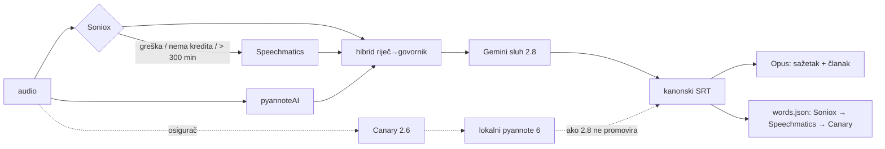

# ASR prioritet: Soniox → Speechmatics → Canary (odluka 25.10.2026.)

**Odluka (Matija, 25.10.2026.):** Soniox je primarni izvor za sve, Speechmatics
sekundarni, Canary tercijarni. Sva tri ostaju u kodu kao fallback. Dugoročni cilj je
pipeline od četiri dijela: **Soniox + pyannoteAI**, pa **Gemini** (sluh u 2.8, EN prijevod)
i **Opus** (sažetak, članak).

Pravilo je zapisano i u `CLAUDE.md` (HARD RULE 3). Stanje toka i put za povratak su u
[`2026-10-24-pipeline-trenutno-stanje.md`](./2026-10-24-pipeline-trenutno-stanje.md).

## Gdje se prioritet primjenjuje

| Mjesto | Primarni | Sekundarni | Tercijarni |
|---|---|---|---|
| Tekst + vremena riječi (KORAK 2.7b, `transcribe_soniox.js`) | Soniox stt-async-v5 | Speechmatics, unutar iste skripte, kad Soniox padne ili nema kredita | — |
| Kostur za Gemini sluh (2.8, `GEMINI_REFINE_SKELETON=auto`) | `soniox_pyannote` | `speechmatics_pyannote`, pa `speechmatics` | Canary + lokalni pyannote (KORAK 6), kad 2.8 ne promovira |
| Vrijeme po riječi za titl (9.87, `generate_words_json.js`) | `.soniox.words.json` | `.speechmatics.json` | `.wav.canary.word_ts.json` |
| Govornici | pyannoteAI precision-3 (2.7c, cloud) | — | lokalni pyannote (KORAK 6) |

U 9.87 se uzima **prvi izvor po prioritetu koji prijeđe prag** usidrenosti (60 %). Ne uzima se
onaj s najvećim udjelom (`pickSource`, test u `generate_words_json.test.js`). Ako nijedan izvor
ne prijeđe prag, `.words.skipped.json` bilježi onaj s najviše usidrenih riječi.

## Zašto words.json više nije „najveći udio"

Do 25.10. Soniox je bio opt-in (`--with-soniox`), a `run_pipeline.sh` tu zastavicu nije
prosljeđivao. U novom toku Speechmatics se vrti samo kad Soniox padne, pa je nightly za words.json
vidio samo Canary. Bez KORAKA 2.6 nova epizoda ne bi imala words.json uopće.

Usidrenost riječi kanonskog SRT-a izmjerena je 25.10. na epizodama koje imaju sve izvore:

| Epizoda | Speechmatics | Soniox | Canary |
|---|---|---|---|
| cQ8TNmlWoMI (lood) | 76,3 % | **84,7 %** | 69,2 % |
| DOfcONrRyDY (muževni) | 79,9 % | **96,0 %** | 82,1 % |
| dYqKlE_pEXI (budi frajer) | — | **97,5 %** | 90,3 % |
| qyyu9q4xnGg (mladi) | 87,7 % | **92,2 %** | 72,1 % |
| RZ1t_HWQ99A (mrežnica) | 80,0 % | **83,8 %** | 69,5 % |
| w7YR_yMrsIU (cryptoverse) | — | **91,1 %** | 72,0 % |
| f2HIRJPHHK4 (re:DEFINICIJA ep. 9) | 77,0 % | **93,9 %** | — |
| nuNw4qWs0r4 (catholic futurist, EN zvuk) | 93,5 % | 91,3 % | **2,9 %** |

Canary je na hrvatskom 69–90 %, s dvije epizode tik iznad praga. Na engleskom zvuku daje 3 %,
jer Canary prevodi EN→HR, pa vremena ne pripadaju riječima kanonskog teksta. Na jedinoj
epizodi gdje Speechmatics ima više od Sonioxa (EN, 93,5 prema 91,3 %) prioritet bira Soniox. Oba
su daleko iznad praga, a pravilo „jedan primarni izvor" vrijedi više od 2 postotna boda.

## Backfill 25.10.

`generate_words_json.js --force` za svih 16 epizoda koje imaju `.soniox.words.json`.
Na CDN je otišlo 5 epizoda kojima se sadržaj promijenio: cQ8TNmlWoMI, qyyu9q4xnGg i RZ1t_HWQ99A
(prije Speechmatics) te dYqKlE_pEXI i w7YR_yMrsIU (prije Canary). Poslane su s
`tools/upload_sponsors_in_video.js --suffix .words.json --channel <kanal>`, a md5 na CDN-u je
jednak disku. Prije uploada provjereno je da je kanonski `diarized.srt` na CDN-u isti kao na disku
za svih 16 epizoda. words.json vrijedi samo uz točno taj SRT.

Re:DEFINICIJA epizode (`muzevni_budite`) već su imale Soniox words.json na CDN-u od ručne obrade
24.10.

**Zamka:** bez `--force` je suho pokretanje preko kataloga htjelo regenerirati samo 3 epizode.
Svježina se računa po mtime-u (izlaz noviji od svih izvora = preskoči), a words.json je bio noviji
od Soniox datoteke. Promjena pravila izbora izvora zato uvijek traži `--force` nad pogođenim
epizodama.

## Što ostaje do „samo Soniox + pyannoteAI"

1. **KORAK 2.6 (Modal Canary) se još vrti** za svaku epizodu praćenog kanala. Gasi se tek kad
   nekoliko noći pokaže da 2.8 promovira iz `soniox_pyannote` kostura. Uz gašenje treba
   produljiti ili maknuti prozor svježine od 3 dana u 2.7b/2.7c, inače epizoda kojoj Soniox i
   Speechmatics oba padnu trajno ispada.
2. **Lokalni pyannote (KORAK 6)** radi samo uz Canary. Kad 2.6 ode, i on postaje mrtav kod koji
   ostaje samo kao fallback.
3. **Katalog prije 24.10.** (~3 300 epizoda) i dalje ima Canary ili Speechmatics prijepis.
   Prebacivanje na Soniox je trošak (~$0,12/h zvuka) i zasebna odluka.
