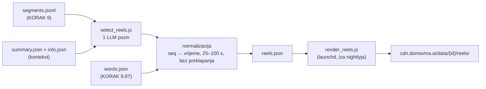
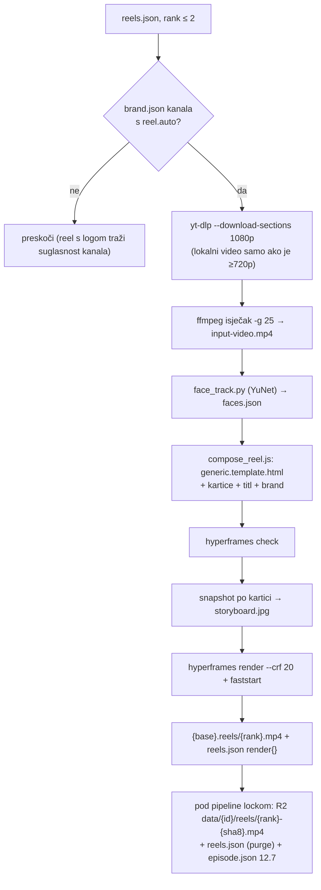
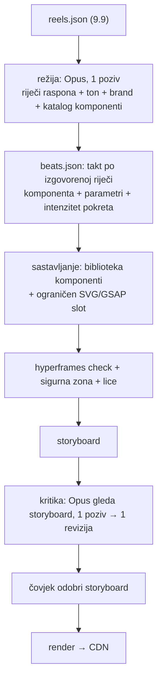

# Reels / shorts: KORAK 9.9 (`select_reels.js`) + render iza nightlyja (`render_reels.js`)

Stanje 25.10.2026.: oba dijela rade od početka do kraja. 9.9 je u nightlyju, render i
objava idu kroz zaseban launchd job `tv.domovina.fetch.reels`. Isprobano na svih 10
epizoda re:DEFINICIJE: izbor trenutaka, brendirani render top 2 po epizodi, CDN.

## Što radi

Kad je epizoda obrađena do kraja (kanonski SRT → `segments.jsonl` u KORAKU 9,
`words.json` u 9.87), jedan LLM poziv nad cijelim prijepisom predloži do 8 trenutaka
od 30–90 s koji stoje sami za sebe. Izlaz je `{base}.reels.json` uz ostale datoteke
epizode.



Tri odluke u dizajnu:

1. **Model vraća redne brojeve cue-ova (`start_seq`/`end_seq`), ne vremena.** Vrijeme se
   uzima iz segmenata, pa reel uvijek počinje i završava na granici cue-a i nema
   izmišljenih timestampova.
2. **Kartice su podaci, ne dizajn.** Tip (`hook`, `lower_third`, `context`, `quote`,
   `number`, `pin`, `end`), trenutak i tekst. Kako izgledaju odlučuju HyperFrames
   predložak i branding kanala (`data/branding/<ime>/`), koji se kasnije mogu mijenjati
   bez novog LLM poziva.
3. **Kartice se sidre na riječ.** Model uz karticu prepiše 2–5 riječi iz cue-a, a vrijeme
   se čita iz `words.json`. Cue-ovi `words.json` i `segments.jsonl` su 1:1 (ep. 9: 280/280,
   isti broj riječi), pa sidrenje nema heuristike. Bez sidra kartica pada na početak cue-a,
   koji traje i 15 s; u prvoj verziji su tri kartice izlazile na 0 s i tri na 42,5 s.

## Format `reels.json` (v1)

```json
{
  "version": 1, "video_id": "f2HIRJPHHK4", "channel": "muzevni_budite", "title": "…",
  "generated_at": "…", "model": "claude-code:opus", "source": "….segments.jsonl",
  "word_timing": "soniox",
  "llm": { "input_tokens": 27777, "output_tokens": 6381, "cost_usd": 0.35, "seconds": 59 },
  "reels": [{
    "rank": 1, "start_sec": 1386.2, "end_sec": 1459.76, "duration_sec": 73.6,
    "start_seq": 131, "end_seq": 139,
    "title": "…", "hook": "…", "why": "…", "kind": "story|insight|emotion|humor|controversy|practical|faith",
    "score": 7, "speaker": "Zlatko Krznarić", "speakers": ["Zlatko Krznarić"], "quote": "…",
    "cards": [{ "type": "pin", "at_sec": 28.98, "text": "Svetište Alojzija Stepinca",
                "value": "Krašić", "anchor": "Ja si mislim u Krašiću", "anchored": true }]
  }],
  "rejected": [{ "title": "…", "reason": "trajanje 112.0 s" }]
}
```

`at_sec` je relativan na početak reela. `rejected` ostaje u datoteci da se vidi što je
model predložio, a normalizacija odbacila.

## Mjerenja (25.10.2026., Opus pod pretplatom)

| Epizoda | Cue-ova | Input / output tokena | Trajanje | API-ekvivalent |
|---|---|---|---|---|
| ep. 9 `f2HIRJPHHK4` | 280 | 27,8k / 6,4k | 59–88 s | ~$0,35 |
| ep. 10 `DOfcONrRyDY` | 307 | ~29k / ~6k | 68 s | ~$0,35 |

Na Vertexu (`gemini-3.8-flash`) isti poziv bi koštao ~$0,05.

**Provjera prema ručnom izboru.** Oba trenutka koja smo prije birali ručno model je našao
sam:

| | Ručno | Model |
|---|---|---|
| ep. 9 „traktor" | 23:20,8–24:19,8 | 23:24–24:19 (1. run), 23:06–24:19 (2. run) |
| ep. 10 „srećka" | 38:59–40:03 | 38:36–40:03, rang #1 |

Dva runa iste epizode ne daju isti popis: jezgra (nesreća, „trudna sam", svećenik,
traktor, usmeni ispit) se ponavlja, rubni kandidati i granice se pomiču. Zato
idempotencija ide preko mtime-a, a ne ponovnog poziva.

## U pipelineu

- KORAK 9.9 u `run_pipeline.sh`, iza 9.87 (treba `words.json`), default ON, `--no-reels` gasi.
- Backend = `GEMINI_BACKEND` kao koraci 7+8 (nightly: `claude` + Opus). Uz `CLAUDE_WINDOW_GUARD=1`
  epizoda se odgađa (`⏸️ [ODGOĐENO]`) kad bi poziv otvorio novi prozor kvote.
- **Doseg:** bez `--video-id` samo epizode s `upload_date` u zadnjih 21 dan, najnovije prve,
  najviše 20 po runu. Katalog (3300+ epizoda) se **ne backfilla sam** — to bi bilo ~3300
  Opus poziva. Za kanal: `node select_reels.js --channel <kanal> --since-days 0 --max-episodes N`.
- Priority / ad-hoc put prosljeđuje `--video-id`, pa ad-hoc epizoda dobije reelove odmah.
- Idempotentno: preskače epizodu čiji `reels.json` je noviji od `segments.jsonl`. Novi
  kanonski SRT → novi segments → novi izbor.
- Kraće od 8 min se preskače.
- Na CDN ide tek s renderom (`render_reels.js --publish-only`), ne iz 9.9.

## Render i objava (`render_reels.js`, launchd `tv.domovina.fetch.reels`)

Odluke (Matija, 25.10.2026.): **top 2** reela po epizodi, render u **zasebnom launchd jobu
iza nightlyja**, objava **odmah na CDN**.



- **Kartice:** `tools/hyperframes_reel/compose_reel.js` + `generic.template.html`. Sedam
  generičkih tipova; raspored u vremenu je jedna kartica u isto vrijeme (hook 0–3 s,
  lower-third odmah iza, ostale na sidro ili čim prethodna nestane, kraj zadnjih 4,5 s).
  Kartica koja ne stane prije kraja otpada. Brojač (`number`) samo za količine, ne godine.
  Raspored oko lica i sigurna zona: postojeći `reel_layout.js`. Ručni predlošci
  (`*.template.html` + `build_composition.py`) ostaju za istaknute reelove.
- **Branding + pristanak = ograda:** renderiraju se samo kanali s `data/branding/<kanal>/brand.json`
  (gitignored, `DOMOVINA_BRANDING_DIR`), a automatski (launchd, bez `--video-id`) samo uz
  `"reel": {"auto": true}` u tom brand.jsonu. Sam brand.json nije pristanak: za Mlade za
  domovinu postoji, a suglasnost za logo se još čeka. `auto: true` danas ima samo `muzevni_budite`.
- **Idempotencija:** `reel.render.fingerprint` = hash raspona, kartica, hooka, mtime-a
  brand.json i `RENDER_VERSION`. Promjena izgleda → povećaj `RENDER_VERSION`. Neuspjeh se
  bilježi (`render.error`, `attempts`), nakon 3 pokušaja se odustaje dok se ulaz ne promijeni.
- **CDN:** `data/{id}/reels/{rank}-{sha8}.mp4` i `.storyboard.jpg` (verzionirani ključevi,
  immutable), `data/{id}/reels.json` bez polja `rejected`, uz `render.url`. Objavljuje se
  samo epizoda koja je već na CDN-u (`data/{id}/info.json` u keys-cacheu). Nakon objave se
  regenerira `episode.json`, inače ekran epizode ne vidi nove datoteke.
- **Kandidati na CDN za SVAKU epizodu (26.10.2026.).** Objava (`--publish-only`, reels tick
  svakih 30 min) šalje `data/{id}/reels.json` i za epizode bez rendera, bez obzira na brand i
  `reel.auto`: markeri na timelineu su samo vremena i naslovi, bez loga i videa. Prije toga
  ga je nosio samo render, pa su istaknute trenutke imale samo izrenderirane epizode
  `muzevni_budite`; noćne epizode ostalih kanala imale su `reels.json` samo na disku (CDN 404).
  Okidač je drift veličine u keys-cacheu, pa se nepromijenjena datoteka ne šalje ponovno.
  Prvi prolaz: 24 epizode. Nova epizoda dobije trenutke u prvom reels ticku nakon što je
  nightly objavi (`info.json` na CDN-u).
- **Mjerenja (ep. 9):** 75 s reel → 2,7 min ukupno (yt-dlp + lica + snapshot + render),
  31 MB; drugi reel 1,8 min / 28 MB. Noću: ~13 novih epizoda × 2 ≈ 50–60 min CPU-a.
- **launchd:** svakih 30 min; tick se preskače dok radi `nightly_pipeline.sh` ili bilo koji
  `run_pipeline.sh`. Najviše 6 rendera po ticku (`REELS_MAX_RENDERS`), objava pod
  `with_pipeline_lock.sh`. Log: `automatic/logs/reels_YYYY-MM-DD.log`. Doseg isti kao 9.9
  (zadnjih 21 dan); stariji katalog samo ručno: `node render_reels.js --channel X --since-days 0`.
- **Okolina:** Python venv s opencv u `~/.cache/domovina-reels/venv` (`REELS_PYTHON`),
  YuNet model u `~/.cache/domovina-reels/`, radni dir `~/.cache/domovina-reels/work/`
  (interni disk; briše se nakon uspjeha, `--keep-work` ga ostavlja), `npx hyperframes@0.8.38`
  iz istog node-a kao skripta, GSAP u `tools/hyperframes_reel/vendor/`.

### Zamke naučene u prvom runu

1. **`montage` i za prazan natpis traži font.** Bez `-font` pada s „unable to read font".
2. **Lokalni `.mkv`/`.mp4` je često 360p** (AV1). Render ga uzima samo kad je ≥720p, inače yt-dlp.
3. **Ista epizoda u kanalu i u `_unlisted`** (auto_reuse_adhoc.js) dobila je dva LLM poziva
   (ep. 7). Obje skripte sad uzimaju samo kanalsku kopiju.
4. **Zastario `segments.jsonl` (ep. 1–4).** Kartice se nisu usidrile (0 od ~30), jer
   segments nije odgovarao `words.json`. Uzrok je bio stvaran bug u pipelineu, ispod.

5. **Boja brenda nije nužno čitljiva na podlozi kartice (26.10.2026.).** `brandCss()` je
   slijepo stavljao `primary` kao tekst na `background` (brojka, istaknuta riječ hooka, URL) i
   kao pozadinu trake s imenom. Mladi za domovinu: bordo `#840C0C` na navy `#071A35` =
   **1,69 : 1**, a crvena `#BE3C28` = 3,2 : 1. Sad `pickContrast()` u `compose_reel.js` bira
   prvu boju (`reel.accent_text` → primary → accent → highlight → secondary → text) s WCAG
   kontrastom ≥ 4,5 : 1, a tekst na traci je ona od background/text/crna/bijela koja na njoj
   jače kontrastira. Za Mlade to je zlatna `#EFC465` (10,6 : 1) s navy tekstom na traci. Za
   Muževne budite CSS je bajt-isti (zlatni primary već ima 7,8 : 1), pa `RENDER_VERSION` nije
   dignut. Nov brand.json: provjeri ga suhim izračunom prije rendera, ne na storyboardu.
6. **Objava videa nije provjeravala pristanak (26.10.2026.).** Render je tražio `reel.auto`,
   objava nije, pa bi launchd tick (`--publish-only`) na CDN poslao i reel izrenderiran ručno
   samo za pregled. Sad video (mp4/poster/storyboard) ide van samo uz `reel.auto` ili izričit
   `--video-id`; `reels.json` s kandidatima i dalje za svaku epizodu. `reels_render.sh` uz to
   preskače tick dok radi ručni `render_reels.js` (oba pišu isti `reels.json`).

7. **Otisak ne prati predložak.** Nakon promjene `compose_reel.js`/`generic.template.html`
   običan run kaže „0 reelova čeka". Za jednu epizodu: `--video-id X --top 8 --force`
   (renderira sve rangove, i gotove). Za cijeli katalog: diži `RENDER_VERSION`.

## Mirni stil i logo kanala (26.10.2026.)

Prvi brendirani reelovi Mladih za domovinu (ep. 118, `ja70p_gJWZA`, svih 8 kandidata,
objavljeno na Matijin zahtjev uz `--video-id`; `reel.auto` za kanal i dalje NIJE upaljen).
Matijin feedback, ugrađen u generički predložak (vrijedi za sve kanale od idućeg rendera;
gotovi reelovi Muževnih budite NISU ponovno renderirani):

- **Ne TikTok.** Kartice su bile prekratke za čitanje i izmjenjivale su se „flash" ritmom.
  Sad: trajanje po brzini čitanja `1,5 s + znakovi/11` (min 4,5 s, max 10 s; hook 4,5 s,
  lower-third 5 s, kraj 5,5 s), **1 s samo videa između kartica**, kartica se ne skraćuje
  zbog sljedeće (sljedeća čeka), usidrena kartica koja bi kasnila > 6 s za izgovorenim
  otpada (`MAX_LATE`; s 4 s je reel #1 izgubio ključnu karticu „puška se raspala").
  Animacije: fade 0,6 s + 16 px, bez back/bounce/scale; titl bez „popa"; kamera 0,8 s sine.
  Cijena: 49 → 43 kartice na 8 reelova (najviše #5: 7 → 4).
- **Logo kanala trajno gore desno**, zrcalno potpisu „Napravljeno s domovina.ai" dolje
  desno (`right 26px`, `top 34px`, kapsula u boji podloge brenda). Namjerno IZVAN sigurne
  zone: prvi pokušaj unutar nje (y 300–392, kako kaže `2026-10-08-reels-layout-best-practices.md`)
  sudarao se s glavom govornika i Matija ga je odbacio. Logo na hook/end kartici maknut
  (bio bi dvaput). Zamka: `brandCss()` kopira `brand/logo.png`, pa se `hasLogo` smije
  provjeriti tek nakon njega.
- Mjerenje: 8 reelova × ~3,3 min = 27 min (yt-dlp + lica + snapshot + render), 30–46 MB/reel.

## Premium reel (LLM režija po reelu) — pilot izveden i objavljen 26.10.2026.

Generički put: LLM (9.9) daje samo **sadržaj** kartica, izgled i animacije su fiksni.
Premium put bi dodao **režiju** po reelu, kao ručni „traktor"/„srećka", ali kao postupak:



- Komponente (ruta/karta, brojač, mjera udaljenosti, vremenska crta, obris predmeta,
  pečat, citat, usporedba) pišu se jednom i izvlače iz ručnih predložaka; slobodan HTML iz
  LLM-a ruši `check`, brand i ujednačenost.
- Registar tona (svjedočanstvo / humor / objašnjenje / molitva) određuje intenzitet: ratno
  svjedočanstvo traži suzdržanost, ne efekte.
- Trošak: ~3 Opus poziva po reelu (~20k/4k režija, ~15k/3k kritika sa slikama), 8 reelova
  ≈ 24 poziva ≈ 0,5 M tokena ≈ jedan dvofazni članak. Render isti CPU.
- Pilot predložen na `ja70p_gJWZA` #1 („puška": rasprsnuta puška na „raspala", mjera
  1 m na „metar", tihi citat na kraju) uz standardni render istog trenutka.

### Pilot 26.10.2026.: `render_reel_premium.js` (ep. 118 `ja70p_gJWZA` #1, „puška")

Izvedeno kao zaseban put, generički render se ne mijenja:

- `tools/hyperframes_reel/premium/compose_premium.js` + `premium.css`: 11 komponenti (hook,
  lower_third, context, quote card/quiet + reveal spoken, counter, distance, illustration,
  steps, stamp, compare, end), kamera (zoom keyframeovi na riječ) i mood (dim/mono). Isti
  `generic.template.html` (tri umetka: CSS, `#mood`, `{{CAMERA_JS}}`), isti `reel_layout.js`.
  SVG slot prima samo path/rect/circle/line/polyline/polygon s brojevima i tokenima boja
  (ink|wine|gold|paper|soft); slobodan HTML iz modela se ne prima.
- Slagač provodi tvrda pravila generičkog puta (jedna kartica, 1 s razmaka, brzina čitanja,
  `MAX_LATE`) i sve prilagodbe vraća kao upozorenja, koja kritika vidi uz sliku.
- `render_reel_premium.js`: riječi → režija (Opus, 1 poziv) → isječak (ovisi o `tail_sec`
  režije) → check + storyboard → kritika (Opus s `--tools Read`, čita veću ploču 432×768 po
  kadru) → jedna revizija → storyboard v2 → `--render` lokalno. Ništa ne objavljuje i ne dira
  reels.json. `--beats` preskače režiju, `--no-critique` kritiku, `--hint` je ideja urednika.
- Koraci `prepareClip` / `storyboard` / `renderVideo` izvučeni su iz `renderOne` u
  `render_reels.js` (ponašanje isto) i izvoze se; `prepareClip({tail})` produlji isječak iza
  govora uz `afade` (zvuk −58 dB u repu).

Mjerenja: režija ~6k in / 2–4k out, kritika ~22k in / 5–6k out (2 turna); 4 poziva u dva
prolaza ≈ 56k in / 17k out. Režija + ploče ~2 min, render 80 s reela 132 s, 34 MB.

Što je pilot naučio:

1. **Bez urednikove ideje režija je oprezna.** Prvi prolaz je sam preskočio crtež puške
   (pravilo „bolje bez crteža nego nejasan"); s `--hint` je nacrtao prepoznatljivu siluetu
   (kundak, sanduk, cijev, okvir s oprugom) koja se rasprsne točno na „iskakalo". Za
   istaknute reelove `--hint` ostaje dio postupka.
2. **Kraj reela nema mjesta** kad govor traje do zadnje riječi: end + 1 s razmaka gurne
   najjači citat van (i generički reel ga je izgubio). Rješenje: `tail_sec` (0–4 s videa iza
   govora, zvuk stišan) i end se skraćuje do 3,5 s prije nego što kartica otpadne. Citat
   `reveal: spoken` traje koliko i izgovor (+0,8 s), ne po brzini čitanja.
3. **Kritika vjeruje pravilima iz prompta više nego slagaču.** S pogrešnim pravilom
   („najmanje 4,5 s") proglasila je citat nespasivim i izbacila ga; pravila u promptu
   moraju biti ista kao u slagaču.
4. **Kritika koja vidi sliku stvarno popravlja crtež** (okvir u `wine` nestao na tamnoj
   kartici → `soft`, opruga veća i zlatna) i sidra (ravnalo 0,9 s prije „metar").
5. `burst` rotira svaku grupu oko vlastitog središta (`transformOrigin 50% 50%`); oko
   središta crteža dijelovi izlete iz kartice.

Objava (Matijin zahtjev, `--video-id`): standardni #1 je lokalno preimenovan u
`1.standard.{mp4,storyboard.jpg,poster.webp}` (+ `reels.json.bak_premium_20261026`), premium
je postao `1.mp4` s `render.premium` i `render.replaced` (stari sha/url), pa
`with_pipeline_lock.sh node render_reels.js --video-id ja70p_gJWZA --publish-only` →
`data/ja70p_gJWZA/reels/1-95dd6512.mp4` + poster + episode.json. **Zamka:** `render.fingerprint`
je ostao stari, pa `--force` ili dignut `RENDER_VERSION` prepisuje premium standardnim.

Otvoreno: tamna traka na dnu kadra je u premiumu izraženija (kamera se diže zbog visoke
kartice s crtežom); premium nije u launchd-u ni u otisku; nema testova za compose_premium.

**Na domovina.ai se premium u popisu ne razlikuje (Matija, 26.10.).** Tri uzroka, sva po
dizajnu: „Istaknuti trenuci" su poredani po `start_sec` (rang 1 je ondje 7. od 8), klijent ne
čita `render.premium`, a poster je čist kadar (`posterSec()` → 57.56 s, samo govornik). Razlika
se vidi tek u 9:16 playeru („Pogledaj"). Oznaka u retku je posao za domovina.ai (signal:
`render.premium != null`, polje je već na CDN-u); poster iz ključnog kadra premiuma
(`poster_sec` override, bez rerendera) ostaje opcija ovdje ako je Matija zatraži.

### Bug: Sortformer je zasjenio Soniox prepis (ispravljeno 25.10.2026.)

`resolveDiarizedSrt()` (5 kopija: summarize, article, prepare_rag{,_import,_combined})
prepoznaje promovirani Gemini prepis po bajt-jednakosti s `{audio}.speechmatics.gemini.diarized.srt`.
Soniox kostur (primarni od 24.10.) piše `{audio}.soniox_pyannote.gemini.diarized.srt`, pa
promocija nije prepoznata i **stari svibanjski `.sortformer.diarized.srt` (stari Canary tekst)
je pobijedio kanonski SRT**. Pogađa svaku epizodu koja ima Sortformer datoteku (~1950 u
katalogu) i dobije Soniox prepis — u re:DEFINICIJI ep. 1–4. Ispravak: `REFINED_SKELETONS`
(`soniox_pyannote`, `soniox`, `speechmatics_pyannote`, `speechmatics`) u svih 5 kopija.
`segments.jsonl` za ep. 1–4 je ponovno izgrađen i reelovi ponovno izabrani; **sažetak, članak
i RAG chunkovi ep. 1–4 od 24.10. vjerojatno su pisani iz Sortformer SRT-a** (otvoreno).

## Otvoreno

- ✅ **launchd `tv.domovina.fetch.reels` instaliran 25.10.2026.** Prije toga je 17 gotovih
  reelova re:DEFINICIJE migrirano na novu formulu otiska (`renderFingerprint(reel,
  loadBrand(kanal))`, oba se izvoze iz render_reels.js; stari otisak ostaje u
  `render.fingerprint_old`). Prvi tick (09:42–09:49) renderirao je i objavio 2 nova reela za
  `-OKU0UM6TIk`, bez grešaka. Predložak (`reel_layout.js`, `compose_reel.js`) NIJE u otisku, pa
  popravak rasporeda ne renderira ponovno gotove reelove; za to se diže `RENDER_VERSION`.
- ✅ **Ep. 3 #1 i ep. 10 #1 su pali na `hyperframes check`** (content_overlap kartice i titla).
  Uzrok: kartica s brojačem mjerila se dok je pisalo „0", a brojač ju je kasnije raširio. Span
  sada nosi `data-to`, `reel_layout.js` mjeri s konačnim brojem i zaključa okvir (5cd385d3).
- ✅ **Sažetak, članak i RAG za re:DEFINICIJA ep. 1–4 bili su iz STAROG Sortformer teksta** —
  ponovno napravljeni 25.10. (vidi `docs/2026-10-24-redefinicija-stanje-obrade.md` §Ponovna obrada ep. 1–4). Kanonski `.wav.canary.diarized.srt` je ispravan (bajt-po-bajt
  `.soniox_pyannote.gemini.diarized.srt`, i na CDN-u), ali `--reprocess-article` 24.10.
  (12:24–13:40) je za sve četiri ispisao `🎭 Dijarizacija: sortformer` (logovi
  `reart_ep1-3.log`, `reart_ep4-10.log`): bez prepoznatog Soniox refinea Sortformer
  pobjeđuje kanonski SRT (bug iz 775ea03f). Ep. 5–10 te linije nemaju. Potvrđeno i
  sadržajem: sve riječi koje su samo u Sortformer SRT-u nalaze se u `rag_combined.jsonl`.
  Metapodatak `source_file` u article.json LAŽE (piše kanonsko ime i kad je čitan Sortformer).
  Magisterium i EN prijevod ep. 1–4 su izvedeni iz tog članka, pa idu ponovno s njim.
  Reelovi su u redu (`segments.jsonl` je regeneriran 25.10. 01:01, nakon popravka).

- Konfiguracija prompta po kanalu (ton, vrste kartica, koliko kandidata) i bogatije
  kartice (ruta, ilustracije) koje danas rade samo ručni predlošci.
- ✅ **domovina.ai prikazuje reelove od v2.0.197 (26.10.2026., domovina.ai 8493395, 1ee7d71).**
  **Ugovor o kojem klijent ovisi — ne lomiti:** `reels.json` naveden u `episode.json` `files`;
  `reels.json` mutable; `render.url` + `render.poster_url`; stabilni `start_sec`/`end_sec`
  izrenderiranih reelova (`keepRendered`).
  Prije: player u izradi (26.10., sesija u domovina.ai repou). Markeri na timelineu za
  SVE kandidate (i bez rendera = „istaknuti trenutak”), pa `start_sec`/`end_sec`/`title`/`hook`
  moraju biti pouzdani i za neizrenderirane.
- ✅ **26.10.: `render.poster_url`** = `data/{id}/reels/{rank}-{sha8}.poster.webp`, 540×960,
  čist kadar (sredina najduljeg razmaka bez kartica, `render.poster_sec`; titl ostaje u kadru).
  Radi se u objavi, pa reel objavljen prije postera dobije ga bez ponovnog rendera (backfill
  22 reela gotov). Lokalni ffmpeg nema libwebp → PNG pa `magick`.
- **Odluka 26.10.: nema 720p varijante** — reelovi ostaju samo 1080×1920 (~35 MB), bez `render.variants`.
- ✅ **26.10.: `data/{id}/reels.json` je MUTABLE** (`max-age=60, must-revalidate` + ETag), i u
  `render_reels.js` i u `upload_to_r2.js` (`cacheControlFor`/`isContentMutable`). Prije je bio
  immutable na godinu, a prepisuje se pri svakom novom renderu/posteru. mp4/jpg/webp ostaju immutable
  (verzionirani ključevi).
- ✅ **26.10.: storyboard** snima `number` karticu tek kad brojač stane (ploča je pokazivala
  „4.569 €” umjesto „5.000 €”; sam video je bio ispravan).
- ⚠️ **Ponovni izbor (9.9) briše `render{}` iz lokalnog `reels.json`.** 25.10. 16:27–16:55
  `--reprocess-article` ep. 1–4 je obnovio `segments.jsonl`, 9.9 je izabrao nove trenutke i
  prepisao datoteku bez rendera, dok su CDN i lokalni mp4 ostali na starom izboru. 26.10. je
  lokalno vraćena CDN verzija (sha256 mp4 = render.sha256), novi izbor je u
  `….reels.json.reselect_20261025`. ✅ Popravljeno istog dana: `keepRendered()` u
  `select_reels.js` zadrži izrenderirane reelove (rang, raspon, tekst, `render{}`), novi
  kandidati koji se s njima preklapaju idu u `rejected`, ostali popune slobodne rangove do
  `--count`. Svjesna zamjena izrenderiranog reela = ručno makni `render` iz `reels.json`.
- Model ne vidi kadar. Trenutak može biti dobar u priči, a loš u slici (gost okrenut,
  totalni plan) — `docs/2026-10-21-hyperframes-reel-proba.md`.
