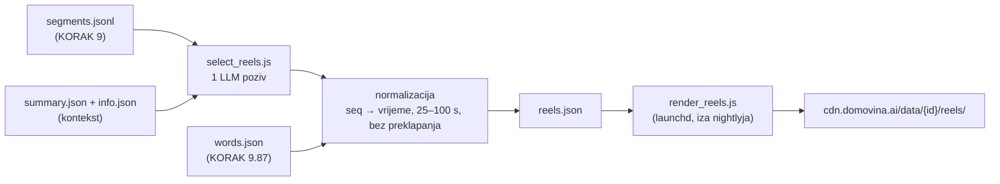
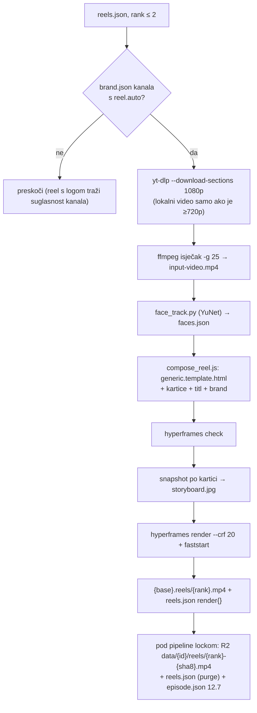

# Reels / shorts: KORAK 9.9 (`select_reels.js`) + render iza nightlyja (`render_reels.js`)

Stanje 25.10.2026.: oba dijela rade od početka do kraja. 9.9 je u nightlyju, render i
objava idu kroz zaseban launchd job `tv.domovina.fetch.reels`. Isprobano na svih 10
epizoda re:DEFINICIJE: izbor trenutaka, brendirani render top 2 po epizodi, CDN.

## Što radi

Kad je epizoda obrađena do kraja (kanonski SRT → `segments.jsonl` u KORAKU 9,
`words.json` u 9.87), jedan LLM poziv nad cijelim prijepisom predloži do 8 trenutaka
od 30–90 s koji stoje sami za sebe. Izlaz je `{base}.reels.json` uz ostale datoteke
epizode.



Tri odluke u dizajnu:

1. **Model vraća redne brojeve cue-ova (`start_seq`/`end_seq`), ne vremena.** Vrijeme se
   uzima iz segmenata, pa reel uvijek počinje i završava na granici cue-a i nema
   izmišljenih timestampova.
2. **Kartice su podaci, ne dizajn.** Tip (`hook`, `lower_third`, `context`, `quote`,
   `number`, `pin`, `end`), trenutak i tekst. Kako izgledaju odlučuju HyperFrames
   predložak i branding kanala (`data/branding/<ime>/`), koji se kasnije mogu mijenjati
   bez novog LLM poziva.
3. **Kartice se sidre na riječ.** Model uz karticu prepiše 2–5 riječi iz cue-a, a vrijeme
   se čita iz `words.json`. Cue-ovi `words.json` i `segments.jsonl` su 1:1 (ep. 9: 280/280,
   isti broj riječi), pa sidrenje nema heuristike. Bez sidra kartica pada na početak cue-a,
   koji traje i 15 s; u prvoj verziji su tri kartice izlazile na 0 s i tri na 42,5 s.

## Format `reels.json` (v1)

```json
{
  "version": 1, "video_id": "f2HIRJPHHK4", "channel": "muzevni_budite", "title": "…",
  "generated_at": "…", "model": "claude-code:opus", "source": "….segments.jsonl",
  "word_timing": "soniox",
  "llm": { "input_tokens": 27777, "output_tokens": 6381, "cost_usd": 0.35, "seconds": 59 },
  "reels": [{
    "rank": 1, "start_sec": 1386.2, "end_sec": 1459.76, "duration_sec": 73.6,
    "start_seq": 131, "end_seq": 139,
    "title": "…", "hook": "…", "why": "…", "kind": "story|insight|emotion|humor|controversy|practical|faith",
    "score": 7, "speaker": "Zlatko Krznarić", "speakers": ["Zlatko Krznarić"], "quote": "…",
    "cards": [{ "type": "pin", "at_sec": 28.98, "text": "Svetište Alojzija Stepinca",
                "value": "Krašić", "anchor": "Ja si mislim u Krašiću", "anchored": true }]
  }],
  "rejected": [{ "title": "…", "reason": "trajanje 112.0 s" }]
}
```

`at_sec` je relativan na početak reela. `rejected` ostaje u datoteci da se vidi što je
model predložio, a normalizacija odbacila.

## Mjerenja (25.10.2026., Opus pod pretplatom)

| Epizoda | Cue-ova | Input / output tokena | Trajanje | API-ekvivalent |
|---|---|---|---|---|
| ep. 9 `f2HIRJPHHK4` | 280 | 27,8k / 6,4k | 59–88 s | ~$0,35 |
| ep. 10 `DOfcONrRyDY` | 307 | ~29k / ~6k | 68 s | ~$0,35 |

Na Vertexu (`gemini-3.8-flash`) isti poziv bi koštao ~$0,05.

**Provjera prema ručnom izboru.** Oba trenutka koja smo prije birali ručno model je našao
sam:

| | Ručno | Model |
|---|---|---|
| ep. 9 „traktor" | 23:20,8–24:19,8 | 23:24–24:19 (1. run), 23:06–24:19 (2. run) |
| ep. 10 „srećka" | 38:59–40:03 | 38:36–40:03, rang #1 |

Dva runa iste epizode ne daju isti popis: jezgra (nesreća, „trudna sam", svećenik,
traktor, usmeni ispit) se ponavlja, rubni kandidati i granice se pomiču. Zato
idempotencija ide preko mtime-a, a ne ponovnog poziva.

## U pipelineu

- KORAK 9.9 u `run_pipeline.sh`, iza 9.87 (treba `words.json`), default ON, `--no-reels` gasi.
- Backend = `GEMINI_BACKEND` kao koraci 7+8 (nightly: `claude` + Opus). Uz `CLAUDE_WINDOW_GUARD=1`
  epizoda se odgađa (`⏸️ [ODGOĐENO]`) kad bi poziv otvorio novi prozor kvote.
- **Doseg:** bez `--video-id` samo epizode s `upload_date` u zadnjih 21 dan, najnovije prve,
  najviše 20 po runu. Katalog (3300+ epizoda) se **ne backfilla sam** — to bi bilo ~3300
  Opus poziva. Za kanal: `node select_reels.js --channel <kanal> --since-days 0 --max-episodes N`.
- Priority / ad-hoc put prosljeđuje `--video-id`, pa ad-hoc epizoda dobije reelove odmah.
- Idempotentno: preskače epizodu čiji `reels.json` je noviji od `segments.jsonl`. Novi
  kanonski SRT → novi segments → novi izbor.
- Kraće od 8 min se preskače.
- Na CDN ide tek s renderom (`render_reels.js --publish-only`), ne iz 9.9.

## Render i objava (`render_reels.js`, launchd `tv.domovina.fetch.reels`)

Odluke (Matija, 25.10.2026.): **top 2** reela po epizodi, render u **zasebnom launchd jobu
iza nightlyja**, objava **odmah na CDN**.



- **Kartice:** `tools/hyperframes_reel/compose_reel.js` + `generic.template.html`. Sedam
  generičkih tipova; raspored u vremenu je jedna kartica u isto vrijeme (hook 0–3 s,
  lower-third odmah iza, ostale na sidro ili čim prethodna nestane, kraj zadnjih 4,5 s).
  Kartica koja ne stane prije kraja otpada. Brojač (`number`) samo za količine, ne godine.
  Raspored oko lica i sigurna zona: postojeći `reel_layout.js`. Ručni predlošci
  (`*.template.html` + `build_composition.py`) ostaju za istaknute reelove.
- **Branding + pristanak = ograda:** renderiraju se samo kanali s `data/branding/<kanal>/brand.json`
  (gitignored, `DOMOVINA_BRANDING_DIR`), a automatski (launchd, bez `--video-id`) samo uz
  `"reel": {"auto": true}` u tom brand.jsonu. Sam brand.json nije pristanak: za Mlade za
  domovinu postoji, a suglasnost za logo se još čeka. `auto: true` danas ima samo `muzevni_budite`.
- **Idempotencija:** `reel.render.fingerprint` = hash raspona, kartica, hooka, mtime-a
  brand.json i `RENDER_VERSION`. Promjena izgleda → povećaj `RENDER_VERSION`. Neuspjeh se
  bilježi (`render.error`, `attempts`), nakon 3 pokušaja se odustaje dok se ulaz ne promijeni.
- **CDN:** `data/{id}/reels/{rank}-{sha8}.mp4` i `.storyboard.jpg` (verzionirani ključevi,
  immutable), `data/{id}/reels.json` bez polja `rejected`, uz `render.url`. Objavljuje se
  samo epizoda koja je već na CDN-u (`data/{id}/info.json` u keys-cacheu). Nakon objave se
  regenerira `episode.json`, inače ekran epizode ne vidi nove datoteke.
- **Mjerenja (ep. 9):** 75 s reel → 2,7 min ukupno (yt-dlp + lica + snapshot + render),
  31 MB; drugi reel 1,8 min / 28 MB. Noću: ~13 novih epizoda × 2 ≈ 50–60 min CPU-a.
- **launchd:** svakih 30 min; tick se preskače dok radi `nightly_pipeline.sh` ili bilo koji
  `run_pipeline.sh`. Najviše 6 rendera po ticku (`REELS_MAX_RENDERS`), objava pod
  `with_pipeline_lock.sh`. Log: `automatic/logs/reels_YYYY-MM-DD.log`. Doseg isti kao 9.9
  (zadnjih 21 dan); stariji katalog samo ručno: `node render_reels.js --channel X --since-days 0`.
- **Okolina:** Python venv s opencv u `~/.cache/domovina-reels/venv` (`REELS_PYTHON`),
  YuNet model u `~/.cache/domovina-reels/`, radni dir `~/.cache/domovina-reels/work/`
  (interni disk; briše se nakon uspjeha, `--keep-work` ga ostavlja), `npx hyperframes@0.8.38`
  iz istog node-a kao skripta, GSAP u `tools/hyperframes_reel/vendor/`.

### Zamke naučene u prvom runu

1. **`montage` i za prazan natpis traži font.** Bez `-font` pada s „unable to read font".
2. **Lokalni `.mkv`/`.mp4` je često 360p** (AV1). Render ga uzima samo kad je ≥720p, inače yt-dlp.
3. **Ista epizoda u kanalu i u `_unlisted`** (auto_reuse_adhoc.js) dobila je dva LLM poziva
   (ep. 7). Obje skripte sad uzimaju samo kanalsku kopiju.
4. **Zastario `segments.jsonl` (ep. 1–4).** Kartice se nisu usidrile (0 od ~30), jer
   segments nije odgovarao `words.json`. Uzrok je bio stvaran bug u pipelineu, ispod.

### Bug: Sortformer je zasjenio Soniox prepis (ispravljeno 25.10.2026.)

`resolveDiarizedSrt()` (5 kopija: summarize, article, prepare_rag{,_import,_combined})
prepoznaje promovirani Gemini prepis po bajt-jednakosti s `{audio}.speechmatics.gemini.diarized.srt`.
Soniox kostur (primarni od 24.10.) piše `{audio}.soniox_pyannote.gemini.diarized.srt`, pa
promocija nije prepoznata i **stari svibanjski `.sortformer.diarized.srt` (stari Canary tekst)
je pobijedio kanonski SRT**. Pogađa svaku epizodu koja ima Sortformer datoteku (~1950 u
katalogu) i dobije Soniox prepis — u re:DEFINICIJI ep. 1–4. Ispravak: `REFINED_SKELETONS`
(`soniox_pyannote`, `soniox`, `speechmatics_pyannote`, `speechmatics`) u svih 5 kopija.
`segments.jsonl` za ep. 1–4 je ponovno izgrađen i reelovi ponovno izabrani; **sažetak, članak
i RAG chunkovi ep. 1–4 od 24.10. vjerojatno su pisani iz Sortformer SRT-a** (otvoreno).

## Otvoreno

- **launchd `tv.domovina.fetch.reels` NIJE instaliran** (25.10.2026.). Prije
  `automatic/launchd/install.sh reels`: (1) pričekati da završi ručni render ostatka
  re:DEFINICIJE, (2) preračunati `render.fingerprint` u reels.json gotovih reelova — run je
  krenuo sa starom formulom (mtime brand.json), nova hashira sadržaj brenda; bez migracije bi
  job sve renderirao ponovno. Migracija: za svaki reel s `render.file` postaviti
  `render.fingerprint = renderFingerprint(reel, loadBrand(kanal))` (export iz render_reels.js).
- **Ep. 10 #1 (`DOfcONrRyDY`) pao na `hyperframes check`** u ručnom runu — pogledati
  `render.error` u reels.json i radni dir (`--keep-work`).

- Konfiguracija prompta po kanalu (ton, vrste kartica, koliko kandidata) i bogatije
  kartice (ruta, ilustracije) koje danas rade samo ručni predlošci.
- domovina.ai još ne prikazuje reelove (`reels.json` + `render.url` su spremni).
- Sažetak, članak i RAG za re:DEFINICIJA ep. 1–4 ponovno iz ispravnog SRT-a.
- Model ne vidi kadar. Trenutak može biti dobar u priči, a loš u slici (gost okrenut,
  totalni plan) — `docs/2026-10-21-hyperframes-reel-proba.md`.
