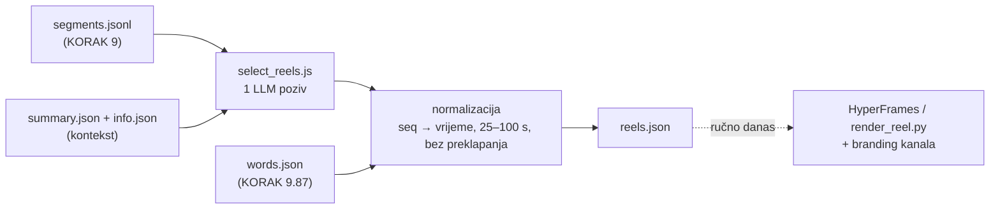

# KORAK 9.9 — kandidati za reels / shorts (`select_reels.js`)

Stanje 25.10.2026.: skripta i korak su gotovi, isprobani na re:DEFINICIJA ep. 9 i 10.
Render, HyperFrames kartice i branding još se pokreću ručno; ovaj korak im daje ulaz.

## Što radi

Kad je epizoda obrađena do kraja (kanonski SRT → `segments.jsonl` u KORAKU 9,
`words.json` u 9.87), jedan LLM poziv nad cijelim prijepisom predloži do 8 trenutaka
od 30–90 s koji stoje sami za sebe. Izlaz je `{base}.reels.json` uz ostale datoteke
epizode.



Tri odluke u dizajnu:

1. **Model vraća redne brojeve cue-ova (`start_seq`/`end_seq`), ne vremena.** Vrijeme se
   uzima iz segmenata, pa reel uvijek počinje i završava na granici cue-a i nema
   izmišljenih timestampova.
2. **Kartice su podaci, ne dizajn.** Tip (`hook`, `lower_third`, `context`, `quote`,
   `number`, `pin`, `end`), trenutak i tekst. Kako izgledaju odlučuju HyperFrames
   predložak i branding kanala (`data/branding/<ime>/`), koji se kasnije mogu mijenjati
   bez novog LLM poziva.
3. **Kartice se sidre na riječ.** Model uz karticu prepiše 2–5 riječi iz cue-a, a vrijeme
   se čita iz `words.json`. Cue-ovi `words.json` i `segments.jsonl` su 1:1 (ep. 9: 280/280,
   isti broj riječi), pa sidrenje nema heuristike. Bez sidra kartica pada na početak cue-a,
   koji traje i 15 s; u prvoj verziji su tri kartice izlazile na 0 s i tri na 42,5 s.

## Format `reels.json` (v1)

```json
{
  "version": 1, "video_id": "f2HIRJPHHK4", "channel": "muzevni_budite", "title": "…",
  "generated_at": "…", "model": "claude-code:opus", "source": "….segments.jsonl",
  "word_timing": "soniox",
  "llm": { "input_tokens": 27777, "output_tokens": 6381, "cost_usd": 0.35, "seconds": 59 },
  "reels": [{
    "rank": 1, "start_sec": 1386.2, "end_sec": 1459.76, "duration_sec": 73.6,
    "start_seq": 131, "end_seq": 139,
    "title": "…", "hook": "…", "why": "…", "kind": "story|insight|emotion|humor|controversy|practical|faith",
    "score": 7, "speaker": "Zlatko Krznarić", "speakers": ["Zlatko Krznarić"], "quote": "…",
    "cards": [{ "type": "pin", "at_sec": 28.98, "text": "Svetište Alojzija Stepinca",
                "value": "Krašić", "anchor": "Ja si mislim u Krašiću", "anchored": true }]
  }],
  "rejected": [{ "title": "…", "reason": "trajanje 112.0 s" }]
}
```

`at_sec` je relativan na početak reela. `rejected` ostaje u datoteci da se vidi što je
model predložio, a normalizacija odbacila.

## Mjerenja (25.10.2026., Opus pod pretplatom)

| Epizoda | Cue-ova | Input / output tokena | Trajanje | API-ekvivalent |
|---|---|---|---|---|
| ep. 9 `f2HIRJPHHK4` | 280 | 27,8k / 6,4k | 59–88 s | ~$0,35 |
| ep. 10 `DOfcONrRyDY` | 307 | ~29k / ~6k | 68 s | ~$0,35 |

Na Vertexu (`gemini-3.8-flash`) isti poziv bi koštao ~$0,05.

**Provjera prema ručnom izboru.** Oba trenutka koja smo prije birali ručno model je našao
sam:

| | Ručno | Model |
|---|---|---|
| ep. 9 „traktor" | 23:20,8–24:19,8 | 23:24–24:19 (1. run), 23:06–24:19 (2. run) |
| ep. 10 „srećka" | 38:59–40:03 | 38:36–40:03, rang #1 |

Dva runa iste epizode ne daju isti popis: jezgra (nesreća, „trudna sam", svećenik,
traktor, usmeni ispit) se ponavlja, rubni kandidati i granice se pomiču. Zato
idempotencija ide preko mtime-a, a ne ponovnog poziva.

## U pipelineu

- KORAK 9.9 u `run_pipeline.sh`, iza 9.87 (treba `words.json`), default ON, `--no-reels` gasi.
- Backend = `GEMINI_BACKEND` kao koraci 7+8 (nightly: `claude` + Opus). Uz `CLAUDE_WINDOW_GUARD=1`
  epizoda se odgađa (`⏸️ [ODGOĐENO]`) kad bi poziv otvorio novi prozor kvote.
- **Doseg:** bez `--video-id` samo epizode s `upload_date` u zadnjih 21 dan, najnovije prve,
  najviše 20 po runu. Katalog (3300+ epizoda) se **ne backfilla sam** — to bi bilo ~3300
  Opus poziva. Za kanal: `node select_reels.js --channel <kanal> --since-days 0 --max-episodes N`.
- Priority / ad-hoc put prosljeđuje `--video-id`, pa ad-hoc epizoda dobije reelove odmah.
- Idempotentno: preskače epizodu čiji `reels.json` je noviji od `segments.jsonl`. Novi
  kanonski SRT → novi segments → novi izbor.
- Kraće od 8 min se preskače.
- **Ne ide na CDN.** Kad ga zatreba domovina.ai (npr. „najbolji trenuci" na ekranu
  epizode), ide u `data/{id}/reels.json`, `upload_to_r2.js` i bundle 12.7.

## Otvoreno

- **Generator HyperFrames kompozicije iz `reels.json`** umjesto ručnog predloška
  (`tools/hyperframes_reel/*.template.html`): kartica → `.slot` element, `reel_layout.js`
  već sam slaže raspored. Plus konfiguracija prompta po kanalu (ton, vrste kartica).
- Branding se primjenjuje automatski iz `data/branding/<kanal>/` (`--brand`).
- Render (`render_reel.py` / HyperFrames) za top N po epizodi i upload.
- Model ne vidi kadar. Trenutak može biti dobar u priči, a loš u slici (gost okrenut,
  totalni plan) — `docs/2026-10-21-hyperframes-reel-proba.md`.
