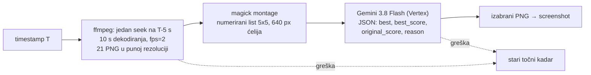
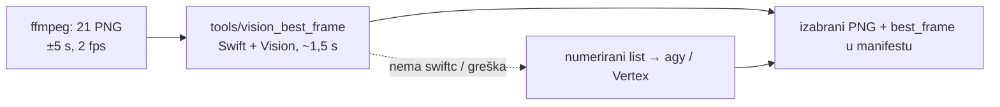

# Screenshotovi: izbor najljepšeg kadra (26.10.2026.)

## Problem

KORAK 10 (`screenshot_youtube.js`) je uzimao kadar **točno** na
`screenshot_timestamp` iz članka. Na epizodi `ja70p_gJWZA` (Mladi za domovinu
#118) od 29 screenshotova najmanje 7 je bilo loše: zatvorene oči, pogled u stol
ili krilo, grimasa, stisnute usne, a jedan je bio **pretapanje dviju kamera**
(00:55:00, dva lica preko slike). Timestamp ne mora biti na sekundu — ±5 s je
sasvim u redu za ilustraciju poglavlja.

## Rješenje (default ON)



Pravila za model, redom:

1. **Ista osoba (isti kadar kamere) kao na T**, osim ako je kadar na T pretapanje,
   mutan, crn ili prazan. Bez ovog pravila model rado prebaci na voditelja jer
   „bolje izgleda" — u prototipu se to dogodilo na 01:16:01 i 01:23:04, gdje u
   tom trenutku govori gost.
2. Oči otvorene, glava gore, pogled prema naprijed ili sugovorniku.
3. Prirodan izraz: bez grimase, škiljenja, stisnutih usana, usta zamrznutih usred riječi.
4. Bez zamućenja, pretapanja, ruke preko lica.

Odluka ide u `_manifest.json` po kadru (`best_frame`: `offset_sec`, `score`,
`original_score`, `reason`, `candidates`, `model`). Odluke iz ranijih runova se
čuvaju kad se kadar preskoči.

Gašenje: `--no-best-frame` ili `SCREENSHOT_BEST_FRAME=0`.

### Fallback na agy kad Vertex vraća 429

Kad Vertex za isti list dvaput zaredom vrati 429 (dvije regije), list ide kroz
**agy** (Antigravity CLI, `gemini-3.8-flash-high`, Google AI Pro pretplata, $0)
u tmux sesiji `agyss`, radni dir `~/git/.agy-screenshots`. `agy -p` ne vraća
odgovor, pa upit ide kroz `tmux send-keys` i agy JSON zapiše u datoteku (obrazac
iz `~/.claude/scripts/agy_glasovna.sh`). Pozivi su serijalizirani (jedna sesija).
Ako agy ne uspije, Vertex nastavlja s preostalim pokušajima; ako se agy uopće ne
pokrene (nije prijavljen), fallback se gasi do kraja runa. U manifestu je tada
`model: "agy:gemini-3.8-flash-high"`, a sažetak runa ispisuje broj agy poziva.

- `SCREENSHOT_AGY_FALLBACK=0` gasi fallback.
- `SCREENSHOT_BEST_FRAME_BACKEND=agy` ide odmah na agy, bez Vertexa (test, ili
  kad je Vertex kvota danima puna).
- Gledanje: `tmux attach -t agyss -r`. Sesija ostaje živa za idući run.
- Test 26.10. (`BACKEND=agy`, 3 kadra ja70p_gJWZA): 3/3 izabrano, ocjene 4–5 → 9.
  Sam okidač na pravi 429 nije uhvaćen uživo (Vertex tada nije vraćao 429).
- Pod launchd-om agy još nije isproban; ako nije prijavljen, run javi
  „agy se nije pokrenuo" i nastavi kao prije.

## Mjerenja

| | |
|---|---|
| Izvlačenje kandidata | ~8 s po timestampu iz 1080p streama |
| Gemini poziv | ~12 s (zadano razmišljanje), ~1 150 ulaznih tokena (slika 1 092) |
| `thinkingLevel: low` | 2,9 s, ali ignorira skalu 1–10 (vratio 88/45) — **ne koristi** |
| `thinkingLevel: minimal` | HTTP 400, nije podržan na 3.8 Flash |
| Trošak | ~$0,005 po kadru, ~$0,13 po epizodi od 29 kadrova |
| Paralelno | 3 timestampa istodobno |
| Puni run (29 kadrova, test 26.10. popodne) | 15 min; 27/29 izabrano (prosjek 5,1 → 8,1), 2 pala na točni kadar |

Spori run nije do koda: Vertex je u to vrijeme za `gemini-3.8-flash` vraćao **429
(DSQ) na `eu` i `global`**, a `us` je odgovarao za 22–63 s. Zato 8 pokušaja s
čekanjem do 30 s; kad ni to ne prođe, kadar pada na stari točni kadar. U nightlyju
korak 10 ide nakon 7+8, pa se s njima ne natječe za kvotu.

Prototip (agy + Gemini 3.8 Flash High, 29 listova): prosječna ocjena originala
4,8 → izabranog 8,9 od 10. agy je za to trebao 18 min jer sam izrezuje lica iz
listova; za nightly je Vertex brži i ne ovisi o tmuxu i prijavi.

## Zamjena screenshotova objavljene epizode

Screenshotovi su na CDN-u `immutable` godinu dana, a ključ (timestamp) se ne
mijenja, pa običan `upload_to_r2.js` novu sliku preskoči. Postupak koji je
odrađen za `ja70p_gJWZA`:

```bash
# 1. stari fajlovi u .reprocess_bak (kopija, ne brisanje)
# 2. novi PNG-ovi u {base}_screenshots/
python3 generate_og_sections.py --input-dir storage/output --channel <kanal>   # mtime → samo ta epizoda
node generate_ebook.js --video-id <VID> --force
node upload_to_r2.js --input-dir storage/output --channel <kanal> --video-id <VID> \
     --force-og --force-screenshots          # re-upload + CF purge
node force_upload.js --video-id <VID> --channel <kanal> --targets epub
node generate_webp_screenshots.js --video-id <VID> --force   # APP ČITA OVO, ne PNG
# + CF purge images/{id}/screenshots/{ts}-960.webp (obje Vary varijante) — skripta ga NE radi
node build_episode_bundle.js --video-id <VID>
```

⚠️ **Aplikacija crta `{ts}-960.webp`, ne PNG** (KORAK 12.65, od 10.10.2026.,
kad postoji `data/{id}/screenshots_webp.json`). Za `ja70p_gJWZA` je prvi prolaz
prepisao PNG-ove, og slike i EPUB, a stranica je i dalje pokazivala stare kadrove
dok WebP-ovi nisu regenerirani i purgeani. `generate_webp_screenshots.js` je
idempotentan po oznaci (preskače epizodu kad oznaka nabraja sve kadrove), pa
`--force` treba, a purge treba ručno jer su WebP-ovi `immutable`.

`--force-screenshots` je dodan u `upload_to_r2.js` uz ovu promjenu (analogno
`--force-og`). Provjera je GET s i bez `Origin` headera i usporedba md5 s diskom.
Preglednik koji je epizodu već otvorio može još prikazivati stari kadar iz svog cachea.

## Otvoreno

- **Backfill kataloga nije pokrenut.** Za postojeće epizode to bi bio
  ~$0,13 + ~3 min po epizodi plus prepis i purge na CDN-u; odluka je korisnikova.
- Kad u cijelom prozoru ±5 s nema dobrog kadra (00:10:02 — voditelj cijelo
  vrijeme gleda u bilješke), mogao bi se proširiti prozor na ±10 s.
- Lokalni fallback (anti-bot) je često 360p; izbor tada radi na lošijoj slici.

## Apple Vision kao primarni backend (28.10.2026.)

Od 28.10. je Vertex isključen (`docs/2026-10-28-vertex-iskljucen-agy-jedini-gemini.md`),
pa je izbor kadra išao samo kroz agy. Jedna tmux sesija serijalizira sva tri
workera, pa je to **~1 kadar u minuti**. Nightly s 235 sekcija stao bi na KORAKU 10
oko 4 sata. Zato kadar sada bira **Apple Vision lokalno**, a agy/Vertex ostaje
rezerva kad Vision nije dostupan.



`tools/vision_best_frame/main.swift`; binarka se gradi sama (`swiftc -O`, ~3 s) kad
nedostaje ili je starija od izvora i nije u gitu. Ručno:
`vision_best_frame --original 11 c01.png … c21.png` → JSON s odlukom i metrikama po kadru.

Po kadru se računa:

| Signal | Vision zahtjev | Uloga |
|---|---|---|
| kvaliteta lica 0–1 | `VNDetectFaceCaptureQualityRequest` | glavna ocjena (oštrina, svjetlo, poza) |
| oči otvorene | `VNDetectFaceLandmarksRequest`, omjer visina/širina oka | zatvorene oči = najčešći loš kadar |
| estetika −1..1 | `VNCalculateImageAestheticsScoresRequest` | kadar bez lica (ekran, slajd) |
| ista osoba / isti kadar | `VNGenerateImageFeaturePrintRequest` nad izrezom lica i cijelim kadrom | pravilo 1 iz prompta |

Pravila odluke:

1. **Lice na timestampu** → kandidati su kadrovi s istim licem (udaljenost feature
   printa ≤ 0,75, središte pomaknuto < 20 % kadra). Ocjena je
   `0,55·kvaliteta + 0,30·oči + 0,15·estetika`, uz malu kaznu za udaljenost od
   timestampa. Kadar se mijenja samo uz dobitak ≥ 0,08, a za **sitno lice**
   (< 6 % visine kadra, npr. PiP govornika preko snimke ekrana) ≥ 0,15.
2. **Nema lica na timestampu** (ekran, slajd) → ostaje točni kadar, osim ako je
   isti kadar ekrana estetski jasno bolji. Za razliku od agy-ja **ne bježi na
   govornika**: tu članak opisuje sadržaj ekrana („Na ekranu je…”).
3. **Sitna lica**: Vision na cijelom 1080p kadru ne nađe lice od ~40 px, pa
   postoji drugi prolaz po 3×2 preklapajuće pločice.

Gašenje: `SCREENSHOT_BEST_FRAME_BACKEND=agy` (ili `vertex`) vraća stari put.
U manifestu je `model: "apple-vision"`.

### Mjerenje: QkcpHsj43rE (StartupVG predavanje, 42 sekcije)

Snimka ekrana s malim PiP-om govornika, plus široki kadrovi dvorane.

| | agy (Gemini 3.8 Flash High) | Apple Vision |
|---|---|---|
| vrijeme odluke | ~60 s (serijski) | **~1,6 s** (67 s za 42) |
| pomaknutih kadrova | 17/42 | 7/42 |
| isti izbor kao agy | — | 10/42 (prva, nekalibrirana verzija) |

Vision je konzervativniji. Pouzdano hvata **zatvorene ili poluzatvorene oči** i
lice okrenuto od publike u širokom kadru (02:01:46: c11 gleda u ekran → c02 gleda
publiku). Ne vidi što agy vidi: „glava spuštena prema laptopu” na licu od 40 px
(pitch iz Visiona je za tako mala lica uvijek 0) ni kompoziciju. Za brz automatski
pipeline je to dobra zamjena: nikad ne pogorša kadar i ne košta vremena.

Zamke:

- Jedan `perform([sve zahtjeve])` s `try?`: ako jedan zahtjev pukne, nestanu
  rezultati svih. Zato svaki zahtjev ide zasebno.
- `VNFaceObservation.pitch` dolazi samo iz `VNDetectFaceRectanglesRequest`
  revision 3, i to ne za sitna lica.
- Estetika vraća `overallScore = 0` i `isUtility = true` za snimke ekrana, pa za
  takve kadrove ne razlikuje ništa.

## og-sections: bez natpisa preko kadra s tekstom (28.10.2026.)

KORAK 9.6 lijepi naslov sekcije s gradijentom preko kadra. Na snimci ekrana ili
slajdu to su dva teksta jedan preko drugog (korisnik: „izgleda katastrofa”,
QkcpHsj43rE, Ora et Labora nBPDxzrAW0Q i n38M_g__TxQ). Sada
`generate_og_sections.py` za sve kadrove epizode jednim pozivom pita
`vision_best_frame --text` (~30 ms po kadru), a kadar s tekstom ide u
`og-t-{sec}.jpg` **čist**, bez gradijenta i natpisa.

Kadar ima tekst ako vrijedi bilo što od ovoga:

| Signal | Prag | Hvata |
|---|---|---|
| `VNClassifyImageRequest` „screenshot” | ≥ 0,5 | snimka ekrana (terminal, preglednik) |
| najviši redak teksta (OCR `.fast`) | ≥ 5 % visine | slajd s naslovom, „Krunica!” |
| tekst u donjih 65 % kadra | ≥ 3 % površine | gusti slajd, natpis, titl |

Kalibracija na 147 kadrova triju epizoda: kadrovi dvorane imaju najviši redak
1,5–4,4 % (logo „start upvg” na zidu, daleka projekcija) i ≤ 1,5 % teksta dolje.
Slajdovi imaju najviši redak ≥ 4,4 % i najmanje 0,9 % teksta dolje, a gotovo uvijek oboje.
Pogreška prema „ima teksta” je bezopasna. Rezultat: QkcpHsj43rE 33/42 bez natpisa,
Ora et Labora 103/103.

Što **ne** radi samo za sebe:

- `isUtility` iz estetike: slajd sa slikom Isusa nije „utility”, a kadar dvorane
  ponekad jest.
- detekcija ljudi: Isus na slajdu je „osoba” (`people_area` 0,21).
- klasifikacija scene: Ora et Labora slajdove vodi kao `people`, ne `document`.

Gašenje: `OG_TEXT_DETECT=0`. Pragovi: `VISION_TEXT_MAX_H`, `VISION_TEXT_LOW_AREA`.
Već objavljene epizode: `generate_og_sections.py --video-id <ID> --force` pa
`upload_to_r2.js --video-id <ID> --force-og` (prepiše i očisti CF cache). Katalog
NIJE backfillan.

## Popravak objavljene epizode: `tools/refresh_screenshots.sh` (28.10.2026.)

Nove epizode dobivaju izbor kadra i og bez natpisa same, kroz KORAK 10 i 9.6.
Za već objavljenu epizodu (kadrovi točno na timestampu ili kroz agy) se pokreće:

```bash
tools/refresh_screenshots.sh catholic_futurist nuNw4qWs0r4 /tmp/vremena.txt
```

Mjereno na nuNw4qWs0r4 (16 kadrova, 31 min): **83 s ukupno**. Izbor kadrova
traje 61 s, og slike 4 s, EPUB 2 s, R2 s purgeom 6 s, WebP s purgeom 8 s, a EPUB
na CDN-u i bundle 2 s. Vision je promijenio 10/16 kadrova, a md5 na CDN-u se
podudara s diskom.

Ograničenje: Vision ocjenjuje **najveće** lice u kadru. U kadru s dvoje ljudi
zatvorene oči drugog govornika ne vidi.

## Zamka: OCR nad cijelim katalogom u nightlyju (29.10.2026.)

Prva verzija detekcije teksta (`7e18cd05`) skupljala je za Vision **sve**
postojeće kadrove epizode, prije provjere idempotencije. Nightly 9.6 prolazi
cijeli katalog (3493 epizode, ~70k kadrova), pa je OCR išao nad svakim kadrom
iako se 69 878 sekcija preskočilo, a generirane su samo 63.

| Nightly | KORAK 9.6 |
|---|---|
| 25.–28.10. | 15–35 s |
| 29.10. (s bugom) | **3902 s (65 min)** |
| nakon popravka, kanal `40_dana_za_zivot` (81 ep) | 0,4 s (prije ~80 s) |

Popravak: kadar ide u `detect_text_frames()` samo ako `should_regenerate()` za
njegov `og-t-{sec}{suffix}.jpg` kaže da treba. Pravilo za buduće korake koji
prolaze katalog: skupi posao (Vision, ffmpeg, LLM) tek **iza** provjere
idempotencije, nikad prije nje.

Vezano: `docs/2026-10-29-nightly-trajanje-po-koracima.md` (trajanje svih koraka nightlyja 29.10.).
