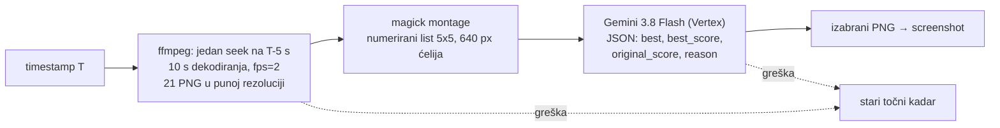

# Screenshotovi: izbor najljepšeg kadra (26.10.2026.)

## Problem

KORAK 10 (`screenshot_youtube.js`) je uzimao kadar **točno** na
`screenshot_timestamp` iz članka. Na epizodi `ja70p_gJWZA` (Mladi za domovinu
#118) od 29 screenshotova najmanje 7 je bilo loše: zatvorene oči, pogled u stol
ili krilo, grimasa, stisnute usne, a jedan je bio **pretapanje dviju kamera**
(00:55:00, dva lica preko slike). Timestamp ne mora biti na sekundu — ±5 s je
sasvim u redu za ilustraciju poglavlja.

## Rješenje (default ON)



Pravila za model, redom:

1. **Ista osoba (isti kadar kamere) kao na T**, osim ako je kadar na T pretapanje,
   mutan, crn ili prazan. Bez ovog pravila model rado prebaci na voditelja jer
   „bolje izgleda" — u prototipu se to dogodilo na 01:16:01 i 01:23:04, gdje u
   tom trenutku govori gost.
2. Oči otvorene, glava gore, pogled prema naprijed ili sugovorniku.
3. Prirodan izraz: bez grimase, škiljenja, stisnutih usana, usta zamrznutih usred riječi.
4. Bez zamućenja, pretapanja, ruke preko lica.

Odluka ide u `_manifest.json` po kadru (`best_frame`: `offset_sec`, `score`,
`original_score`, `reason`, `candidates`, `model`). Odluke iz ranijih runova se
čuvaju kad se kadar preskoči.

Gašenje: `--no-best-frame` ili `SCREENSHOT_BEST_FRAME=0`.

## Mjerenja

| | |
|---|---|
| Izvlačenje kandidata | ~8 s po timestampu iz 1080p streama |
| Gemini poziv | ~12 s (zadano razmišljanje), ~1 150 ulaznih tokena (slika 1 092) |
| `thinkingLevel: low` | 2,9 s, ali ignorira skalu 1–10 (vratio 88/45) — **ne koristi** |
| `thinkingLevel: minimal` | HTTP 400, nije podržan na 3.8 Flash |
| Trošak | ~$0,005 po kadru, ~$0,13 po epizodi od 29 kadrova |
| Paralelno | 3 timestampa istodobno |
| Puni run (29 kadrova, test 26.10. popodne) | 15 min; 27/29 izabrano (prosjek 5,1 → 8,1), 2 pala na točni kadar |

Spori run nije do koda: Vertex je u to vrijeme za `gemini-3.8-flash` vraćao **429
(DSQ) na `eu` i `global`**, a `us` je odgovarao za 22–63 s. Zato 8 pokušaja s
čekanjem do 30 s; kad ni to ne prođe, kadar pada na stari točni kadar. U nightlyju
korak 10 ide nakon 7+8, pa se s njima ne natječe za kvotu.

Prototip (agy + Gemini 3.8 Flash High, 29 listova): prosječna ocjena originala
4,8 → izabranog 8,9 od 10. agy je za to trebao 18 min jer sam izrezuje lica iz
listova; za nightly je Vertex brži i ne ovisi o tmuxu i prijavi.

## Zamjena screenshotova objavljene epizode

Screenshotovi su na CDN-u `immutable` godinu dana, a ključ (timestamp) se ne
mijenja, pa običan `upload_to_r2.js` novu sliku preskoči. Postupak koji je
odrađen za `ja70p_gJWZA`:

```bash
# 1. stari fajlovi u .reprocess_bak (kopija, ne brisanje)
# 2. novi PNG-ovi u {base}_screenshots/
python3 generate_og_sections.py --input-dir storage/output --channel <kanal>   # mtime → samo ta epizoda
node generate_ebook.js --video-id <VID> --force
node upload_to_r2.js --input-dir storage/output --channel <kanal> --video-id <VID> \
     --force-og --force-screenshots          # re-upload + CF purge
node force_upload.js --video-id <VID> --channel <kanal> --targets epub
node generate_webp_screenshots.js --video-id <VID> --force   # APP ČITA OVO, ne PNG
# + CF purge images/{id}/screenshots/{ts}-960.webp (obje Vary varijante) — skripta ga NE radi
node build_episode_bundle.js --video-id <VID>
```

⚠️ **Aplikacija crta `{ts}-960.webp`, ne PNG** (KORAK 12.65, od 10.10.2026.,
kad postoji `data/{id}/screenshots_webp.json`). Za `ja70p_gJWZA` je prvi prolaz
prepisao PNG-ove, og slike i EPUB, a stranica je i dalje pokazivala stare kadrove
dok WebP-ovi nisu regenerirani i purgeani. `generate_webp_screenshots.js` je
idempotentan po oznaci (preskače epizodu kad oznaka nabraja sve kadrove), pa
`--force` treba, a purge treba ručno jer su WebP-ovi `immutable`.

`--force-screenshots` je dodan u `upload_to_r2.js` uz ovu promjenu (analogno
`--force-og`). Provjera je GET s i bez `Origin` headera i usporedba md5 s diskom.
Preglednik koji je epizodu već otvorio može još prikazivati stari kadar iz svog cachea.

## Otvoreno

- **Backfill kataloga nije pokrenut.** Za postojeće epizode to bi bio
  ~$0,13 + ~3 min po epizodi plus prepis i purge na CDN-u; odluka je korisnikova.
- Kad u cijelom prozoru ±5 s nema dobrog kadra (00:10:02 — voditelj cijelo
  vrijeme gleda u bilješke), mogao bi se proširiti prozor na ±10 s.
- Lokalni fallback (anti-bot) je često 360p; izbor tada radi na lošijoj slici.
