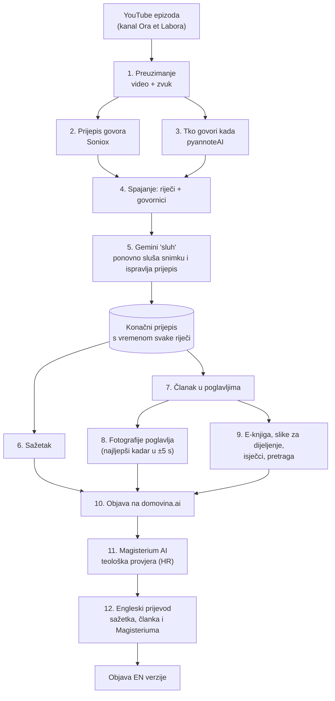
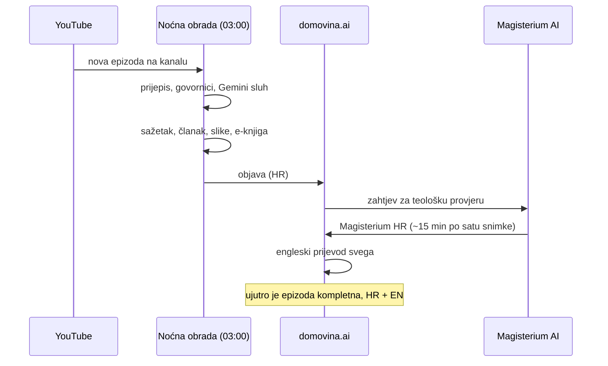

# Ora et Labora na domovina.ai: kako izgleda puna obrada jedne epizode

**27. listopada 2026.** · izmjereno na stvarnoj epizodi, ne procjena

> **Ukratko.** Epizoda *„120. Milosrđe Božje – Kako raste kraljevstvo Božje?"*
> (1 h 47 min) prošla je cijelu obradu za **44 minute**, bez ijedne ručne intervencije.
> Iz snimke je nastao točan prijepis s vremenom svake riječi, sažetak, novinarski članak
> u 38 poglavlja s fotografijama, e-knjiga, isječci za društvene mreže, teološka provjera
> **Magisterium AI** i engleski prijevod. Novac koji obrada stvarno troši je oko **$1 po
> epizodi**. Od 27.10.2026. svaka nova epizoda kanala ovako se obrađuje automatski, svake
> noći. Za cijeli katalog (1101 starija epizoda, ~1400 sati snimke) procjena je na kraju.

**Pogledajte rezultat:** <https://domovina.ai/v/nBPDxzrAW0Q>

---

## 1. Što epizoda dobije

| Što | Što to znači za slušatelja |
|---|---|
| **Prijepis s vremenom svake riječi** | Cijela emisija kao tekst; klik na riječ pušta snimku točno od tog mjesta, titl prati govor riječ po riječ |
| **Sažetak** | Odlomak o čemu je emisija, ključne teme, spomenute osobe, mjesta i organizacije |
| **Članak u poglavljima** | 38 poglavlja u 3 tematske cjeline, svako s naslovom, tekstom i fotografijom iz snimke; svako poglavlje ima svoju poveznicu na točan trenutak |
| **Magisterium AI** | Teološka provjera svakog poglavlja prema Katekizmu, dokumentima Crkve i Svetom pismu, s citatima izvora |
| **Engleska verzija** | Sažetak, članak i Magisterium prosudbe prevedeni na engleski, bez prepričavanja |
| **E-knjiga (EPUB)** | Cijeli članak sa slikama za čitač ili mobitel; poveznice vode natrag na domovina.ai |
| **Pretraga** | Epizoda ulazi u pretragu domovina.ai (i AI asistenta) — može se naći po onome što je *rečeno*, ne samo po naslovu |
| **Isječci (reels)** | 8 samostalnih trenutaka od 30–90 s, predloženih za društvene mreže |
| **Slike za dijeljenje** | Svako poglavlje ima vlastitu sliku za WhatsApp / Facebook, s naslovom poglavlja |

Primjer iz ove epizode — tri cjeline koje je obrada sama prepoznala:

| Cjelina | Vrijeme | Tema |
|---|---|---|
| 1 | 0:00 – 38:02 | Uvodne molitve, Krunica Božjega milosrđa, Litanije milosrđu i Gospina krunica |
| 2 | 38:07 – 1:12:14 | Otajstvo braka i Crkve, strah Božji te dužnost raskrinkavanja grijeha u Crkvi i društvu |
| 3 | 1:12:14 – 1:47:07 | Dužnost navještaja Krista, prispodobe o gorušičinu zrnu i kvascu, najave i svjedočanstva |

---

## 2. Tok obrade

Zašto dvije stvari slušaju snimku (Soniox i Gemini): prvi prolaz daje riječi i točno
vrijeme, a drugi prolaz ponovno sluša zvuk i ispravlja ono što je prvi krivo čuo —
imena, biblijske citate, hrvatske riječi koje strojevi često iskrive. Na ovoj epizodi
prijepis je nakon Gemini prolaza imao 13 478 riječi (Soniox 13 436).

### Kad se što događa

Od 27.10. svaka nova epizoda ide ovim putem sama:

---

## 3. Izmjereno na epizodi 120 (27.10.2026.)

```mermaid
gantt
    title Epizoda 120 — 1 h 47 min snimke, obrada 12:23–13:06
    dateFormat HH:mm
    axisFormat %H:%M
    section Zvuk
    Preuzimanje i priprema         :a1, 12:23, 3m
    Soniox prijepis                :a2, 12:26, 3m
    pyannoteAI govornici           :a3, 12:29, 1m
    Gemini sluh (ispravak)         :a4, 12:30, 15m
    section Tekst
    Sažetak                        :b1, 12:45, 1m
    Članak (38 poglavlja)          :b2, 12:46, 8m
    section Slike i objava
    Fotografije poglavlja          :c1, 12:54, 10m
    E-knjiga, isječci, titl        :c2, 13:04, 2m
    Objava na domovina.ai          :c3, 13:06, 1m
```

| Korak | Trajanje | Novac | Napomena |
|---|---|---|---|
| Preuzimanje + priprema zvuka | 3 min | — | |
| Soniox prijepis | 3 min 23 s | **$0,21** | 13 436 riječi, 32× brže od stvarnog vremena |
| pyannoteAI govornici | ~1 min | **$0,23** | 1 govornik (monolog s molitvama) |
| Gemini sluh | 14 min 48 s | **$0,35** | 11 prozora snimke, 15 poziva |
| Sažetak | 34 s | (pretplata) | Claude Opus |
| Članak | 7 min 44 s | (pretplata) | Claude Opus, 4 poziva, 3 cjeline / 38 poglavlja |
| Fotografije poglavlja | ~10 min | **$0,11** | Gemini bira najljepši kadar (oči otvorene, ista osoba) |
| E-knjiga, titl, isječci, sponzori | ~2 min | (pretplata za isječke) | e-knjiga 4,3 MB |
| Objava | ~1 min | — | 46 MB na CDN |
| **Ukupno do objave** | **44 min** | **~$0,90** | |
| Magisterium AI (HR) | _upisuje se po završetku_ | **$0** | Pro pretplata Magisterium AI |
| Engleski prijevod | _upisuje se po završetku_ | _~$0,2_ | Gemini, strogi režim bez prepričavanja |

„Pretplata" znači da se taj dio ne plaća po epizodi nego troši mjesečnu kvotu Claude
pretplate. Njegova vrijednost po tržišnoj cijeni bila bi oko $3,30 po ovakvoj epizodi
(sažetak $0,44 + članak $2,82) — to je bitno samo zato što kvota ograničava koliko
epizoda dnevno može proći, ne zbog računa.

---

## 4. Cijeli katalog: 1101 starija epizoda

Kanal ima sezone, svaka sa svojom playlistom:

| Sezona | Razdoblje | Epizoda | Sati snimke |
|---|---|---|---|
| Evanđelje dana iz Međugorja | 2024. | 364 | 440 |
| Evanđelje dana iz Međugorja II / Ora Et Labora | 2025. | 361 | 583 |
| Ora Et Labora II | 1.–6. 2026. | 178 | 231 |
| Milosrđe Božje | od 29.6.2026. | 118 | 158 |
| OEL razgovori, Svjedočanstva, Božja Riječ, ostalo | | ~80 | ~30 |
| **Ukupno** | | **~1100** | **~1440** |

**Procjena (linearno s izmjerene epizode, ~$0,50 po satu snimke):**

| | Procjena |
|---|---|
| Novac (prijepis, govornici, Gemini sluh, fotografije, EN prijevod) | **~$800–1000** za cijeli katalog |
| Magisterium AI | $0 (pretplata), ali ~15 min po satu snimke i strogo jedan po jedan → **~15 dana** neprekidnog rada |
| Članci (Claude Opus) | troše kvotu pretplate (~280 tisuća tokena po epizodi) — to je glavno ograničenje brzine; točan dnevni broj izmjerit ćemo na prvih 20 epizoda |
| Ukupno vrijeme | **~2 mjeseca** uz postupno puštanje, sezonu po sezonu |

Predloženi redoslijed: od najnovijeg prema starijem — *Milosrđe Božje* (118), pa
*Ora Et Labora II* (178), pa 2025. i 2024. Svaka sezona je odmah upotrebljiva čim je
gotova; ne čeka se kraj cijelog kataloga. Procjena se temelji na jednoj epizodi i
korigirat ćemo je nakon prvih 20.

---

## 5. Za tehnički znatiželjne

- Prijepis: **Soniox** (stt-async-v5) · govornici: **pyannoteAI** precision-3 · ispravak:
  **Gemini 3.8 Flash** (Google Vertex) · sažetak i članak: **Claude Opus** (Anthropic) ·
  teološka provjera: **Magisterium AI** (Longbeard) · prijevod: Gemini, temperatura 0.
- Rezervni prijepis (Canary, NVIDIA) radi se paralelno i služi kao provjera, ne ulazi u objavu.
- Svaka epizoda ima zapis odakle je koji dio teksta došao (koji model, koja verzija).
- Obrada je idempotentna: ako se nešto prekine, sljedeći prolaz nastavlja gdje je stao.
- Sav kod je javan: <https://github.com/domovinatv/fetch.domovina.tv>.
