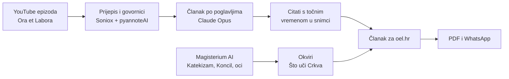
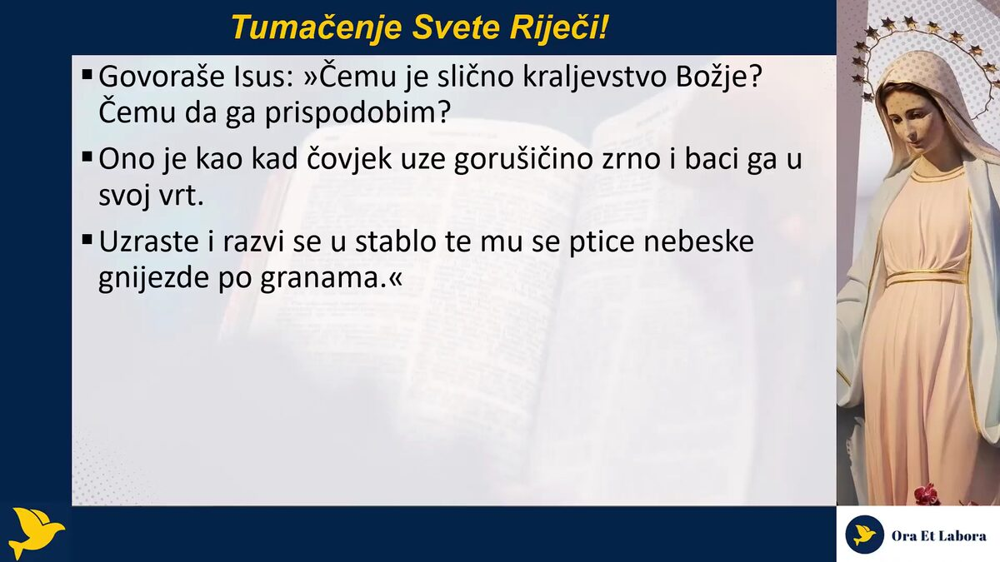
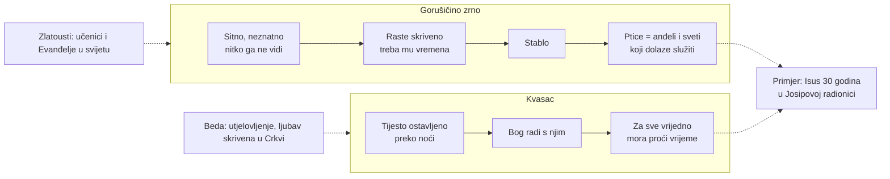
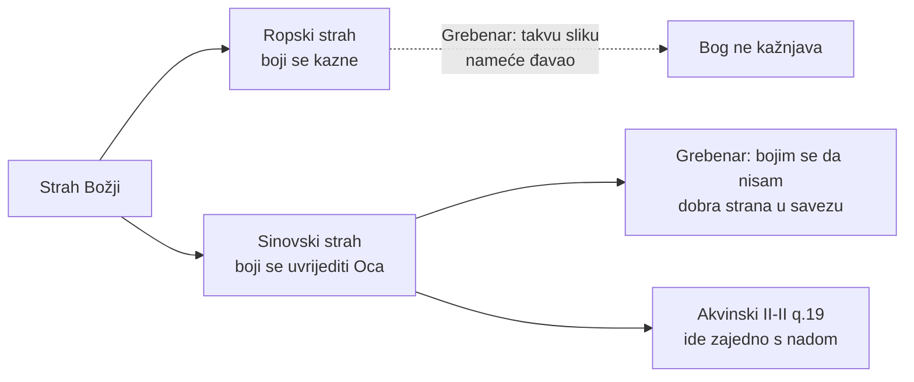
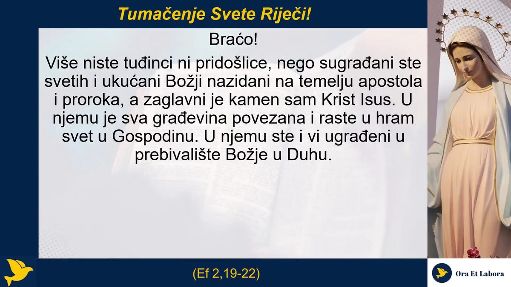
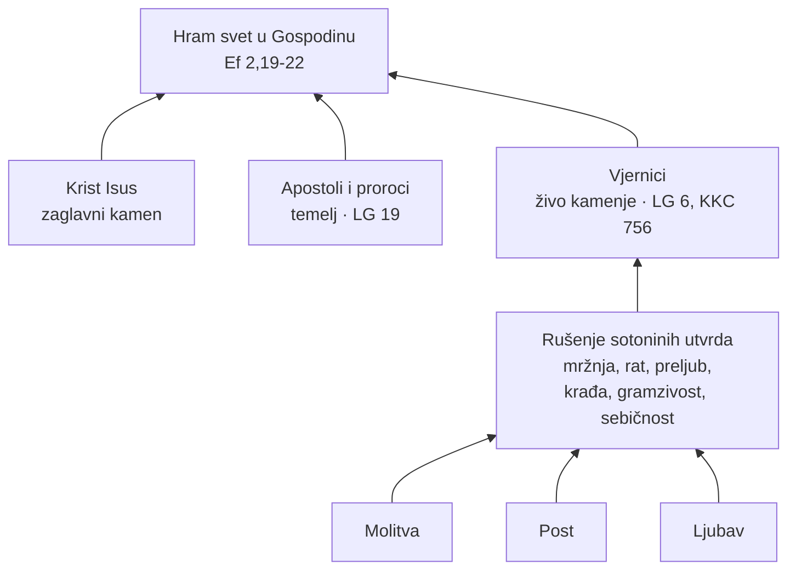
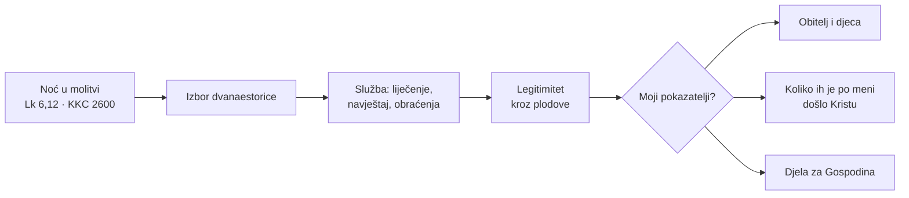

**Što je ovo.** Prijedlog dvaju novinskih članaka za portal **oel.hr**, napisanih iz dviju najnovijih epizoda podcasta Ora et Labora Međugorje (120. i 121., 27. i 28. listopada 2026.). Stil prati članke s rubrike Duhovnost na oel.hr: nadrubrika, naslov, kratki lead, međunaslovi, citati u hrvatskim navodnicima i tagovi na kraju.

**Odakle sadržaj.** Svi citati dr. sc. Vladimira Grebenara doslovno su preuzeti iz prijepisa epizoda (DOMOVINA.ai: Soniox prijepis, pyannoteAI govornici, Opus obrada). Uz svaki je vrijeme u snimci i link na točan trenutak. Okviri **„Što uči Crkva”** novo su znanje koje u epizodi nije izgovoreno, a dohvaćeno je iz **Magisterium AI** (Katekizam, II. vatikanski koncil, pape, crkveni oci), s navedenim izvorom.

DUHOVNOST · TUMAČENJE SVETE RIJEČI

# Grebenar: Bog djeluje kroz ono što svijet ne vidi, a za sve vrijedno treba vremena

Piše: OEL · 27.10.2026.

U 120. epizodi podcasta „Ora et labora Međugorje” dr. sc. Vladimir Grebenar tumačio je prispodobe o gorušičinu zrnu i kvascu (Lk 13,18-21) i govorio o strahu Božjem koji ne znači strah od kazne. Poručio je i da prijateljstvo kršćanina obvezuje na navještaj Krista.

Emisija je, kao i svakoga dana, započela zaštitnom molitvom, posvetom Bezgrešnom Srcu Marijinu i Presvetom Srcu Isusovu, krunicom Božjega milosrđa i žalosnim otajstvima Gospine krunice. U tumačenju svete riječi Grebenar je pošao od Pavlove Poslanice Efežanima o braku kao slici otajstva Krista i Crkve, a zatim od psalma „Blago svakome koji se boji Gospodina”.

## Zrno koje nitko ne vidi

Gorušičino je zrno, podsjetio je Grebenar, toliko sitno da ga nitko ne vidi, a kad padne, ne može ga se naći. Upravo kroz takvo što Bog djeluje.

„Iz Nazareta, može li što dobro izaći?”, citirao je pitanje iz Evanđelja. Božji znakovi, objasnio je, nisu nužno spektakularni. Razlučuju se duhom i srcem: otvorenima se otkrivaju, a drugima ne znače ništa. Zrno raste skriveno i tek kad izraste u stablo, u njemu se gnijezde ptice. Grebenar ih tumači kao **sliku anđela i svetih koji dolaze služiti**.

Prispodoba o kvascu, prema njegovim riječima, govori o vremenu. Žena zamijesi tijesto i ostavi ga preko noći. Ne radi na njemu, nego „Bog radi s njim nešto”.

> „Za nešto veliko, vrijedno, važno, ukusno, pravo mora proći vrijeme.”
> [1:38:00](https://domovina.ai/v/nBPDxzrAW0Q/t/5880)

Primjer je sam Isus, koji je **trideset godina u skrovitosti radio s Josipom u radionici**. Ni susjedi nisu znali da je Mesija dok nije došlo vrijeme.

**Što uči Crkva: gorušičino zrno i kvasac**

Crkveni oci prispodobe čitaju na dvije razine, kao javni rast Kraljevstva i kao njegovo skriveno djelovanje u čovjeku:

- **Sv. Ivan Zlatousti** u zrnu vidi malenu skupinu učenika, a u stablu Evanđelje rašireno po svijetu. Kvasac je tiho djelovanje učenika koji žive i propovijedaju među drugima *(Homilija 46. na Matejevo evanđelje, 2)*.
- **Sv. Beda Časni** u zrnu vidi Kristovo ponizno utjelovljenje, ukop i uskrsnuće, a u granama nauk Crkve u kojemu vjerne duše nalaze počinak. Kvasac je ljubav skrivena u Crkvi koja preobražava cijelog čovjeka *(Komentar Lukina evanđelja, IV.)*.
- **Sv. Ambrozije** (prema *Catena aurea* sv. Tome Akvinskoga) zrno tumači kao Krista, vjeru ili mučenike, ženu kao Crkvu, a kvasac kao Krista.

Grebenarovo čitanje, u kojemu je Bog skriven u neznatnome i ništa vrijedno ne raste bez vremena, tako se izravno nadovezuje na Bedu i Zlatoustoga.

Izvor: Magisterium AI · magisterium.com

## Strah Božji nije strah od kazne

Tumačeći psalam, Grebenar je bez okolišanja rekao: „Ja se bojim Gospodina.” Odmah je pojasnio da se ne boji kazne. Takvu sliku Boga, tvrdi, nameće đavao, „jer je sam takav”, a „Bog ne želi kažnjavati i ne kažnjava”.

Boji se nečeg drugog: **da on nije dobra strana u savezu s Bogom**. Usporedio je to s obiteljskim životom. Teško bi ga pogodilo kad bi mu djeca, koja su u vjeri i vole Isusa, rekla: „Ti nisi bio dobar tata za nas.” [1:00:08](https://domovina.ai/v/nBPDxzrAW0Q/t/3608)

U nastavku je izrekao i najosobniji strah, da mu Gospodin jednoga dana kaže:

> „Bezakoniče, koliki broj ljudi sam poslao da sluša ono zbog čeg sam ti milost dao, a što si ti učinio?”
> [1:12:20](https://domovina.ai/v/nBPDxzrAW0Q/t/4340)

Kao grijehe koje bi mu Bog mogao predbaciti nabrojio je šutnju, pasivnost i nerad, ali i „naslikavanje po društvenim mrežama”.

**Što uči Crkva: sinovski i ropski strah**

Ono što Grebenar opisuje teologija naziva **sinovskim strahom** (*timor filialis*), za razliku od **ropskoga** (*timor servilis*).

- **Sv. Toma Akvinski:** ropski strah boji se kazne, a sinovski strah boji se „počiniti krivnju”, kao što se dijete boji uvrijediti oca *(Summa theologiae II-II, q. 19, a. 2)*. Sinovski strah ide zajedno s nadom: ne boji se da će Bog iznevjeriti nas, nego da bismo se mi mogli udaljiti od njega *(II-II, q. 19, a. 9)*.
- **Papa Franjo:** dar straha Božjega „ne znači bojati se Boga”. To je ponizno i povjerljivo predanje Ocu, koje nas ujedno upozorava na grijeh *(Opća audijencija, 11. lipnja 2014.)*.

Izvor: Magisterium AI · magisterium.com

## Prijateljstvo obvezuje na navještaj

Posebno snažan dio emisije bio je posvećen prijateljstvu s ljudima drugih religija i svjetonazora. Grebenar je pitanje uputio svima, a posebno kleru, koji bi trebao „živjeti za Isusa, a ne od Isusa”.

> „Ako ti nekog zoveš svojim prijateljem, onda tebe to obvezuje da mu navijestiš Krista. To je kršćanstvo na djelu.”
> [1:15:00](https://domovina.ai/v/nBPDxzrAW0Q/t/4500)

Za navještaj, kaže, ponekad je „dovoljna jedna rečenica”, na poslovnom ručku ili u politici. Može ga se dati i znakom, primjerice križanjem prije jela pred sugovornikom. Ili ljubavlju, **kao Majka Tereza**, koja je liječila i prihvaćala hinduse, a oni su po njoj upoznavali Isusa.

> „Žedan je Isus. Žedan je obraćenja ljudi.”
> [1:18:40](https://domovina.ai/v/nBPDxzrAW0Q/t/4720)

Grebenar je u emisiji oštro kritizirao i ono što naziva prihvaćanjem grijeha „u ime tolerancije” u dijelu klera, laika i politike. Istodobno je poručio da osobe koje žive u grijehu ne treba osuđivati, nego im navijestiti Krista i moliti za njih.

## „Kontrolabilnost”: grijeh lažnog katoličanstva

Da bi opisao duh koji ne razumije prispodobe, Grebenar je iz poslovnog svijeta posudio pojam **kontrolabilnost**. Riječ je o katolicima koji bi kontrolirali druge, „pa i samog Isusa i Duha Svetoga”. Prenio je riječi čovjeka koji mu je rekao da je „dobio PTSP od tih kontrola”. Kontrolabilnost je nazvao „užasom i grijehom današnjeg lažnog katoličanstva” i suprotstavio joj Isusove riječi: „Ne brani, tko nije protiv nas, za nas je.” [1:31:15](https://domovina.ai/v/nBPDxzrAW0Q/t/5475)

## Svjedočanstva i poziv muškarcima

Pri kraju emisije pročitana su svjedočanstva slušateljica. Božana piše da joj je muž ozdravio od autoimune bolesti toliko rijetke da u cijeloj Njemačkoj, prema njezinim riječima, ima oko 800 oboljelih. Tereza svjedoči o sestri koja je unatoč karcinomu dojke postila pet dana na nakanu sinova zdravlja: „Ja sam pozvana i odazivam se.” Sinu su potom, piše, vrijednosti u krvi i urinu pale za više od 50 posto. [1:43:30](https://domovina.ai/v/nBPDxzrAW0Q/t/6210)

Grebenar je pozvao muškarce iz Hrvatske, BiH, Njemačke i Austrije na javnu molitvu krunice u **Zagrebu 7. studenoga**, a sve ostale da molitvu pokrenu na trgu svoga mjesta. Ako ne daju moliti na trgu, neka „po dvojica šeću trgom i mole”, jer to im nitko ne može zabraniti.

TAGOVI: Ora et labora Međugorje · Vladimir Grebenar · gorušičino zrno · strah Božji · evangelizacija · Lk 13,18-21 · Isus lider

▶ Cijela epizoda: <a href="https://domovina.ai/v/nBPDxzrAW0Q">domovina.ai/v/nBPDxzrAW0Q</a> · 107 min

DUHOVNOST · TUMAČENJE SVETE RIJEČI

# „Više vrijedi pet obraćenih duša nego pet milijuna pregleda”: kako se gradi hram Božji

Piše: OEL · 28.10.2026.

U 121. epizodi podcasta „Ora et labora Međugorje” dr. sc. Vladimir Grebenar tumačio je Pavlove riječi o Crkvi kao duhovnom hramu i evanđelje o izboru dvanaestorice apostola (Lk 6,12-19). Crkva se, poručio je, gradi rušenjem sotoninih utvrda u ljudskim srcima, a legitimitet daju plodovi.

Nakon molitvenog dijela, slavnih otajstava Gospine krunice i krunice Božjega milosrđa, Grebenar je pročitao odlomak iz Poslanice Efežanima: „Braćo, više niste tuđinci ni pridošlice, nego sugrađani ste svetih i ukućani Božji, nazidani na temelju apostola i proroka, a zaglavni je kamen sam Krist Isus.”

„Taj hram, to je čitava Crkva, braćo i sestre, Crkva Kristova”, sažeo je. [37:10](https://domovina.ai/v/n38M_g__TxQ/t/2230)

## Rušenje sotoninih utvrda

Ključnu misao tumačenja Grebenar je izrekao jednom rečenicom: **„Crkva se gradi tako da se ruše sotonine utvrde.”** Te su utvrde u srcima ljudi: mržnja, želja za ratom, želja za preljubom, želja za krađom, gramzivost i sebičnost. Kad vjernici poste i mole za obraćenje drugih i za narod, utvrde padaju i sve više ljudi prilazi Kristu.

Odatle i kritika mjerila medijskog uspjeha:

> „Više vrijedi pet obraćenih duša nego pet milijuna pregleda nečega na nekom podcastu.”
> [42:55](https://domovina.ai/v/n38M_g__TxQ/t/2575)

Obraćenje je pritom definirao široko: kao rast u vjeri, otvaranje očiju i spoznaju nečega novoga.

**Što uči Crkva: Crkva kao hram od živoga kamenja**

- **II. vatikanski koncil** kaže da je Crkva „sagrađena na apostolima”, a „sam Krist Isus vrhovni je zaglavni kamen” *(Lumen gentium, 19)*. Vjernici su „živo kamenje” ugrađeno u sveti Božji hram *(LG 6)*.
- **Katekizam Katoličke Crkve** naziva Krista kamenom zaglavnim i navodi da je Crkva „sagrađena od apostola”, a vjernici se kao živo kamenje ugrađuju u taj hram *(KKC 756)*. Budući da u Crkvi i njezinim članovima prebiva Duh Sveti, „i kršćani postaju hramovi Duha Svetoga” *(KKC 1197)*.

Grebenarova slika Crkve koja raste obraćenjem pojedinih srdaca tako se oslanja na koncilsku sliku živoga kamenja: hram ne raste zidovima, nego ljudima.

Izvor: Magisterium AI · magisterium.com

## Strog prema grijehu, nježan prema grešniku

Grebenar je jasno povukao granicu u prokazivanju zla. Smije se „uprijeti prstom u grijeh koji netko čini”, ali ne u osobu ili instituciju. Uzor je Isus, koji je osudio grijeh, ali ne i ženu preljubnicu.

> „Treba biti vrlo strog na grijeh, a vrlo nježan i blag prema grešniku.”
> [45:58](https://domovina.ai/v/n38M_g__TxQ/t/2758)

Grešnici su, kaže, ranjeni ljudi kojima treba pomoć, a ne osuda. Osuđeni se čovjek osjeća „kao mačka stjerana u kut”. „Bog nas nije odbacio. Bog je sebe odbacio na križu da bismo mi bili spašeni.”

U jednom od najosobnijih trenutaka emisije voditelj je i sam zamolio slušatelje za oprost: „Žao mi je zbog svih pogrešaka koje činim i koje sam napravio. Uistinu mi je žao. Braćo, ja vas molim da mi oprostite.” Pravilo koje iz toga izvodi glasi: što je javno pogriješeno, treba se javno i pokajati. [44:59](https://domovina.ai/v/n38M_g__TxQ/t/2699)

**Što uči Crkva: milosrđe koje ne odobrava grijeh**

U prizoru sa ženom preljubnicom (Iv 8) Isus spaja milosrđe prema osobi s jasnim odbacivanjem grijeha: „Ni ja te ne osuđujem. Idi i odsada više ne griješi.” Milosrđe ne znači proglasiti grijeh dobrim niti ostaviti čovjeka u njemu. **Sv. Ivan Pavao II.** u homiliji o tom prizoru ističe da su Kristove riječi „Tko je od vas bez grijeha, neka prvi baci kamen na nju” toj ženi spasile život *(Homilija u župi sv. Saturnina, Rim, 12. ožujka 1989.)*.

Izvor: Magisterium AI · magisterium.com

## Post protiv duhova rata

Grebenar je u emisiji podsjetio da zajednica Ora et Labora upravo završava **40-dnevni post protiv rata i duhova rata**. Političke promjene u Srbiji, nakon izbora održanih 25. listopada, povezao je s tim postom i s Gospinim riječima: „Post može zaustaviti ratove.” Pozvao je pritom na oprez. Ovo je, kaže, tek prva i privremena pobjeda, „ima još mnogo utakmica, jako mnogo”. Posljednja Gospina poruka, podsjetio je, upozorava da mržnja i rat vladaju u srcima ljudi i poziva na još jaču molitvu. [39:25](https://domovina.ai/v/n38M_g__TxQ/t/2365)

**Što uči Crkva: molitva i post za mir**

Crkva molitvu, ljubav i post naziva „glavnim putovima koji Bogu omogućuju da djeluje u našim životima i u svijetu” te duhovnim sredstvima kojima vjernici mole za mir *(Acta Apostolicae Sedis, ožujak 2022.)*. **Papa Pio XII.** uči da se pravedan i trajan mir traži Kristovim načelima, provedenima u djelo iskrenom pobožnošću i usmjerenima prema istini, pravdi i ljubavi *(Summi maeroris, 9)*. Post nije zamjena za rad na miru, nego oblikuje čovjeka u obraćenju i ljubavi, bez kojih mira nema.

Izvor: Magisterium AI · magisterium.com

## Apostoli izabrani u molitvi, legitimitet kroz plodove

Evanđelje dana govori o noći koju je Isus proveo u molitvi prije nego što je izabrao dvanaestoricu. Grebenar u tome vidi pravilo za svaku službu: nitko ne bi smio preuzeti mjesto u hijerarhiji ako ga Bog prije toga nije potvrdio. Onome kome se takvo mjesto ponudi savjetuje odgovor: „Moram prvo pitati Gospodina je li volja Božja.” [54:20](https://domovina.ai/v/n38M_g__TxQ/t/3260)

**Što uči Crkva: Isus moli prije odlučnih trenutaka**

**Katekizam** uči da Isus moli prije odlučnih trenutaka svoga poslanja i poslanja apostola, među kojima izričito navodi izbor i poziv dvanaestorice. Ta molitva je „ponizno i pouzdano predanje njegove ljudske volje ljubeznoj volji Očevoj” *(KKC 2600)*. **Benedikt XVI.** primjećuje da su Isusove molitve postajale sve dulje i intenzivnije kad su odluke postajale hitne i složene *(Opća audijencija, 30. studenoga 2011.)*. Broj dvanaest podsjeća na dvanaest Izraelovih plemena: okupljajući dvanaestoricu, Isus naznačuje nastanak novoga Božjeg naroda, Crkve *(KKC 551, Benedikt XVI., 15. ožujka 2006.)*.

Izvor: Magisterium AI · magisterium.com

Isus i apostoli imali su rezultate: liječili su, istjerivali zle duhove, a „more ljudi se obratilo”. „Kad imaš rezultate, oni ti daju legitimitet”, rekao je Grebenar. Usporedio je to s košarkaškom statistikom, nogometnim duelima i završnim financijskim izvještajem poduzetnika. Pokazatelji kršćanina su obitelj, djeca i broj ljudi koji su po njemu došli Kristu. [56:02](https://domovina.ai/v/n38M_g__TxQ/t/3362)

## Strah od prazne stranice

Emisiju je obilježilo svjedočanstvo jedne žene s promocije knjige. Rekla je da se boji trenutka kad Gospodin pred njom otvori knjigu njezina života i upita što je učinila za Njega, a stranica bude **prazna**. Bojala se da će ondje pisati samo da je primala: Tijelo Kristovo, oproštenje grijeha, milosti i radost na duhovnim obnovama. Prisutni su joj zapljeskali. Grebenar je priznao da je njezin kratak govor imao veći učinak od njegova izlaganja: „Nekad Bog progovori preko nas tako snažno i to obrati nekoga.” [1:00:35](https://domovina.ai/v/n38M_g__TxQ/t/3635)

## Promocije i krunica na trgovima

Promocije knjige „Isus lider” nastavljaju se ovaj i idući tjedan: **Drniš** (srijeda, 28. listopada), **Sinj**, hotel Alkar (četvrtak), **Ljubuški**, hotel Bigeste (petak, 30. listopada), **Prozor-Rama**, dvorana HE Rama (subota, 31. listopada), **Biograd na Moru**, hotel Ilirija (ponedjeljak, 2. studenoga), **Solin**, hotel President (utorak, 3. studenoga) i **Imotski**, Pučko otvoreno učilište (srijeda, 4. studenoga). Promocije u Umagu i Pazinu neće se održati, jer se u Pazinu održava duhovna obnova, na koju Grebenar potiče sve da odu. [1:02:00](https://domovina.ai/v/n38M_g__TxQ/t/3720)

Na kraju je ponovio poziv na molitvu krunice na trgu u Zagrebu i na pokretanje molitvenih skupina u vlastitom mjestu, makar ih bilo „dvoje-troje”: „Dat će Bog da naraste, pa će to biti nešto veliko u hrvatskom narodu, veliko za svijet. Već sad jest.”

TAGOVI: Ora et labora Međugorje · Vladimir Grebenar · Crkva kao hram · izbor apostola · post za mir · Lk 6,12-19 · Ef 2,19-22

▶ Cijela epizoda: <a href="https://domovina.ai/v/n38M_g__TxQ">domovina.ai/v/n38M_g__TxQ</a> · 67 min

**Napomena za uredništvo.** Citati su doslovni iz prijepisa, a uz svaki stoji vrijeme u snimci za provjeru. Tvrdnje o politici (Srbija, izbori) prenesene su kao stav voditelja i nisu zasebno provjeravane. Okviri „Što uči Crkva” sažeci su izvora koje je vratio Magisterium AI. Prije objave preporučujemo provjeriti hrvatske službene prijevode citiranih dokumenata (KKC, *Lumen gentium*).

Pripremio Claude (Anthropic) u Claude Code sesiji za DOMOVINA.ai, na zahtjev Matije · 28.10.2026.

