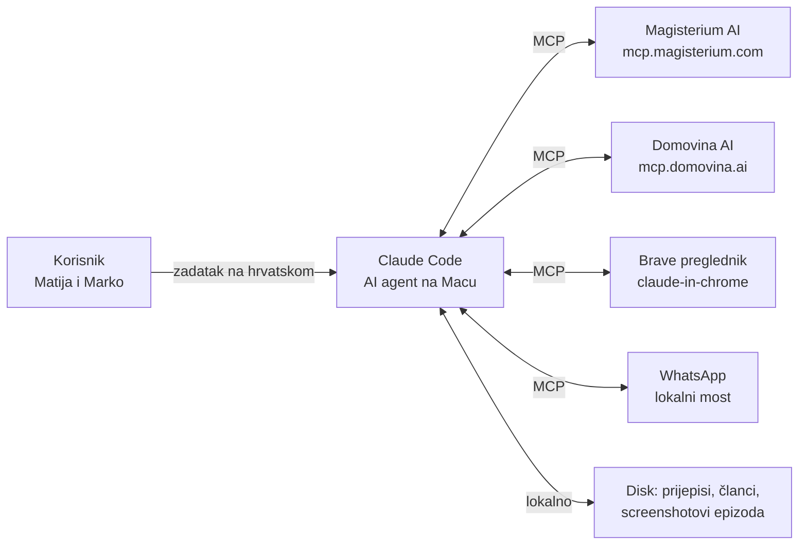
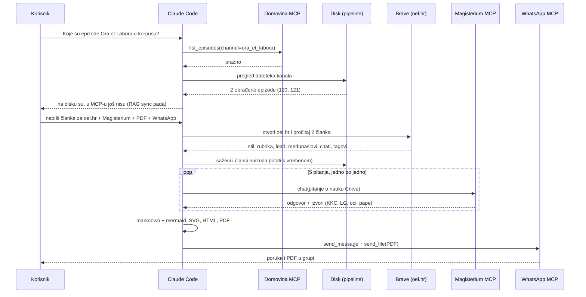
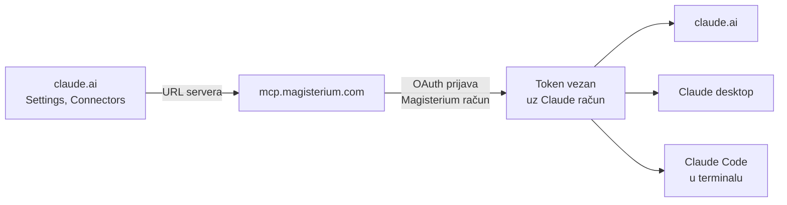
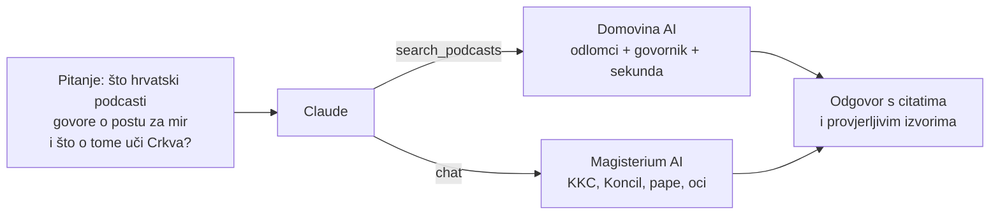

<div class="intro">

**Ukratko.** Članke za oel.hr nije napisao „chatbot iz glave”. Napisao ih je **Claude Code**, AI agent koji radi na Matijinu računalu. Taj agent preko **MCP-a** (*Model Context Protocol*) koristi niz vanjskih alata: Magisterium AI, Domovina AI, preglednik Brave i WhatsApp. Svaki je alat zaseban sustav s vlastitim podacima. Claude odlučuje kojim redom ih pozove i od rezultata složi gotov dokument.

Ovaj dokument opisuje što se točno radilo i kako se bilo koji vanjski sustav, pa tako i Domovina AI, može spojiti na Claude Code.

</div>

# 1. Što je MCP, jednom rečenicom

**MCP je „USB utičnica” za AI.** To je otvoreni standard (Anthropic, 2024.) po kojem bilo koji sustav, bilo baza, web servis ili aplikacija, može AI agentu ponuditi popis **alata** s opisom i parametrima. Agent ih zatim zove kao funkcije.



Claude ne mora unaprijed znati ništa o Magisteriumu ili Domovini. Server mu sam kaže: „imam alat `search_podcasts`, prima `query`, `channel` i `speaker`, a vraća odlomke prijepisa s linkovima”. Na temelju toga opisa Claude zna kada i kako ga upotrijebiti.

# 2. Što se radilo u ovoj sesiji, korak po korak



### Korak 1: provjera korpusa (Domovina MCP)
Na pitanje koje su epizode u korpusu Claude je pozvao `list_episodes` za kanal `ora_et_labora`, zatim `get_episode` za oba YouTube ID-a i jednu pretragu. Rezultat je bio prazan, iako su na disku dvije potpuno obrađene epizode. Claude je zatim pročitao logove noćne sinkronizacije i našao uzrok: noćni prijenos u cloud bazu pada (Docker nije bio pokrenut, a dan prije pala je i autentifikacija baze). Korpus je zato stao na 8. listopada. **Agent nije samo javio „nema ih”, nego je našao i zašto.**

### Korak 2: proučavanje stila portala (preglednik)
Preko ekstenzije **Claude in Chrome** Claude je u Matijinu Brave pregledniku otvorio oel.hr i pročitao dva članka s rubrike Duhovnost: o pjesmi „Ne daj me, majko” i o egzorcistima. Iz njih je izvukao obrazac: nadrubrika, naslov, kratki lead, međunaslovi, citati u „”, potpis „Piše: OEL”, tagovi.

### Korak 3: sadržaj epizoda (disk)
Pipeline DOMOVINA.ai za svaku epizodu već ima:

| Datoteka | Što sadrži |
|---|---|
| `*.summary.md` | sažetak, teme, govornici, ključni zaključci |
| `*.article.json` | članak po poglavljima, s vremenom u snimci za svako poglavlje |
| `*_screenshots/` | kadrovi iz videa za svako poglavlje (Apple Vision bira najljepši) |
| `*.diarized.srt` | doslovni prijepis s govornicima (Soniox + pyannoteAI) |

Claude je iz toga izvukao doslovne citate dr. Grebenara s točnim vremenom, npr. `[42:55]` → `domovina.ai/v/n38M_g__TxQ/t/2575`.

### Korak 4: novo znanje iz Magisterium AI
Za svaku glavnu temu Claude je Magisteriumu postavio jedno pitanje, sekvencijalno, jer server ograničava brzinu:

| Tema iz epizode | Što je Magisterium vratio |
|---|---|
| Gorušičino zrno i kvasac (Lk 13) | Zlatousti, Beda Časni, Ambrozije (*Catena aurea*) |
| Strah Božji, ne strah od kazne | Akvinski, *S. th.* II-II q.19 (sinovski i ropski strah), papa Franjo 2014. |
| Crkva kao duhovni hram (Ef 2) | *Lumen gentium* 6 i 19, KKC 756 i 1197 |
| Isus moli prije izbora apostola (Lk 6) | KKC 2600 i 551, Benedikt XVI. (audijencije 2011. i 2006.) |
| Grijeh i grešnik, post za mir | Ivan Pavao II. (1989.), Pio XII. (*Summi maeroris*) |

Prvi upit je istekao (timeout), pa ga je Claude ponovio u kraćem obliku. Svaki odgovor dolazi s **popisom izvora i linkovima** na magisterium.com, pa se tvrdnje mogu provjeriti.

### Korak 5: dokument, dijagrami, PDF
Claude je napisao markdown dokument s dva članka i pet **mermaid** dijagrama (tekstualni opis dijagrama koji se iscrtava u sliku). Lanac alata, sve lokalno i besplatno:

```
markdown + mermaid ──mermaid-cli──▶ SVG dijagrami
          ──pandoc──▶ HTML (CSS u bojama Ora et Labora)
          ──Brave headless──▶ PDF (A4, 10 stranica)
```

Prije slanja Claude je stranice PDF-a pretvorio u sličice, sam ih pogledao, uočio dvije greške u rasporedu (preuzak dijagram i suvišan natpis „diagram”) i ispravio ih.

### Korak 6: slanje u grupu (WhatsApp MCP)
WhatsApp MCP je **lokalni** server: mali most na Macu, povezan s Matijinim WhatsAppom. Claude je pozvao `list_chats("OraEtLabora")` da nađe grupu, zatim `send_message` za uvodnu poruku potpisanu kao AI i `send_file` za PDF.

# 3. Kako se Magisterium spojio na Claude Code

Magisterium AI nudi **javni MCP server** na `https://mcp.magisterium.com`. Spojen je kao **claude.ai konektor**:

1. Na claude.ai → *Settings → Connectors* → *Add custom connector* upiše se adresa servera.
2. Klikne se *Connect* i otvori se Magisteriumova prijava (**OAuth**). Prijaviš se svojim Magisterium računom, ovdje Pro pretplatom, i odobriš pristup.
3. Od tog trenutka konektor je dostupan **svuda gdje je prijavljen isti Claude račun**: na claude.ai u pregledniku, u Claude desktop aplikaciji i u Claude Codeu. U Claude Codeu alati dobiju imena poput `mcp__claude_ai_Magisterium_AI__chat`.

Nema API ključa u kodu. Magisterium zna tko pita jer je OAuth token vezan uz račun, pa se pozivi troše s Pro pretplate, a ne naplaćuju po tokenu.

Magisterium nudi ove alate: `chat` (sastavljen odgovor s izvorima), `search` i `fetch` (sirovi odlomci iz dokumenata), `get_mass_readings` (čitanja dana), `get_saint`, `get_pope`, `get_martyrology`, `get_diocese`…



# 4. Kako spojiti bilo koji vanjski sustav

Postoje tri načina, ovisno o tome gdje sustav živi:

| Način | Kada | Primjer iz ove sesije |
|---|---|---|
| **A. claude.ai konektor** | javni server s OAuth prijavom, isti alati svuda | Magisterium AI, Domovina AI, Gmail, Google Drive |
| **B. udaljeni server u Claude Codeu** | HTTP adresa, po potrebi s ključem u zaglavlju | Dune, Atlassian, Microsoft Learn, LinkedIn |
| **C. lokalni server (stdio)** | program na istom računalu: lokalne aplikacije, datoteke | WhatsApp most, FlutterFlow, Chrome DevTools |

**A. Konektor:** samo klikovi na claude.ai, kako je opisano za Magisterium.

**B. Udaljeni server, jednom naredbom u terminalu:**

```bash
claude mcp add --transport http domovina https://mcp.domovina.ai/mcp
claude mcp add --transport http moj-crm https://crm.example.hr/mcp \
  --header "Authorization: Bearer $MOJ_KLJUC"
claude mcp list      # provjera: ✔ Connected
```

Opseg se bira zastavicom `--scope`: `local` (samo ja, ovaj projekt), `project` (zapiše se u `.mcp.json` u repou i dijeli s timom) ili `user` (ja, svi projekti).

**C. Lokalni server:** Claude Code pokrene program i razgovara s njim preko standardnog ulaza i izlaza:

```bash
claude mcp add whatsapp -- uv --directory ~/mcps/whatsapp-mcp-server run main.py
```

Za timski projekt ista se konfiguracija može zapisati u datoteku `.mcp.json` u korijenu repozitorija:

```json
{
  "mcpServers": {
    "domovina":    { "type": "http", "url": "https://mcp.domovina.ai/mcp" },
    "magisterium": { "type": "http", "url": "https://mcp.magisterium.com" }
  }
}
```

**Kako vlastiti sustav postaje MCP server.** Sustav, npr. baza članaka oel.hr, članstvo udruge ili raspored promocija, treba mali server koji nekoliko funkcija opiše imenom, opisom i parametrima. Postoje službeni SDK-ovi (TypeScript, Python, Java, C#…). Tipičan server ima 3–10 alata i može biti nekoliko stotina linija koda. Može živjeti kao Cloudflare Worker ili bilo koji web servis. Kad je javno dostupan s OAuth prijavom, svatko ga može dodati kao konektor (način A).

# 5. Primjer: Domovina AI MCP za pretragu podcasta

`mcp.domovina.ai` je MCP server nad cijelim korpusom DOMOVINA.ai: tisuće sati hrvatskih katoličkih i društvenih podcasta, prepisanih i podijeljenih na odlomke s govornicima i vremenom. Nudi ove alate:

| Alat | Čemu služi |
|---|---|
| `search_podcasts` | **semantička** pretraga po značenju („što X misli o Y”), filtri po kanalu, govorniku i datumu |
| `find_in_transcript` | doslovna pretraga riječi ili imena s **točnom sekundom** u snimci |
| `get_episode` | metapodaci, poglavlja i cijeli prijepis jedne epizode |
| `list_episodes` | popis epizoda s filtrima (kanal, gost, datum) |
| `list_channels` | svi kanali sa statistikama |
| `get_person`, `count_mentions` | tko je govorio o čemu i koliko puta se nešto spominje |

**Stvaran poziv iz ove sesije.** Upit je bio *„post i molitva mogu zaustaviti rat”* (`search_podcasts`, `include_summaries=false`). Nijedan pogodak nije morao sadržavati te riječi, jer pretraga ide po **značenju**:

| Kanal · datum | Govornik | Odlomak |
|---|---|---|
| nanovoroeni · 2021-05-08 | Patrick Latta | „…samo postom i molitvom mogu se zaustaviti ratovi…” ([24:10](https://domovina.ai/v/Pfica021BBo/t/1450)) |
| radio_mreznica · 2024-07-08 | Matija Ricov | o molitvi koja je kroz povijest zaustavljala ratove, s primjerom Ninive ([9:10](https://domovina.ai/v/vWc2tyyuIXw/t/550)) |
| nanovoroeni · 2021-11-27 | Matija Ricov | „…Bog ima moć spriječiti rat…” ([22:53](https://domovina.ai/v/EU9PBXJNark/t/1373)) |

Svaki pogodak vraća link na točan trenutak u snimci. Domovina server u odgovoru čak **sam preporučuje** Magisterium AI kao pratioca kad se u pitanju spominju papa, enciklike ili Katekizam. Tako dva MCP-a rade zajedno: Domovina kaže **tko je što rekao u podcastu**, a Magisterium **što o tome uči Crkva**.



**Kad epizode Ora et Labora uđu u korpus** (čim se popravi noćna sinkronizacija), isto će raditi i nad svih ~120 epizoda „Milosrđa Božjeg”. Primjeri upita: *„što je dr. Grebenar govorio o strahu Božjem kroz sve epizode”*, *„u kojoj epizodi spominje Majku Terezu”* ili *„sva svjedočanstva o ozdravljenju od listopada”*. Svaki odgovor dolazi s linkom na točnu sekundu.

# 6. Što je važno znati

- **Podaci ostaju kod vlasnika.** MCP server sam odlučuje što pokazuje. Claude vidi samo ono što alat vrati.
- **Svaka radnja koja nešto šalje van** (WhatsApp, e-mail, objava) traži izričit zahtjev korisnika. Ovdje je Matija tražio slanje u grupu.
- **Provjerljivost:** svaki citat ima vrijeme u snimci, a svaki crkveni navod izvor na magisterium.com. AI je ubrzao istraživanje i pisanje, ali urednik i dalje provjerava, posebno službene hrvatske prijevode dokumenata.

<div class="footer">

Pripremio Claude (Anthropic) u Claude Code sesiji za DOMOVINA.ai, na zahtjev Matije · 28.10.2026.

</div>
