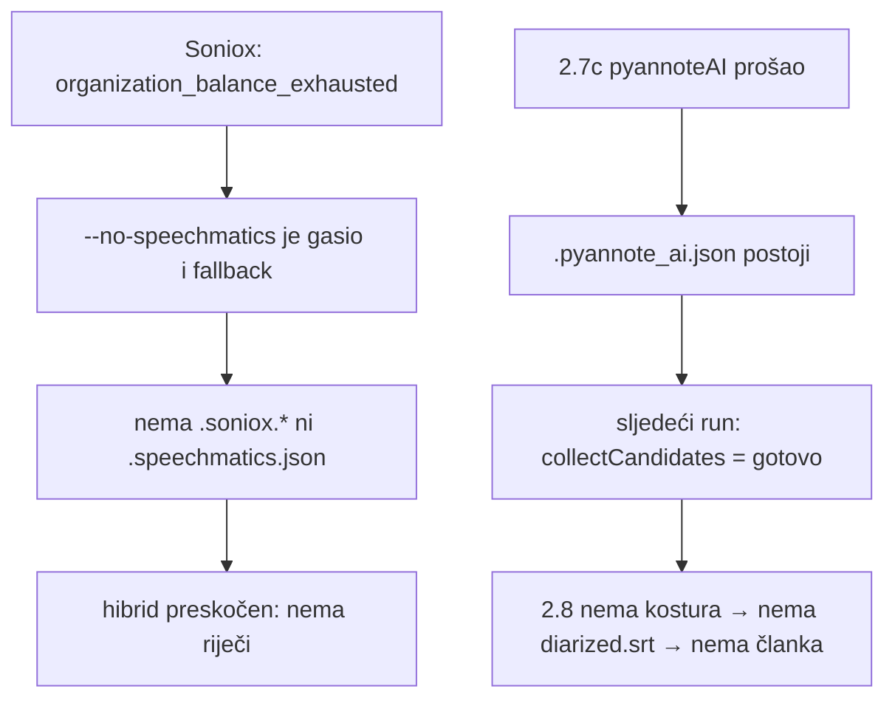

# ASR po tieru: Tier 1 Soniox, Tier 2 Speechmatics (02.11.2026.)

## Odluka

- **Tier 1** = praćeni kanali (`automatic/refresh_podcasts.sh` → `automatic/podcasts/*-lista.txt`,
  nightly). Primarni ASR **Soniox**, Speechmatics je fallback.
- **Tier 2** = sve ostalo što ide kroz pipeline.domovina.ai (obrada svih novih epizoda iz
  `automatic/enqueue_all_new.js`, ručni ⚡ za video koji nije na popisu praćenih).
  Primarni ASR **Speechmatics**, Soniox je fallback.

Soniox krediti su tako rezervirani za nightly. Govornici su u oba tiera pyannoteAI (2.7c).

## Zašto je bila rupa

Jutros (02.11.) je Soniox ostao bez kredita (`organization_balance_exhausted`). 12 epizoda prošlo je
bez ijednog članka, jer su se poklopile dvije odluke:

1. 28.10. `--no-speechmatics` je gasio i KORAK 2.7 i Soniox→Speechmatics fallback u 2.7b, uz
   pretpostavku da je mreža Canary (2.6) + lokalni pyannote (6).
2. 31.10. je lokalna diarizacija ugašena. Canary je i dalje davao tekst, ali bez govornika nije
   bilo `.wav.canary.diarized.srt`, a hibrid 2.7c zna uzeti riječi samo iz Sonioxa ili Speechmaticsa.

## Mehanizam

| Gdje | Što |
|---|---|
| `run_pipeline.sh` | `--no-speechmatics` gasi SAMO KORAK 2.7. Fallback u 2.7b gasi `--no-speechmatics-fallback` / `SPEECHMATICS_FALLBACK=0` |
| `transcribe_soniox.js` | `--primary speechmatics` ili env `ASR_PRIMARY=speechmatics`: prvo Speechmatics, pa Soniox fallback. `.soniox.meta.json` dobije `provider: "speechmatics", tier: 2` |
| `pipeline.domovina.ai/bridge/plan.js` | `isTier2()`: video nije u popisu praćenih → `env.ASR_PRIMARY = 'speechmatics'` |
| `pipeline.domovina.ai/bridge/priority_poller.js` | `tier1Ids()` čita ID-eve iz `automatic/podcasts/*-lista.txt` pri svakom claimu; nečitljiv popis → sve kroz Soniox |

Rubni slučaj: nova epizoda praćenog kanala pokrenuta ručnim ⚡ prije nego je `refresh_podcasts.sh`
upiše u listu ide kao Tier 2.

## Trošak

Procjene iz koda (`SONIOX_USD_PER_HOUR` 0,12, `SPEECHMATICS_USD_PER_HOUR` 0,80 za enhanced; cijene
nisu ponovno provjerene s cjenikom). Tier 2 je ~20 epizoda / ~24 h zvuka dnevno → ~19 $/dan kroz
Speechmatics (~580 $/mj.), naspram ~3 $/dan kroz Soniox. Prijava na Speechmatics Startup Program
(do 50 000 $ kredita) je otvorena; Sonioxu je 02.11. poslan upit za kredite (info@soniox.com).

## Više Speechmatics ključeva (02.11.2026.)

Tier 2 troši Speechmatics ~7× brže od Soniox nightlyja, pa jedan račun brzo ostane bez
kredita. `lib/asr/speechmatics.js` `multiClient()` zato radi preko svih ključeva iz `.env`:

```
SPEECHMATICS_API_KEY=...        # prvi
SPEECHMATICS_API_KEY_2=...      # idući kad se prvi potroši
SPEECHMATICS_API_KEY_3=...
# ili: SPEECHMATICS_API_KEYS=k1,k2,k3 (ide prije gornjih, duplikati se izbacuju)
```

- Ključ se mijenja samo kad račun odbije **slanje** posla: HTTP 401/402/403 ili poruka o
  kreditu/kvoti/naplati. Greška nakon prihvaćenog posla (timeout, `rejected`) se ne ponavlja
  na drugom računu jer nije stvar kredita.
- Odbijen ključ se pamti 12 h (`SPEECHMATICS_EXHAUSTED_TTL_H`) u
  `~/.cache/domovina-pipeline/speechmatics_exhausted.json`, po sha256 otisku (ne sam ključ).
  Idući job ga stavlja na kraj, da ne šalje cijeli MP3 na prazan račun. Kad ključ opet
  prođe (nadoplata), oznaka se briše. Kad su svi označeni, probaju se svi redom.
- `.speechmatics.meta.json` bilježi `key_index` i `key_fingerprint` (koji račun je platio).
- Kad svi ključevi padnu, Tier 2 ide na Soniox fallback, a Tier 1 ostaje bez ASR-a (job pada).
- Testovi: `node --test lib/asr/speechmatics.test.js`.
- `transcribe_speechmatics.js` (KORAK 2.7, evaluacijski, ugašen) koristi prvi ključ s popisa;
  `SPEECHMATICS_API_KEY` bez broja nije obavezan (od 02.11. u `.env` su samo `_2`, `_3`, `_4`).

## Incident 02.11.2026. — tijek i drugi bug (pyannoteAI „gotovo” bez hibrida)



- Pogođeno: 12 ⚡ epizoda noći 02.11. + Goran Ćurković (KLPD-Meu4e8, ponovna obrada).
- Popravak 1 (`5cebe3cf`): fallback odvojen od `--no-speechmatics`. Prve 4 epizode su prošle
  preko Speechmaticsa (~6,40 $).
- Popravak 2 (`bb18d669`): `diarize_pyannote_ai.js` epizodu s `.pyannote_ai.json` smatra gotovom
  tek kad postoji hibrid (`.soniox_pyannote.diarized.srt` / `.speechmatics_pyannote.…`) ili kad još
  nema riječi. Bez toga je ostalih 8 nakon nadoplate Sonioxa (9,93 $) dobilo Soniox prijepis, ali ne i
  članak. Hibrid nad postojećim pyannote izlazom = nula API poziva.
- Sve 13 epizoda gotove 02.11. do 18:18 (članak + Magisterium HR + EN).

## Otvoreno

- **Poller je ponovnu obradu nakon pada pokrenuo kao `--reprocess-article`.** Ćurković job
  (`reprocess=1, redo_article=1`) pao je ujutro na `--replace`; drugi claim (15:40) pokrenuo je samo
  `--reprocess-article KLPD-Meu4e8`, tj. novi članak iz STAROG Canary prijepisa. Ručno je ponovljeno s
  `--reprocess` (Soniox) + `auto_reuse_adhoc.js --replace`. Treba naći u `bridge/plan.js` zašto
  retry bira article-only put (vjerojatno `attempts>0` ili postojeći članak u kanalu).
- Ručne serije (scratchpad `rerun*.sh`) ne prolaze kroz bridge pa ne dobivaju tier: Tier 2 epizode
  idu na Soniox dok im se ne doda `ASR_PRIMARY=speechmatics`.
- Saldo Speechmatics računa vidi se samo na portalu (API ga nema); `/v2/usage` daje potrošnju po računu.
