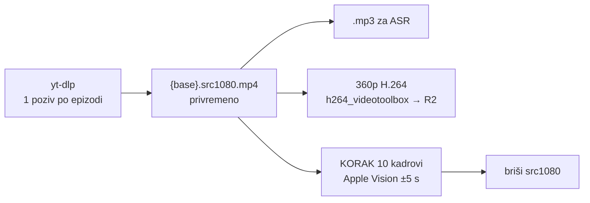

# TODO: jedan 1080p download po epizodi, sve ostalo lokalno

Plan od 03.11.2026. Radi se iterativno, korak po korak, u jednoj ili više sesija.
Svaki korak ima kriterij „gotovo kad” i commita se zasebno. Kvačicu stavi tek kad je
kriterij provjeren na stvarnoj epizodi, ne kad kod prođe sintaksu.

## Zašto

03.11.2026. je 14 od 28 epizoda ostalo **bez ijednog screenshota**, a job je javio
„gotovo”. Uzrok: `screenshot_youtube.js` je dobio stream URL (`--get-url`), ali YouTube
je odbio sam dohvat medija (403). Lokalni fallback se palio samo kad padne dohvat URL-a,
a lokalna kopija je ionako samo **360p** (`fetch.js:31` `bestvideo[height<=360]`,
`run_pipeline.sh:1543` `--max-height 360`). Popravak fallbacka je već u kodu
(`screenshot_youtube.js`, „Stream URL je prošao, a kadrovi nisu”), ali daje 360p kadrove.

Hipoteza (nije izmjerena): YouTube anti-bot okida **broj izvlačenja i isprekidanih
zahtjeva po IP-u**, ne količinu podataka. Danas po epizodi: fetch, screenshot
`--get-url` + desetke seekova po ±5 s (33 sekcije × 21 kandidat), ručni titlovi, reels.
Jedan neprekinut 1080p download izgleda kao obično gledanje.

Isti dan: dvije anti-bot pauze po 2 h (06:13–08:14, 10:02–12:03) pojele su 4 h slota.
Vidi `docs/2026-11-03-dnevni-report-obrade.md`.

## Cilj

- Jedan yt-dlp download po epizodi (1080p, prednost `avc1`).
- MP3, 360p za CDN i svi kadrovi izvode se lokalno iz te datoteke.
- Velika datoteka se briše čim prođe KORAK 10.
- Poller skida iduću epizodu dok trenutna piše članak (prefetch 1 unaprijed), s razmakom
  između yt-dlp poziva.

## Ograničenja koja se ne smiju prekršiti

- **Disk.** 03.11. je slobodno bilo 11 GB, a slot 2 traži ≥ 25 GB. 1080p ≈ 0,5–1 GB/h
  (Tribina 169 min ≈ 3 GB). Prefetch najviše **1** epizoda unaprijed, i samo uz ≥ 15 GB slobodno.
- **Shell `find`/`ls` nad `storage/output/` ne radi iz launchd-a** (macOS TCC). Novi skeneri u Nodeu.
- **Ne brisati wildcardom.** Briše se točno `{base}.src1080.mp4`, jedna imenovana datoteka.
- **Izvedeni fajlovi su signal idempotencije.** Ne smije nastati `.epub` ni og bez kadrova
  (zamka KORAKA 9.8). Brisanje src1080 ne smije pokrenuti ponovni download kod idućeg runa.
- **Tier 1 (nightly) ostaje na starom** dok Tier 2 ne bude provjeren barem jedan dan.
- **Ne pokretati dva pipelinea paralelno** (nema locka). Prefetch je samo `fetch.js`, ne run_pipeline.

## Koraci

### 0. Priprema i mjerenje polazišta
- [ ] Zapiši polazište za Tier 2 iz `docs/2026-11-03-dnevni-report-obrade.md`: anti-bot
      događaja po danu, epizoda bez kadrova, medijan min/ep, vršni disk.
- [ ] Izmjeri na 2–3 epizode (ručno, kroz proxy ako radi): veličina i trajanje 1080p
      downloada (`avc1` vs. AV1), brzina `h264_videotoolbox` 1080p → 360p.
- **Gotovo kad:** brojke su upisane u ovaj dokument (sekcija Mjerenja dolje).

### 1. `fetch.js`: 1080p izvor iza zastavice
- [ ] Nova opcija `FETCH_MAX_HEIGHT` (env) / `--max-height`; default ostaje 360 (ponašanje se ne mijenja).
- [ ] Format za 1080: `bestvideo[height<=1080][vcodec^=avc1]+bestaudio/bestvideo[height<=1080]+bestaudio/best[height<=1080]`.
- [ ] Izlaz `{base}.src1080.mp4` (mp4 kontejner kad je avc1; inače mkv i to piše u log).
- [ ] MP3 se radi iz te datoteke, bez drugog downloada.
- [ ] `_unlisted-state.json` / `downloaded()` poštuju novu datoteku (poller ne smije misliti da nije skinuto).
- **Gotovo kad:** `fetch.js --unlisted-url … --max-height 1080` na jednoj epizodi daje
  src1080 + mp3 jednim yt-dlp pozivom (provjeri u logu da je `[youtube] Extracting URL` jednom).

### 2. 360p za CDN iz lokalne datoteke
- [ ] Nađi gdje nastaje 360p koji ide na R2 (Beamly video download, `run_pipeline.sh:1543`,
      `BEAMLY_DL_ARGS`) i dodaj granu: ako postoji src1080 → `ffmpeg -c:v h264_videotoolbox`
      → isti izlazni naziv i format kao sada (H.264, ciljni TV-i: memorija `target_tv_devices_decode`).
- [ ] fmp4 pravila ostaju ista (`-frag_interleave` + `+cmaf`, memorija `fmp4_needs_frag_interleave`).
- **Gotovo kad:** 360p iz src1080 se reproducira na domovina.ai (seek radi), a log nema drugog yt-dlp poziva za video.

### 3. Screenshotovi iz lokalnog 1080p
- [ ] `screenshot_youtube.js`: redoslijed izvora = lokalni ≥ 720p → yt-dlp stream (zadnja
      rezerva) → lokalni 360p. `findBestLocalVideo` mora vidjeti `src1080`.
- [ ] U `_manifest.json` zapisati izvor (`source: local-1080 | stream | local-360`).
- [ ] Provjeri da Apple Vision ±5 s radi s lokalnim izvorom jednako brzo ili brže.
- **Gotovo kad:** epizoda s 30+ sekcija dobije sve kadrove bez ijednog `googlevideo.com`
  zahtjeva, a `_manifest.json` kaže `local-1080`.

### 4. Čišćenje src1080
- [ ] Novi mali korak iza KORAKA 10 (i iza 9.6 og-sections, koji radi iz PNG-ova):
      briše `{base}.src1080.mp4` **samo ako** su svi kadrovi iz manifesta na disku.
- [ ] Ako kadrova fali, datoteka ostaje i u log ide upozorenje (da se može ponoviti bez downloada).
- [ ] Idući run ne smije ponovno skinuti 1080p samo zato što src1080 više nema (gate po
      `_manifest.json` / postojećim kadrovima, ne po postojanju src1080).
- **Gotovo kad:** nakon runa src1080 nema, kadrovi i 360p su na CDN-u, ponovni run ne zove yt-dlp.

### 5. Brava za yt-dlp
- [ ] Jedna globalna brava (`~/.cache/domovina-pipeline/ytdlp.lock`, PID + vrijeme, stara
      brava se preuzima nakon N min) za `fetch.js`, `screenshot_youtube.js` (stream rezerva),
      `automatic/fetch_youtube_subs.js`, `render_reels.js`.
- [ ] Uz bravu zapiši `last_ytdlp_end_at` za razmak u koraku 6.
- **Gotovo kad:** dva paralelna pokušaja downloada čekaju jedan drugog (test s dva terminala).

### 6. Prefetch u `priority_poller.js` (pipeline.domovina.ai)
- [ ] U svakom ticku, dok slot radi: uzmi prvi `queued` prioritetni job koji nije
      `downloaded()` i pokreni samo `fetch.js` za njega (ne run_pipeline), ako:
  - nijedan yt-dlp ne radi (brava iz koraka 5),
  - od `last_ytdlp_end_at` je prošlo ≥ 3 min + slučajno 0–2 min,
  - trenutni job je izašao iz downloada (npr. postoji njegov `.mp3` / ASR meta),
  - slobodno ≥ 15 GB,
  - nema aktivne anti-bot pauze (ili radi proxy, onda kroz proxy).
- [ ] Prefetch ne claima job (ostaje `queued`); claim i run ide kao do sada, fetch ga preskoči.
- [ ] Ako prefetch padne na anti-bot: isti marker kao `fetch.js` → pauza i retry nakon
      pauze (`retryAfterPause`, uvedeno 03.11.) vrijede bez promjene.
- **Gotovo kad:** u logu se vidi download epizode N+1 dok epizoda N piše članak, a
  razmak između yt-dlp poziva je ≥ 3 min.

### 7. Uključivanje za Tier 2
- [ ] `plan.js`: za Tier 2 (`ASR_PRIMARY=speechmatics` grana, `bridge/plan.js:148`)
      postavi `FETCH_MAX_HEIGHT=1080`. Test u `plan.test.js`.
- [ ] Jedan dan rada, pa dnevni report kao `docs/2026-11-03-dnevni-report-obrade.md`
      (skripta za generiranje je bila u scratchpadu; po potrebi je prebaci u `tools/`).
- **Gotovo kad:** usporedba s polazištem iz koraka 0 je upisana dolje.

### 8. Odluka za Tier 1 (nightly) i reels
- [ ] Ako Tier 2 dan prođe bolje (manje anti-bota, 0 epizoda bez kadrova, disk OK),
      uključi i nightly.
- [ ] Reels: može li `render_reels.js` koristiti src1080 umjesto vlastitog yt-dlp isječka
      (traži odgodu brisanja do reelsa, samo kanali s brandom). Za početak ostaje kako jest.

## Mjerenja

| što | prije (03.11.) | poslije |
|---|---|---|
| anti-bot događaja / dan (Tier 2) | 2 (+ 4 h pauze) | |
| epizoda bez kadrova | 14 / 28 | |
| rezolucija kadrova | stream ≤ 1080p ili ništa | |
| medijan obrade min/ep | 14 | |
| vršni slobodni disk | 4–19 GB | |
| 1080p download, MB/h i trajanje | – | |
| h264_videotoolbox 1080p → 360p, s/h | – | |

## Već napravljeno 03.11.2026. (prije ovog plana)

- `screenshot_youtube.js`: kadrovi koji padnu iz streama ponove se iz lokalne kopije.
- `lib/audio_silence.js` + `transcribe_soniox.js`: tihi zvuk (≤ -80 dB) → `{base}.silent.json`, bez ASR-a.
- `priority_poller.js`: `.silent.json` → job `failed` („video nema zvuka”); `retryAfterPause`
  pokreće `enqueue_all_new.js --retry-only` jednom po anti-bot događaju.
- `enqueue_all_new.js --retry-only`.
- Ponovni kadrovi za 14 epizoda kroz `tools/refresh_screenshots.sh`.
