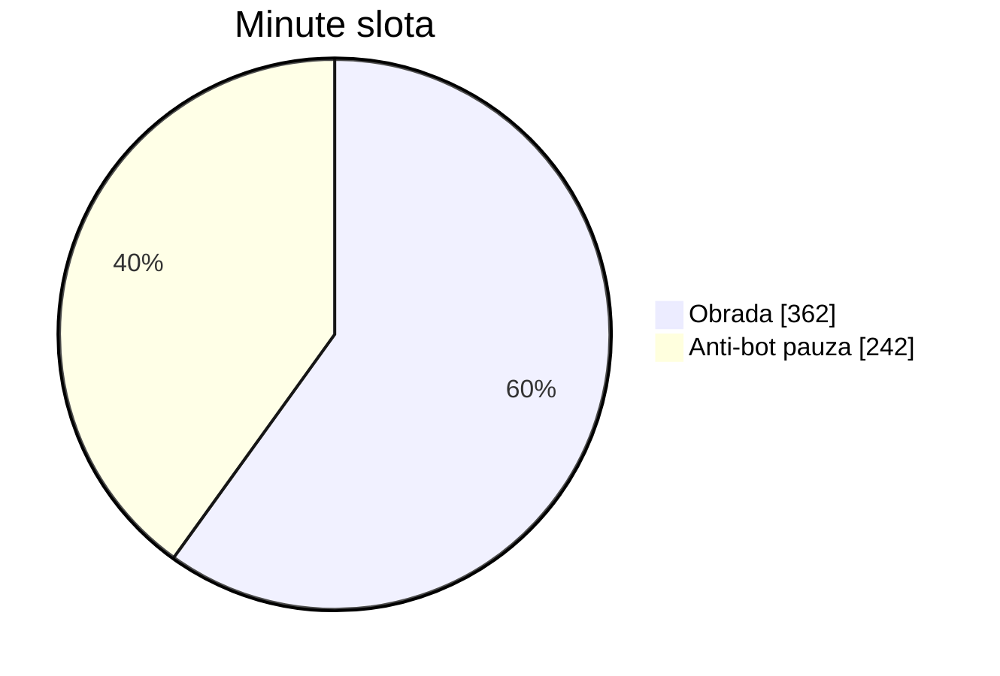

# Dnevni report obrade, 03.11.2026.

Stanje u 14:02 (CET). Izvori: API `pipeline.domovina.ai` (`/api/jobs`: vrijeme slanja, preuzimanja i kraja svakog posla), `automatic/logs/magisterium_2026-11-03.log` i `magisterium-en_2026-11-03.log` (početak i kraj ticka), `automatic/logs/nightly_2026-11-03.log`, `automatic/logs/priority_2026-11-03.log` (pauze). Sva vremena su po lokalnom vremenu (CET).

## Sažetak

- **Obrađeno 27 epizoda s člankom:** 4 iz nightlyja (praćeni kanali, 03:00–04:10) i 23 iz prioritetnog reda (`enqueue_all_new.js`, nepraćeni kanali, poslano u 03:59).
- **Još u radu:** 2 (`VOcypz9_Ofo` radiobenkovac, stanje `transcribing`; `K6eYb4JMuIM` Hrvatska radiotelevizija, stanje `fetching`).
- **Palo:** 2, oba na YouTube anti-botu (`KyMHBGFS5Gc` PSIHOLOGiJA HRT, `cs5GMSWgbxs` Tribina).
- **Magisterium HR:** 21 epizoda, 300 MCP poziva, medijan 9 min po epizodi. **EN prijevod:** 27 epizoda, medijan 3 min.
- **Audio obrađen u prioritetnom redu:** 21.1 h; obrada po epizodi medijan **14 min** (od preuzimanja do kraja posla).
- **Slot je 4 h stajao** zbog dvije anti-bot pauze od 2 h (06:13–08:14 i 10:02–12:03). Bez njih bi red bio gotov oko 4 h ranije, otprilike do 10 h.
- Svi poslovi u redu imaju `source=api` i nijedan nema `api_key_name`, dakle sve je poslala vlastita automatika (`PIPELINE_QUEUE_INGEST_KEY`). Vanjskih ključeva nema.

## Pregled dana po trakama

```mermaid
gantt
    title Rad po trakama, 03.11.2026. (CET)
    dateFormat HH:mm:ss
    axisFormat %H:%M
    section Nightly
    Nightly pipeline (4 clanka) :done, 03:00:05, 04:10:19
    enqueue_all_new salje 27 poslova :milestone, 03:59:08, 0s
    section Prioritetni slot
    Obrada blok 1 (7 ep) :done, 04:00:27, 06:13:38
    Obrada blok 2 (11 ep) :done, 08:14:22, 10:03:11
    Obrada blok 3 (9 ep) :active, 12:03:02, 14:02:47
    section Anti-bot pauza
    Pauza 2 h (screenshot B59glGW0usU) :crit, 06:13:38, 08:14:22
    Pauza 2 h (fetch cs5GMSWgbxs) :crit, 10:02:11, 12:03:02
    section Magisterium HR
    21 epizoda, tick svakih 10 min :done, 04:02:44, 13:44:57
    section EN prijevod
    27 epizoda, tick svake 2 min :done, 03:57:59, 13:55:14
```

## Prioritetni red, po epizodi

Bar traje od trenutka kad je slot preuzeo posao (`claimed_at`) do kraja (`done_at`). Svi poslovi su u red stigli između 03:59:08 i 03:59:15.

```mermaid
gantt
    title Obrada epizode (download, Soniox, pyannoteAI, Opus, R2)
    dateFormat HH:mm:ss
    axisFormat %H:%M
    section Prioritetni red
    Atma 103m :done, 04:00:27, 04:26:28
    Kriminalno dobre priče 42m :done, 04:26:29, 04:40:15
    Tetka Škrti Otočanin 32m :done, 04:40:17, 04:50:59
    Denis Podcast 68m :done, 04:50:59, 05:10:56
    bijelo plavi 79m :done, 05:10:57, 05:29:17
    Podcast Inkubator 145m :done, 05:29:18, 05:59:51
    Ofenziva - Sportski podcast 51m :done, 05:59:52, 06:13:38
    Ofenziva - Sportski podcast 107m :done, 08:14:22, 08:38:51
    Sportske novosti 53m :done, 08:45:17, 08:59:21
    SBS Audio 48m :done, 08:51:55, 09:05:29
    PSIHOLOGiJA HRT 0m :crit, 08:59:22, 09:00:22
    Telegram.hr 24m :done, 09:05:29, 09:14:41
    Hajdučka štorija 15m :done, 09:11:38, 09:20:49
    Podcast s Brezom 57m :done, 09:17:45, 09:34:37
    Novi radio Zadar 31m :done, 09:23:53, 09:40:46
    VIDA 57m :done, 09:34:37, 09:51:29
    Lider 42m :done, 09:51:30, 10:02:11
    Tribina 0m :crit, 10:02:11, 10:03:11
    Jutarnji list 34m :done, 12:03:02, 12:15:18
    Večernji TV 64m :done, 12:15:18, 12:33:41
    Nađi Način 27m :done, 12:33:41, 12:45:57
    radiobenkovac 50m :active, 12:45:57, 14:02:47
    Hrvatska radiotelevizija 36m :done, 12:52:06, 13:04:24
    HRT vijesti 33m :done, 13:04:24, 13:15:09
    LaudatoTV 76m :done, 13:15:10, 13:36:38
    LaudatoTV 44m :done, 13:36:38, 13:50:27
    Hrvatska radiotelevizija 0m :active, 13:50:28, 14:02:47
```

## Magisterium HR i EN prijevod, po epizodi

Bar je trajanje ticka u kojem je epizoda obrađena (HR tick obradi jednu epizodu, pa je to vrijeme epizode). Prva četiri EN reda prije 04:30 su nightly epizode.

```mermaid
gantt
    title Magisterium HR i EN prijevod
    dateFormat HH:mm:ss
    axisFormat %H:%M
    section Magisterium HR
    Ora et Labora (16 poz.) :done, 04:02:44, 04:20:35
    Atma (26 poz.) :done, 04:30:35, 04:57:05
    Kriminalno dobre priče (13 poz.) :done, 05:07:05, 05:16:32
    Tetka Škrti Otočanin (10 poz.) :done, 05:26:32, 05:32:18
    Denis Podcast (18 poz.) :done, 05:42:19, 05:52:07
    bijelo plavi (17 poz.) :done, 06:02:07, 06:10:44
    Podcast Inkubator (29 poz.) :done, 06:20:44, 06:42:50
    Ofenziva - Sportski podcast (12 poz.) :done, 06:52:50, 07:01:20
    Ofenziva - Sportski podcast (21 poz.) :done, 08:53:44, 09:08:35
    Sportske novosti (14 poz.) :done, 09:18:36, 09:27:32
    Telegram.hr (6 poz.) :done, 09:37:32, 09:41:18
    SBS Audio (16 poz.) :done, 09:51:18, 10:01:35
    Hajdučka štorija (8 poz.) :done, 10:11:35, 10:16:05
    Novi radio Zadar (8 poz.) :done, 10:26:06, 10:31:17
    Podcast s Brezom (17 poz.) :done, 10:41:18, 10:50:36
    VIDA (13 poz.) :done, 11:00:36, 11:07:37
    Lider (8 poz.) :done, 11:17:39, 11:22:03
    Jutarnji list (15 poz.) :done, 12:32:13, 12:47:57
    Nađi Način (9 poz.) :done, 12:57:57, 13:07:05
    Večernji TV (14 poz.) :done, 13:17:06, 13:25:03
    HRT vijesti (10 poz.) :done, 13:35:04, 13:44:57
    section EN prijevod
    Mreže riječi :done, 03:57:59, 03:59:47
    Na Novo Rođeni :done, 04:01:48, 04:05:36
    Podcast Čušpajz :done, 04:07:36, 04:09:28
    Atma :done, 04:23:42, 04:27:10
    Ora et Labora :done, 04:29:11, 04:32:32
    Kriminalno dobre priče :done, 04:40:39, 04:42:59
    Tetka Škrti Otočanin :done, 04:51:06, 04:53:06
    Denis Podcast :done, 05:11:24, 05:14:09
    bijelo plavi :done, 05:28:21, 05:31:12
    Podcast Inkubator :done, 05:57:37, 06:02:04
    Ofenziva - Sportski podcast :done, 06:12:12, 06:14:22
    Ofenziva - Sportski podcast :done, 08:37:49, 08:42:55
    Sportske novosti :done, 08:57:58, 09:01:01
    SBS Audio :done, 09:07:06, 09:09:43
    Hajdučka štorija :done, 09:21:55, 09:23:51
    Podcast s Brezom :done, 09:34:01, 09:36:58
    Novi radio Zadar :done, 09:41:01, 09:42:57
    Telegram.hr :done, 09:44:58, 09:47:30
    VIDA :done, 09:51:33, 09:54:24
    Lider :done, 10:02:32, 10:05:08
    Jutarnji list :done, 12:15:25, 12:17:57
    Večernji TV :done, 12:34:12, 12:36:44
    Hrvatska radiotelevizija :done, 13:05:18, 13:07:55
    Nađi Način :done, 13:09:55, 13:13:14
    LaudatoTV :done, 13:35:39, 13:39:20
    HRT vijesti :done, 13:45:25, 13:49:22
    LaudatoTV :done, 13:53:25, 13:55:14
```

## Tablica po epizodi

| # | video | kanal | audio | preuzeto | gotovo | obrada | Mag HR | EN | naslov |
|---|---|---|---|---|---|---|---|---|---|
| 1 | `LRmW5VuwfcY` | Mreže riječi | – | nightly | ≤ 04:10 | – | nema HR Mag. posla | 03:57–03:59 | nightly, praćeni kanal |
| 2 | `NHqYXf_xg6o` | Na Novo Rođeni | – | nightly | ≤ 04:10 | – | nema HR Mag. posla | 04:01–04:05 | nightly, praćeni kanal |
| 3 | `_MfD9go1CEs` | Ora et Labora | – | nightly | ≤ 04:10 | – | 04:02–04:20 (18 min) | 04:29–04:32 | nightly, praćeni kanal |
| 4 | `-RhxbJ7JA80` | Podcast Čušpajz | – | nightly | ≤ 04:10 | – | nema HR Mag. posla | 04:07–04:09 | nightly, praćeni kanal |
| 5 | `v6lxl5Qtc5k` | Atma | 103 min | 04:00 | 04:26 | 26 min | 04:30–04:57 (27 min) | 04:23–04:27 | BOG JE U NAMA! Najveća istina koju su mnogi zabora |
| 6 | `W7IE2hP0ups` | Kriminalno dobre priče | 42 min | 04:26 | 04:40 | 14 min | 05:07–05:16 (9 min) | 04:40–04:42 | 456. epizoda Obitelj Puskas |
| 7 | `ldKMsUBmWJU` | Tetka Škrti Otočanin | 32 min | 04:40 | 04:50 | 11 min | 05:26–05:32 (6 min) | 04:51–04:53 | Pregled listopada 2026. FIRE Podcast za siromašne  |
| 8 | `64C4iXiJizs` | Denis Podcast | 68 min | 04:50 | 05:10 | 20 min | 05:42–05:52 (10 min) | 05:11–05:14 | HNL LIVE / Mario Kovačević više nije trener Dinama |
| 9 | `9Qgyp4YLzFs` | bijelo plavi | 79 min | 05:10 | 05:29 | 18 min | 06:02–06:10 (9 min) | 05:28–05:31 | Bijelo-plavi podcast 263 Čudotvorac |
| 10 | `wJc7ORQIIU8` | Podcast Inkubator | 145 min | 05:29 | 05:59 | 31 min | 06:20–06:42 (22 min) | 05:57–06:02 | Podcast Inkubator 1508 - Marko Hambi i Leonard Pij |
| 11 | `B59glGW0usU` | Ofenziva - Sportski podcast | 51 min | 05:59 | 06:13 | 14 min | 06:52–07:01 (9 min) | 06:12–06:14 | Krepat ma ne molat Rijeka - Varaždin 1 1 |
| 12 | `ZCkXKQeFZZk` | Ofenziva - Sportski podcast | 107 min | 08:14 | 08:38 | 24 min | 08:53–09:08 (15 min) | 08:37–08:42 | Adria Slipstream F1 podcast VN Meksika - Kimi Anto |
| 13 | `MdT-RZY6LKE` | Sportske novosti | 53 min | 08:45 | 08:59 | 14 min | 09:18–09:27 (9 min) | 08:57–09:01 | Var soba 12 Kovačević osuđen na propast. Oscar Gar |
| 14 | `kqpmSSGlhyo` | SBS Audio | 48 min | 08:51 | 09:05 | 14 min | 09:51–10:01 (10 min) | 09:07–09:09 | Program SBS-a na hrvatskom za utorak 3.11.2026. |
| 15 | `KyMHBGFS5Gc` | PSIHOLOGiJA HRT | 0 min | 08:59 | – | ❌ prioritetni download nije uspio (private | – | – | S3E09 PSIHOLOGiJA 90 Burnout ( Krunoslav Nujić i d |
| 16 | `bmHAbHIoIh8` | Telegram.hr | 24 min | 09:05 | 09:14 | 9 min | 09:37–09:41 (4 min) | 09:44–09:47 | Počinje Trumpov kraj Putin mu je zadnja nada |
| 17 | `zm_LgSdLlRI` | Hajdučka štorija | 15 min | 09:11 | 09:20 | 9 min | 10:11–10:16 (5 min) | 09:21–09:23 | KORAK PO KORAK Hajduk ima 26 bodova iz 12 utakmica |
| 18 | `U6aJFkZIins` | Podcast s Brezom | 57 min | 09:17 | 09:34 | 17 min | 10:41–10:50 (9 min) | 09:34–09:36 | JANJIĆ Srpski svet je srušen padom Vučića Srbija i |
| 19 | `UzP7C3tuVM0` | Novi radio Zadar | 31 min | 09:23 | 09:40 | 17 min | 10:26–10:31 (5 min) | 09:41–09:42 | ZADARSKI PODCAST 17 - JURE BRKLJAČA |
| 20 | `b_wBAxXlKN4` | VIDA | 57 min | 09:34 | 09:51 | 17 min | 11:00–11:07 (7 min) | 09:51–09:54 | Zavidavanje by Lado Tomičić 174 - Dinko Gruhonjić |
| 21 | `78WYAXS007Q` | Lider | 42 min | 09:51 | 10:02 | 11 min | 11:17–11:22 (4 min) | 10:02–10:05 | Način na koji proizvodimo HRANU mora se promijenit |
| 22 | `cs5GMSWgbxs` | Tribina | 0 min | 10:02 | – | ❌ YouTube anti-bot (Sign in to confirm) —  | – | – | Noć vještica |
| 23 | `l5d8dtQHi0w` | Jutarnji list | 34 min | 12:03 | 12:15 | 12 min | 12:32–12:47 (16 min) | 12:15–12:17 | Ivan Zidarević Vučić ne želi opet nositi gajbe iza |
| 24 | `QPlihbO2m90` | Večernji TV | 64 min | 12:15 | 12:33 | 18 min | 13:17–13:25 (8 min) | 12:34–12:36 | Čovjek koji je presudio Kovačeviću Danas je on sut |
| 25 | `u9VdoOKmZ4g` | Nađi Način | 27 min | 12:33 | 12:45 | 12 min | 12:57–13:07 (9 min) | 13:09–13:13 | Cijena uspjeha koju odbijam platiti Poduzetništvo  |
| 26 | `VOcypz9_Ofo` | radiobenkovac | 50 min | 12:45 | – | ⏳ transcribing | – | – | Superznalac Benkovac - gost gđa. Cecilija Jureško |
| 27 | `UmbclKm2who` | Hrvatska radiotelevizija | 36 min | 12:52 | 13:04 | 12 min | ⏳ running | 13:05–13:07 | Što je klasik? Nietzsche s Trešnjevke |
| 28 | `mKWl-fmeWmk` | HRT vijesti | 33 min | 13:04 | 13:15 | 11 min | 13:35–13:44 (10 min) | 13:45–13:49 | Otvoreno Može li se ponoviti fenomen Miše Kovača? |
| 29 | `fOepT80TVz0` | LaudatoTV | 76 min | 13:15 | 13:36 | 21 min | ⏳ queued | 13:35–13:39 | Zoran Vakula i fr. Dominik Iličić Novi Život |
| 30 | `1CAJX0za5FU` | LaudatoTV | 44 min | 13:36 | 13:50 | 14 min | ⏳ queued | 13:53–13:55 | Obitelj Grgić In Familia Dei |
| 31 | `K6eYb4JMuIM` | Hrvatska radiotelevizija | 0 min | 13:50 | – | ⏳ fetching | – | – | Na rubu znanosti Junak s tisuću lica |

## Gdje je otišlo vrijeme prioritetnog slota (04:00 → sada)

## Uočeno usput

1. **Anti-bot pauze su glavni gubitak.** Dvaput je YouTube tražio prijavu (`Sign in to confirm`) i slot je oba puta stao na 2 h. U logu piše i `YouTube proxy http://100.71.146.11:8888 ne odgovara — idem bez njega`, dakle iPhone proxy preko Tailscalea danas nije bio dostupan.
2. **EN posao `KLPD-Meu4e8` vrti se u krug svake 2 min.** `enqueue_en_new.js` ga stavi u red (`_unlisted`, 02.11.), poller nađe artefakt na CDN-u i odmah ga označi `done`, ali lokalno se ne pojavi `.article.en.json`, pa ga idući tick opet stavi u red. Danas već **168 takvih redaka** u D1. CPU troši zanemarivo, ali puni tablicu: `/api/magisterium?limit=…` vraća najviše 200 redaka, pa su HR Magisterium poslovi od prije 06:50 već ispali iz liste. Zato su vremena za Magisterium u ovom reportu uzeta iz logova.
3. **`VOcypz9_Ofo` (radiobenkovac) je u stanju `transcribing` od 12:46.** Slot je krenuo dalje u 12:52, dakle transkripcija ide asinkrono. Vrijedi provjeriti ako se ne završi.
4. Nightly je završio s `audit_pipeline.js` exit 1 (rupe disk ↔ CDN). Pipeline zbog toga ne staje.
