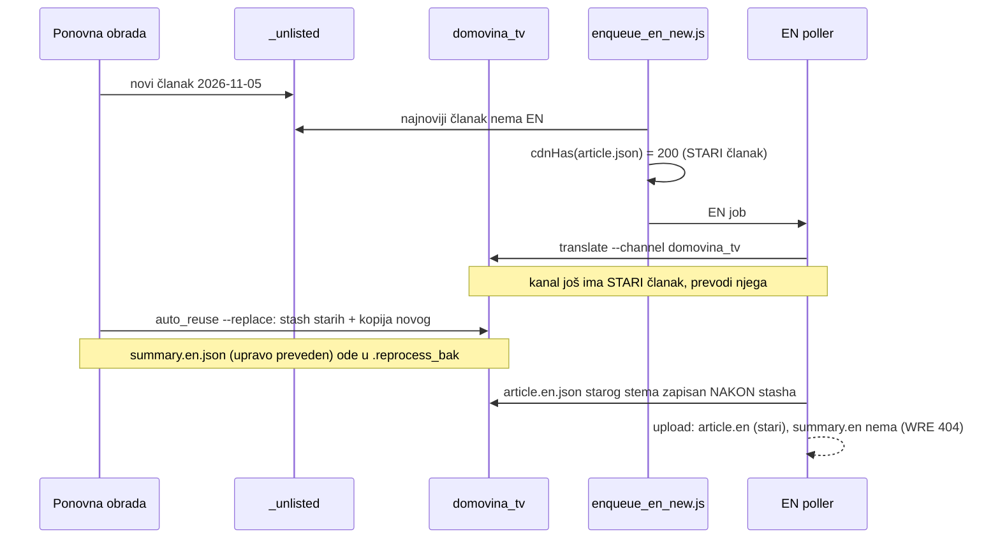

# EN preveden iz starog HR članka nakon ponovne obrade (05.11.2026.)

## Ukratko

Pet domovina_tv epizoda je 05.11. ponovno obrađeno (🔁 Ponovna obrada: novi Soniox prepis,
novi Opus članak i sažetak, novi HR Magisterium). EN traka ih je odmah prevela, ali iz
**starog** HR članka. Na CDN-u su zato `article.en.json`, `summary.en.json` i
`article.magisterium.en.json` imali `generated_at` starog članka (07-31, 03-27, 03-20) i drugi
broj sekcija (b-nls1ck8EE: HR 57, EN 28). Seek po poglavljima na EN-u je zato skakao na
krivo mjesto. WRE248YCIeI je usto ostao bez `summary.en.json` (404).

| Video | HR članak (novi) | EN prije popravka |
|---|---|---|
| WRE248YCIeI | 2026-11-05T09:30 | article.en 2026-07-31, summary.en 404, Mag EN 404 |
| fO7iltytw0I | 2026-11-05T09:48 | article.en 2026-07-31 (CDN od 06.10.), summary.en 05-27 |
| AoXN-3Mkmew | 2026-11-05T10:10 | article.en 2026-03-27 |
| b-nls1ck8EE | 2026-11-05T10:42 | article.en 2026-03-27 |
| oxq1U0xypu8 | 2026-11-05T11:14 | article.en 2026-03-20 |

## Uzrok: dvije stvari

1. **Prozor između `_unlisted` i kanala.** Reobrada piše novi članak prvo u `_unlisted/`, a
   u kanalski dir tek nekoliko minuta kasnije. `collectCandidates` je vidio epizodu u
   `_unlisted` bez EN-a, a `cdnHas(article.json)` je prošao jer je na CDN-u bio **stari**
   članak (200 je bio jedini uvjet). Poller prevodi kanalski dir (`--channel` iz inventara),
   gdje je još bio stari članak.
2. **Postojanje ≠ svježina.** `fO7iltytw0I` je već imao stari `article.en.json` na CDN-u, pa
   ga je zaštita od petlje (`EN već na CDN-u, preskačem`, uvedena zbog KLPD-Meu4e8 199×)
   trajno preskakala. Isto tako `translate_to_english.js` preskače svaki postojeći `.en.json`,
   a `summary.en.json` nema datum u imenu, pa stari sažetak nikad ne bi bio prepisan.

WRE248YCIeI `summary.en.json` 404: EN job ga je preveo u `domovina_tv` u 10:38 (lokalno),
reobrada ga je u 10:41:33 premjestila u
`.reprocess_bak/domovina_tv/WRE248YCIeI_20261105-104133/` (ispravno, smatrala ga je starim), a
`article.en.json` je zapisan oko 10:41:45, iza stasha, pa je objavljen samo on.

## Popravak (samo naprijed)

**Pravilo: EN je svjež samo ako nosi `generated_at` HR dokumenta iz kojeg je preveden.**
EN je deep clone HR-a, pa `metadata.generated_at` (članak, Magisterium) odnosno
`generated_at` (sažetak) ostaje izvorni.

- `translate_to_english.js`: postojeći `.en.json` se preskače samo ako mu je izvorni
  `generated_at` jednak trenutnom HR-u (`enStaleBySource`). Inače ga prevodi ponovno.
- `automatic/enqueue_en_new.js`:
  - `resolveEpisodes()`: kanal ima prednost pred `_unlisted`. Dok `_unlisted` ima noviji
    članak (ili isti stem s drugim `generated_at`), epizoda **čeka** (`čeka prijenos u kanal`).
  - EN job ide tek kad CDN `article.json` ima **isti `generated_at`** kao lokalni članak, a ne
    samo kad vraća 200.
  - `refreshStaleEn()`: EN koji **postoji** na CDN-u, ali iz drugog HR izvora → skloni lokalne
    zastarjele `.en.json` (rename u `.reprocess_bak/<kanal>/<ID>_<ts>_en_stale/`), prevedi
    lokalno, `upload_to_r2` (novi ključevi: reels.en, book.en) + `force_upload.js` (prepis
    immutable `data/*`, purge s i bez `Origin`, `episode.json`). Provjera nakon objave:
    CDN `article.en.json` `generated_at` == HR. Ne enqueuea: poller bi job preskočio jer
    `article.en.json` postoji, a idući tick bi ga opet ubacio (KLPD petlja).
  - Stanje `automatic/logs/.en_stale_state.json` po potpisu HR izvora: potvrđeno svjež potpis
    se više ne provjerava, a isti potpis ima najviše 3 pokušaja. `EN_STALE_MAX` (default 2) po
    ticku.
  - **Nije backfill:** zastario je samo EN koji POSTOJI na CDN-u, i to za članke od
    `EN_AUTO_SINCE`. Nedostajući summary/Magisterium EN (74/80 Tier 2 epizoda bez Magisterium
    EN) nije razlog za run (prva verzija ih je hvatala; suhi prolaz to je pokazao).

## Što nije riješeno

- Poller i dalje prevodi `--channel` iz inventara. Ograda je sada u enqueueu (čeka kanal i
  CDN), ne u polleru.
- `MGLq9v3AtvE` (CroAI Code Club 01): reobrada pala na YouTube anti-botu („Sign in to confirm”
  i 05.11. popodne), pa u red ide kad anti-bot popusti.
