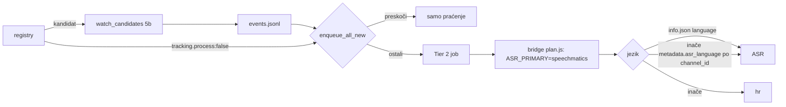

# NaPOD festival 2026: predavači u registry, regionalni podcasti u Tier 2

05.11.2026. Popis predavača s https://napodfest.com/predavaci/ (18 podcasta) uspoređen s
registryjem. 12 smo već imali, 9 je dodano. Odluka korisnika: **svi idu u Tier 2, i
regionalni** — „velika je vrijednost sad kad će biti festival", autori će dobiti link na domovina.ai.

## Stanje po podcastu

| Podcast | slug | Jezik | Prije | Sada |
|---|---|---|---|---|
| LOOD, Rastući s djecom | `lood-podcast`, `rastuci-s-djecom` | hr | Tier 1 | Tier 1 |
| Inkubator, Explora, Mjesto Zločina, Špica, Lider, Netokracija, Tribina (playliste), La Vie, Games Croatia, book&zvook | — | hr | Tier 2 kandidati | isto + `events[]` |
| Agelast, Pojačalo, Tampon Zona, Zdrava priča sa Dolores | `agelast`, `pojacalo`, `tampon-zona`, `zdrava-prica-sa-dolores` | sr | — | Tier 2 |
| Apparatus: Če veš kaj mislim, Opazovalnica, Glave | `apparatus-*` (playliste kanala `@AnzeTomic`) | sl | — | Tier 2, `asr_language: sl` |
| Podcasting for Solopreneurs | `podcasting-for-solopreneurs` | en | — | Tier 2, watch prag 300 s |
| Podcast.rs | `podcast-rs` | — | — | `not-podcast`, `process:false` (imenik, ne emisija) |

Novi unosi nose `metadata.language/country`, `region` (`hr`/`regional`), `events[]`
(festival, predavač, tema) i `watch` pravila. Istraživanje: 3 Sonnet subagenta (yt-dlp + RSS).

## Mehanizmi uvedeni (commit 65f36d55)

1. **`tracking.process: false`** — `enqueue_all_new.js` šalje SVAKI original iz `events.jsonl`,
   bez filtra po jeziku. Zastavica isključuje kandidata iz obrade, watch ga i dalje bilježi.
2. **`metadata.asr_language`** — YouTube za SVE ove kanale vraća `language: NA` (yt-dlp, 6/6),
   pa bi `_unlisted` epizode išle kao `hr`. Fallback po `channel_id` iz `{base}.info.json`:
   `registryAsrLanguage()` u `transcribe_soniox.js` i `transcribe_speechmatics.js`, jq u
   `_source_lang_for_path` (`run_pipeline.sh`). Postavlja se samo eksplicitno: Apparatus `sl`;
   srpski namjerno bez (hr ASR na srpskom radi). Testirano samo na lažnim info.json.

**Zamka (ispravljeno u razgovoru):** `transcription: 'soniox'` u tijelu joba NE bira ASR, samo
cloud tok. Tier 2 = Speechmatics → Soniox (`pipeline.domovina.ai/bridge/plan.js:148`).

## Pokrenuto ručno 05.11.

- Po jedna najnovija epizoda svakog od 8 novih (`all_episodes.json`, `manual: napod-2026-zadnja-epizoda`);
  kvota prije: tjedni 74 %, 5h 11 %. Jobovi: Agelast 116 min, Pojačalo 140, Tampon Zona 108,
  Zdrava priča 119, ČVKM 48, Opazovalnica 42, Glave 67 (svibanj 2026.), Solopreneurs 14.
- `backfill_days.js --slug` za 8 kanala: 1475 originala, 222 jedinice kvote. Agelast 405 orig./893
  isječaka/1000 shortsa; Pojačalo 379/421/931.
- Katalog: podcast.domovina.ai naslov „Hrvatski i regionalni podcasti" (19a4595), opis kanala neutralan.

## Otvoreno

- **Prvi Apparatus prijepis + članak provjeriti** (sl ASR → HR članak), prvi put u produkciji.
- ~~Glave playlista (203 videa) miješa epizode drugih Apparatus emisija → mogući duplikati s ČVKM.~~
  Provjereno 06.11.: 0 od 197 originala Glava nije u ČVKM ni Opazovalnici, duplikata nema.
- Država kanala (YouTube `snippet.country`, 06.11.): Rastući s djecom je **BA**, ostali hrvatski `HR`.
- Zdrava priča: epizode 079–082 uploadane dvaput pod različitim naslovima → dvostruki Tier 2 jobovi.
- Kadenca Tampon Zone / Pojačala iz agenata je dijelom procjena (bot-check bez kolačića).
- Regionalni unosi ulaze i u glasački bazen pri idućem `sync_voting_candidates.mjs --commit`
  (filtar je samo po statusu) — nije odlučeno je li to željeno.

Vezani dokumenti: `docs/2026-11-06-napod-statistika-podcasta.md` (statistika + procjena publike, PDF uz njega),
`docs/2026-11-01-obrada-svih-epizoda-pilot.md`,
`docs/2026-11-02-asr-tier1-soniox-tier2-speechmatics.md`, `docs/REGISTRY_DISCOVERY.md`.
