# Nightly report 05.11.2026.: vrijeme po koraku za svaku epizodu

Stanje u 10:07 (CET). Izvori: `automatic/logs/nightly_2026-11-05.log`, `priority_2026-11-05.log`, `magisterium_2026-11-05.log`, `magisterium-en_2026-11-05.log`, API `pipeline.domovina.ai/api/jobs` i `cdn.domovina.ai/data/<id>/episode.json`. Trajanje koraka je razmak između dva uzastopna zapisa „📢 KORAK” u logu. Grafovi su u PDF-u: `docs/2026-11-05-nightly-report-vremena-po-koraku.pdf`.

## Sažetak

- **28 novih epizoda, svih 28 s člankom na CDN-u, 0 palih poslova.** 4 iz nightlyja (praćeni kanali, run_pipeline 03:00–03:49, cijeli nightly gotov 04:04, „Svi koraci OK”) i 24 iz prioritetnog reda (Tier 2, nepraćeni kanali, svi poslani u 03:53).
- **Prvi put dva slota.** Slot 1 je obradio 13, slot 2 11 epizoda. Prvi posao preuzet u 03:53, zadnji gotov u 07:44 (3,9 h, 25,4 h zvuka). Oba slota su radila istodobno 2,8 h. Jučer je jedan slot 18 epizoda (19,0 h zvuka) obrađivao 5,5 h (04:03–09:31).
- **Zašto slot 2 nije stalno radio:** novi posao smije se preuzeti tek 300 s nakon prethodnog (`zadnji claim prije … < 300 s`), a između 05:13 i 05:31 slot 2 je 14 puta odbijen jer je SSD imao 3–4 GB (< 5 GB). Ukupno je slot 2 bio prazan 46 min dok je u redu još bilo posla.
- **Obrada po epizodi** (zbroj koraka) medijan **16 min**, raspon 9–27 min. Čekanje u redu od slanja do preuzimanja: medijan 120 min, najdulje 219 min (jučer 160 / 319 min).
- **Kamo ide vrijeme** (zbroj Tier 2): Članak Opus (8) 131 min (34 %), H.264 video (12.5) 57 min (15 %), ASR (2.7b) 43 min (11 %), Modal Canary (2.6) 42 min (11 %), Reels Opus (9.9) 42 min (11 %).
- **⚠️ Magisterium HR nije gotov.** Gotovo 15 epizoda (medijan 12 min obrade; tick uzima jednu po jednu, pa nova kreće u prosjeku svakih 26 min), zadnja u 09:55. **U redu čeka još 10 epizoda** (`y0J491L5J9s`, `tEXwoOtvwbY`, `j7rEm8gLd-I`, `jCh-JcdhZJ4`, `7d3MpFWfk1M`, `_YOkTkbrh_k`, `BqJ67OO-FVA`, `xGAmPf_ihm4`, `3DCHLVmPIk0`, `qu66kgKgIqY`). Tim ritmom to je još oko 4,3 h, do oko 14:24. Magisterium smije biti spor; bitno je da stigne.
- **⚠️ EN traka je od 08:10 bila zaglavljena.** `enqueue_en_new.js` je svaki tick (2 min) ponovno stavljao `KLPD-Meu4e8` u red jer lokalno nema `.article.en.json`, a poller ga je preskakao jer je EN već na CDN-u. Danas 199 puta. Za to vrijeme `xGAmPf_ihm4` i `y0J491L5J9s` čekaju EN članak (oba su u redu od ~06:45 i ~07:45). Popravljeno u 10:05 (`automatic/enqueue_en_new.js`): kandidat čiji je `article.en.json` već na CDN-u se preskače. Ostalih 26 epizoda ima EN članak na CDN-u, a svih 16 s gotovim Magisterium HR ima i Magisterium EN.
- **⚠️ pyannoteAI i dalje bez kredita** (HTTP 402 od 04.11. 05:51). U nightlyju su sve 4 epizode praćenih kanala dobile govornike iz golog Sonioxa (novi fallback iz `5013e60b`, prije bi bez kanonskog SRT-a ostale bez kostura). Tier 2 ionako koristi Speechmaticsovu dijarizaciju (`asr_provider=speechmatics` na svih 24), pa ga 402 ne dira.
- YouTube proxy (iPhone preko Tailscalea, `100.71.146.11:8888`) nije odgovarao cijelo jutro; download je išao bez njega i nijedan nije pao.
- Modal Canary (2.6) se i dalje vrti kao osigurač na svakoj Tier 2 epizodi: 42 min ukupno, oko 1,7 min po epizodi.

## Gantogram

```mermaid
gantt
    title 05.11.2026. – rad po trakama (CET)
    dateFormat HH:mm:ss
    axisFormat %H:%M
    tickInterval 30minute
    todayMarker off
    section Nightly
    K1 Osvježavanje i preuzimanje p :03:00:13, 03:03:02
    K2.5 Upload WAV datoteka na Googl :03:03:10, 03:04:17
    K2.6 Modal on-demand Canary trans :03:04:17, 03:10:27
    K2.7b Soniox cloud ASR [--with-son :03:10:27, 03:14:19
    K7 Gemini Sumarizacija transkri :03:14:27, 03:16:05
    K8 Gemini Generiranje članaka :03:16:05, 03:30:54
    K10 YouTube screenshotovi (yt-dl :03:31:01, 03:34:32
    K9.6 Generiranje OG-sections comp :03:34:32, 03:35:57
    K9.9 kandidati za reels/shorts (s :03:36:33, 03:42:47
    K12 Cloudflare R2 upload (cdn.do :03:42:47, 03:44:46
    K12.5 H.264 cross-platform video ( :03:44:46, 03:48:19
    section Slot 1
    FiK_F09oGkI Eduza :03:53:18, 04:12:35
    Ax0_di2vbaQ Mame kod Lane :04:13:08, 04:31:16
    JppxeAaWuwk HopeCast :04:31:31, 04:49:35
    4NDoUgqhFCY Podcast Inkubato :04:49:53, 05:16:40
    Nf_syoGgO9A Podcast Besida :05:17:48, 05:31:32
    efHFfGilwWU Ofenziva - Sport :05:33:04, 05:49:02
    goBvDM_UDhI Projekt Velebit :05:49:51, 06:13:09
    qu66kgKgIqY Hrvatska radiote :06:14:18, 06:23:17
    xGAmPf_ihm4 Kišobran UNIRI :06:23:28, 06:43:36
    _YOkTkbrh_k Tribina :06:47:57, 07:07:40
    jCh-JcdhZJ4 Hrvatska katolič :07:07:51, 07:18:51
    tEXwoOtvwbY TV Jadran :07:20:06, 07:31:41
    y0J491L5J9s HRT vijesti :07:32:19, 07:43:11
    section Slot 2
    bFYJepR2ZPM Denis Podcast :03:59:23, 04:19:30
    h9YyLdnRjb0 Ideje :04:20:48, 04:36:47
    U1cAxmbVdYk Felix Contras :04:37:39, 04:51:39
    JgcF9JM6dHQ Podcast Inkubato :04:55:59, 05:12:49
    ARgec9vlU2Y SBS Audio :05:39:09, 05:52:27
    ri0QaNglg94 Telegram.hr :05:55:58, 06:05:03
    qyYRS7qP-2w Telegram.hr :06:06:39, 06:23:15
    3DCHLVmPIk0 VEZ sv. Antuna :06:29:35, 06:41:41
    BqJ67OO-FVA Tribina :06:41:48, 07:07:14
    7d3MpFWfk1M Hrvatska katolič :07:14:12, 07:25:26
    j7rEm8gLd-I Jutarnji list :07:26:12, 07:36:40
    section Magisterium HR
    63Z90Dc8Jkg :03:51:31, 04:03:12
    FiK_F09oGkI :04:23:14, 04:37:52
    Ax0_di2vbaQ :04:47:52, 05:07:08
    bFYJepR2ZPM :05:17:09, 05:29:05
    h9YyLdnRjb0 :05:39:05, 05:50:12
    U1cAxmbVdYk :06:00:13, 06:10:11
    JppxeAaWuwk :06:20:11, 06:32:03
    JgcF9JM6dHQ :06:42:04, 06:57:12
    4NDoUgqhFCY :07:07:13, 07:45:40
    Nf_syoGgO9A :07:55:40, 08:06:34
    ARgec9vlU2Y :08:16:35, 08:26:38
    efHFfGilwWU :08:36:38, 08:47:59
    goBvDM_UDhI :08:57:59, 09:24:33
    ri0QaNglg94 :09:34:34, 09:42:24
    qyYRS7qP-2w :09:52:25, 09:55:38
```

## Tier 2: trajanje faza po epizodi (min:s)

| # | slot | video | kanal | audio | poslano | preuzeto | čekanje | Preuzimanje | WAV | Modal Canary | ASR | pyannoteAI | Kostur | Sažetak Opus | Članak Opus | RAG + sličice | Screenshotovi | OG/EPUB/sponz./words | Reels Opus | R2 upload | H.264 video | CDN ostalo | start | zatv. | gotovo | obrada | govornici |
|---|---|---|---|---|---|---|---|---|---|---|---|---|---|---|---|---|---|---|---|---|---|---|---|---|---|---|---|
| 1 | s1 | `FiK_F09oGkI` | Eduza | 79:37 | 03:52:58 | 03:53:14 | 16 s | 41 s | 2 s | 1:41 | 1:40 | · | 1 s | 35 s | 7:50 | · | 1:34 | 6 s | 2:00 | 4 s | 2:49 | 14 s | 4 s | 31 s | 04:13:06 | 19:17 | speechmatics |
| 2 | s2 | `bFYJepR2ZPM` | Denis Podcast | 78:09 | 03:52:58 | 03:59:20 | 6:22 | 33 s | 3 s | 1:37 | 1:08 | · | · | 37 s | 7:16 | 1 s | 3:48 | 5 s | 1:39 | 11 s | 2:51 | 18 s | 3 s | 1:15 | 04:20:45 | 20:07 | speechmatics |
| 3 | s1 | `Ax0_di2vbaQ` | Mame kod Lane | 87:20 | 03:52:59 | 04:13:06 | 20:07 | 40 s | 3 s | 1:44 | 1:42 | · | 1 s | 27 s | 6:47 | 1 s | 1:25 | 5 s | 1:46 | 5 s | 3:04 | 18 s | 2 s | 12 s | 04:31:28 | 18:08 | speechmatics |
| 4 | s2 | `h9YyLdnRjb0` | Ideje | 61:04 | 03:52:59 | 04:20:45 | 27:46 | 26 s | 3 s | 1:36 | 2:13 | · | · | 36 s | 5:29 | · | 1:27 | 5 s | 1:35 | 5 s | 2:08 | 16 s | 3 s | 49 s | 04:37:36 | 15:59 | speechmatics |
| 5 | s1 | `JppxeAaWuwk` | HopeCast | 83:00 | 03:52:59 | 04:31:28 | 38:29 | 34 s | 3 s | 2:01 | 1:28 | · | 1 s | 24 s | 6:53 | · | 42 s | 3 s | 2:18 | 5 s | 3:16 | 16 s | 3 s | 16 s | 04:49:51 | 18:04 | speechmatics |
| 6 | s2 | `U1cAxmbVdYk` | Felix Contras | 64:03 | 03:52:59 | 04:37:36 | 44:37 | 30 s | 2 s | 1:28 | 1:46 | · | · | 37 s | 4:57 | · | 12 s | 2 s | 1:45 | 4 s | 2:23 | 14 s | 3 s | 1:15 | 04:52:54 | 14:00 | speechmatics |
| 7 | s1 | `4NDoUgqhFCY` | Podcast Inkubator | 135:11 | 03:53:00 | 04:49:50 | 56:50 | 57 s | 5 s | 2:29 | 2:31 | · | · | 38 s | 10:32 | 1 s | 1:42 | 9 s | 2:11 | 7 s | 4:58 | 27 s | 3 s | 1:05 | 05:17:45 | 26:47 | speechmatics |
| 8 | s2 | `JgcF9JM6dHQ` | Podcast Inkubator | 84:43 | 03:53:00 | 04:55:57 | 62:57 | 35 s | 3 s | 2:15 | 1:09 | · | · | 36 s | 6:34 | 1 s | 17 s | 3 s | 1:37 | 4 s | 3:23 | 13 s | 2 s | 21 s | 05:13:10 | 16:50 | speechmatics |
| 9 | s1 | `Nf_syoGgO9A` | Podcast Besida | 50:42 | 03:53:00 | 05:17:45 | 84:45 | 32 s | 2 s | 1:52 | 2:28 | · | · | 35 s | 3:53 | 1 s | 26 s | 3 s | 1:47 | 4 s | 1:49 | 12 s | 3 s | 1:29 | 05:33:01 | 13:44 | speechmatics |
| 10 | s1 | `efHFfGilwWU` | Ofenziva - Sportski podc | 53:58 | 03:53:00 | 05:33:02 | 100:02 | 26 s | 2 s | 2:46 | 1:50 | · | · | 31 s | 5:36 | 1 s | 38 s | 3 s | 1:51 | 5 s | 1:53 | 15 s | 2 s | 46 s | 05:49:48 | 15:57 | speechmatics |
| 11 | s2 | `ARgec9vlU2Y` | SBS Audio | 47:25 | 03:53:01 | 05:39:07 | 106:06 | 31 s | 2 s | 1:34 | 2:27 | · | 1 s | 48 s | 4:22 | · | 18 s | 2 s | 1:17 | 4 s | 1:38 | 13 s | 2 s | 25 s | 05:52:52 | 13:17 | speechmatics |
| 12 | s1 | `goBvDM_UDhI` | Projekt Velebit | 111:11 | 03:53:01 | 05:49:48 | 116:47 | 48 s | 5 s | 1:31 | 4:46 | · | · | 47 s | 8:44 | 1 s | 16 s | 2 s | 1:48 | 5 s | 4:07 | 18 s | 3 s | 1:06 | 06:14:15 | 23:18 | speechmatics |
| 13 | s2 | `ri0QaNglg94` | Telegram.hr | 35:23 | 03:53:01 | 05:55:55 | 122:54 | 19 s | 1 s | 1:30 | 49 s | · | 1 s | 23 s | 2:41 | 1 s | 9 s | 1 s | 1:44 | 3 s | 1:14 | 9 s | 3 s | 2 s | 06:05:05 | 9:05 | speechmatics |
| 14 | s2 | `qyYRS7qP-2w` | Telegram.hr | 22:40 | 03:53:01 | 06:06:37 | 133:36 | 11 s | 1 s | 1:34 | 43 s | · | · | 23 s | 1:32 | 1 s | 9:29 | 1 s | 1:36 | 2 s | 55 s | 7 s | 2 s | 11 s | 06:23:26 | 16:35 | speechmatics |
| 15 | s1 | `qu66kgKgIqY` | Hrvatska radiotelevizija | 33:24 | 03:53:02 | 06:14:15 | 141:13 | 13 s | 2 s | 1:22 | 51 s | · | · | 25 s | 2:21 | 1 s | 42 s | 3 s | 1:29 | 3 s | 1:17 | 9 s | 3 s | 9 s | 06:23:26 | 8:58 | speechmatics |
| 16 | s1 | `xGAmPf_ihm4` | Kišobran UNIRI | 71:52 | 03:53:02 | 06:23:26 | 150:24 | 1:18 | 2 s | 1:45 | 3:39 | · | · | 1:00 | 6:28 | 1 s | 41 s | 3 s | 2:10 | 5 s | 2:39 | 16 s | 2 s | 1:14 | 06:44:50 | 20:07 | speechmatics |
| 17 | s2 | `3DCHLVmPIk0` | VEZ sv. Antuna | 47:21 | 03:53:02 | 06:29:32 | 156:30 | 26 s | 1 s | 1:44 | 44 s | · | 1 s | 34 s | 3:30 | · | 1:17 | 3 s | 1:48 | 3 s | 1:44 | 11 s | 3 s | 5 s | 06:41:46 | 12:06 | speechmatics |
| 18 | s2 | `BqJ67OO-FVA` | Tribina | 105:57 | 03:53:02 | 06:41:46 | 168:44 | 1:26 | 4 s | 2:47 | 2:09 | · | · | 47 s | 10:35 | 1 s | 1:02 | 3 s | 1:47 | 5 s | 4:21 | 18 s | 2 s | 33 s | 07:07:47 | 25:25 | speechmatics |
| 19 | s1 | `_YOkTkbrh_k` | Tribina | 95:15 | 03:53:02 | 06:47:54 | 174:52 | 46 s | 3 s | 1:54 | 1:46 | · | 1 s | 1:00 | 7:13 | 1 s | 24 s | 2 s | 2:06 | 4 s | 4:08 | 15 s | 3 s | 7 s | 07:07:47 | 19:43 | speechmatics |
| 20 | s1 | `jCh-JcdhZJ4` | Hrvatska katolička mreža | 37:35 | 03:53:03 | 07:07:48 | 194:45 | 21 s | 1 s | 1:11 | 1:46 | · | 1 s | 26 s | 2:57 | 1 s | 1:07 | 4 s | 1:24 | 4 s | 1:23 | 14 s | 3 s | 1:10 | 07:20:01 | 11:00 | speechmatics |
| 21 | s2 | `7d3MpFWfk1M` | Hrvatska katolička mreža | 46:18 | 03:53:03 | 07:14:09 | 201:06 | 21 s | 2 s | 1:14 | 57 s | · | 1 s | 26 s | 3:18 | 1 s | 1:16 | 4 s | 1:33 | 3 s | 1:45 | 12 s | 3 s | 42 s | 07:26:08 | 11:13 | speechmatics |
| 22 | s1 | `tEXwoOtvwbY` | TV Jadran | 26:32 | 03:53:03 | 07:20:03 | 207:00 | 18 s | 1 s | 1:20 | 1:44 | · | 1 s | 31 s | 4:28 | 1 s | 48 s | 3 s | 1:08 | 4 s | 58 s | 10 s | 3 s | 35 s | 07:32:16 | 11:35 | speechmatics |
| 23 | s2 | `j7rEm8gLd-I` | Jutarnji list | 33:31 | 03:53:03 | 07:26:09 | 213:06 | 17 s | 2 s | 1:38 | 1:24 | · | · | 32 s | 3:14 | 1 s | 8 s | 2 s | 1:42 | 4 s | 1:14 | 10 s | 3 s | 11 s | 07:36:51 | 10:28 | speechmatics |
| 24 | s1 | `y0J491L5J9s` | HRT vijesti | 32:36 | 03:53:04 | 07:32:17 | 219:13 | 26 s | 2 s | 1:16 | 1:08 | · | · | 35 s | 3:34 | 1 s | 42 s | 2 s | 1:38 | 4 s | 1:11 | 12 s | 2 s | 1:19 | 07:44:30 | 10:51 | speechmatics |

## Magisterium HR, EN prijevod i Magisterium EN

| # | video | kanal | članak gotov | EN tick | EN | Mag HR tick | Mag HR | poziva | čekanje HR | Mag EN | sve gotovo |
|---|---|---|---|---|---|---|---|---|---|---|---|
| 1 | `x176kmhHcmI` | budiFRAjer | 03:49:36 (nightly) | 03:53:12–03:55:15 | 2:03 | nije u planu | – | – | – | – | 03:55:15 |
| 2 | `SiKEiejafpE` | Mreže riječi | 03:49:36 (nightly) | 03:57:15–03:59:30 | 2:15 | nije u planu | – | – | – | – | 03:59:30 |
| 3 | `63Z90Dc8Jkg` | Ora et Labora | 03:49:36 (nightly) | 04:07:56–04:11:12 | 3:16 | 03:51:31–04:03:12 | 11:41 | 12 | 1:55 | s EN tickom | 04:11:12 |
| 4 | `qFOD-W0-GvU` | Podcast Čušpajz | 03:49:36 (nightly) | 04:01:30–04:03:53 | 2:23 | nije u planu | – | – | – | – | 04:03:53 |
| 5 | `FiK_F09oGkI` | Eduza | 04:13:06 | 04:15:15–04:18:36 | 3:21 | 04:23:14–04:37:52 | 14:38 | 16 | 10:08 | 04:37:34 (kasni, 58 s) | 04:41:29 |
| 6 | `bFYJepR2ZPM` | Denis Podcast | 04:20:45 | 04:22:39–04:26:06 | 3:27 | 05:17:09–05:29:05 | 11:56 | 20 | 56:24 | 05:30:17 (kasni, 1:01) | 05:31:26 |
| 7 | `Ax0_di2vbaQ` | Mame kod Lane | 04:31:28 | 04:30:11–04:33:31 | 3:20 | 04:47:52–05:07:08 | 19:16 | 18 | 16:24 | 05:07:47 (kasni, 1:01) | 05:08:57 |
| 8 | `h9YyLdnRjb0` | Ideje | 04:37:36 | 04:37:34–04:41:29 | 3:55 | 05:39:05–05:50:12 | 11:07 | 15 | 61:29 | 05:49:47 (kasni, 1:04) | 05:53:41 |
| 9 | `JppxeAaWuwk` | HopeCast | 04:49:51 | 04:49:37–04:53:00 | 3:23 | 06:20:11–06:32:03 | 11:52 | 20 | 90:20 | 06:34:26 (kasni, 1:25) | 06:35:58 |
| 10 | `U1cAxmbVdYk` | Felix Contras | 04:52:54 | 04:57:03–04:59:39 | 2:36 | 06:00:13–06:10:11 | 9:58 | 15 | 67:19 | 06:10:13 (kasni, 1:01) | 06:11:21 |
| 11 | `4NDoUgqhFCY` | Podcast Inkubator | 05:17:45 | 07:47:30–07:55:10 | 7:40 | 07:07:13–07:45:40 | 38:27 | 32 | 109:28 | s EN tickom | 07:55:10 |
| 12 | `JgcF9JM6dHQ` | Podcast Inkubator | 05:13:10 | 05:13:00–05:16:04 | 3:04 | 06:42:04–06:57:12 | 15:08 | 14 | 88:54 | 06:58:30 (kasni, 55 s) | 06:59:32 |
| 13 | `Nf_syoGgO9A` | Podcast Besida | 05:33:01 | 08:07:24–08:10:29 | 3:05 | 07:55:40–08:06:34 | 10:54 | 13 | 142:39 | s EN tickom | 08:10:29 |
| 14 | `efHFfGilwWU` | Ofenziva - Sportski podc | 05:49:48 | 05:49:47–05:53:41 | 3:54 | 08:36:38–08:47:59 | 11:21 | 17 | 166:50 | 08:48:09 (kasni, 52 s) | 08:49:09 |
| 15 | `ARgec9vlU2Y` | SBS Audio | 05:52:52 | 05:57:44–06:00:10 | 2:26 | 08:16:35–08:26:38 | 10:03 | 14 | 143:43 | 08:26:47 (kasni, 49 s) | 08:27:44 |
| 16 | `goBvDM_UDhI` | Projekt Velebit | 06:14:15 | 06:13:22–06:17:42 | 4:20 | 08:57:59–09:24:33 | 26:34 | 22 | 163:44 | 09:25:56 (kasni, 2:22) | 09:28:28 |
| 17 | `ri0QaNglg94` | Telegram.hr | 06:05:05 | 06:06:15–06:08:13 | 1:58 | 09:34:34–09:42:24 | 7:50 | 8 | 209:29 | 09:42:45 (kasni, 49 s) | 09:43:42 |
| 18 | `qyYRS7qP-2w` | Telegram.hr | 06:23:26 | 06:25:51–06:27:40 | 1:49 | 09:52:25–09:55:38 | 3:13 | 5 | 208:59 | 09:55:56 (kasni, 34 s) | 09:56:38 |
| 19 | `qu66kgKgIqY` | Hrvatska radiotelevizija | 06:23:26 | 06:29:40–06:32:26 | 2:46 | ⏳ u redu | – | – | – | – | 06:32:26 |
| 20 | `xGAmPf_ihm4` | Kišobran UNIRI | 06:44:50 | – | – | ⏳ u redu | – | – | – | – | 06:44:50 |
| 21 | `3DCHLVmPIk0` | VEZ sv. Antuna | 06:41:46 | 06:42:05–06:44:14 | 2:09 | ⏳ u redu | – | – | – | – | 06:44:14 |
| 22 | `BqJ67OO-FVA` | Tribina | 07:07:47 | 07:05:39–07:09:38 | 3:59 | ⏳ u redu | – | – | – | – | 07:09:38 |
| 23 | `_YOkTkbrh_k` | Tribina | 07:07:47 | 07:11:38–07:14:59 | 3:21 | ⏳ u redu | – | – | – | – | 07:14:59 |
| 24 | `jCh-JcdhZJ4` | Hrvatska katolička mreža | 07:20:01 | 07:21:05–07:24:40 | 3:35 | ⏳ u redu | – | – | – | – | 07:24:40 |
| 25 | `7d3MpFWfk1M` | Hrvatska katolička mreža | 07:26:08 | 07:28:43–07:31:04 | 2:21 | ⏳ u redu | – | – | – | – | 07:31:04 |
| 26 | `tEXwoOtvwbY` | TV Jadran | 07:32:16 | 07:35:07–07:37:05 | 1:58 | ⏳ u redu | – | – | – | – | 07:37:05 |
| 27 | `j7rEm8gLd-I` | Jutarnji list | 07:36:51 | 07:41:08–07:43:27 | 2:19 | ⏳ u redu | – | – | – | – | 07:43:27 |
| 28 | `y0J491L5J9s` | HRT vijesti | 07:44:30 | – | – | ⏳ u redu | – | – | – | – | 07:44:30 |

## Nightly: skupni koraci (sve epizode zajedno)

| KORAK | opis | početak | trajanje |
|---|---|---|---|
| 0 | Skidanje novih diarisation fajlova s Google Drive-a | 03:00:07 | 6 s |
| 1 | Osvježavanje i preuzimanje podcasta | 03:00:13 | 2:49 |
| 2 | Konverzija MP3 → WAV | 03:03:02 | 8 s |
| 2.5 | Upload WAV datoteka na Google Drive | 03:03:10 | 1:07 |
| 2.6 | Modal on-demand Canary transkripcija [--with-modal-transcr | 03:04:17 | 6:10 |
| 2.7b | Soniox cloud ASR [--with-soniox] (fallback Speechmatics) | 03:10:27 | 3:52 |
| 2.7c | pyannoteAI govornici + hibrid [--with-pyannote-ai] | 03:14:19 | 3 s |
| 2.8 | promocija kostura (auto) BEZ Gemini sluha [--no-gemini-ear | 03:14:22 | 5 s |
| 7 | Gemini Sumarizacija transkripata | 03:14:27 | 1:38 |
| 8 | Gemini Generiranje članaka | 03:16:05 | 14:49 |
| 9 | RAG priprema (chunkanje i import) | 03:30:54 | 6 s |
| 9.4 | Beamly video download (matchane subclub/launched) | 03:31:00 | 0 s |
| 9.5 | Generiranje OG-share varijante (1200×630 progressive JPEG  | 03:31:00 | 1 s |
| 9.7 | WebP thumbnail varijante (320/640/1280 q80) | 03:31:01 | 0 s |
| 10 | YouTube screenshotovi (yt-dlp + ffmpeg) | 03:31:01 | 3:31 |
| 9.6 | Generiranje OG-sections composite-a (per-section Tier B) | 03:34:32 | 1:25 |
| 9.8 | EPUB e-knjige (article.json + screenshotovi → .epub) | 03:35:57 | 9 s |
| 9.85 | sponzori u snimci (opis + poglavlja + transkript → sponsor | 03:36:06 | 26 s |
| 9.87 | vrijeme po riječi za titl (diarized.srt + Soniox/Speechmat | 03:36:32 | 1 s |
| 9.9 | kandidati za reels/shorts (segments.jsonl + words.json → r | 03:36:33 | 6:14 |
| 12 | Cloudflare R2 upload (cdn.domovina.ai) | 03:42:47 | 1:59 |
| 12.5 | H.264 cross-platform video (video_h264.mp4) | 03:44:46 | 3:33 |
| 12.6 | Audio-only .mp3 upload (data/{id}/audio.mp3) | 03:48:19 | 1 s |
| 12.65 | WebP screenshotovi (960 px q80, PNG ostaje) | 03:48:20 | 15 s |
| 12.66 | nadograđene e-knjige (book.epub) na CDN | 03:48:35 | 0 s |
| 12.7 | episode.json bundle (data/{id}/episode.json) | 03:48:35 | 16 s |
| 13 | Channel index regen + meta upload | 03:48:51 | 45 s |
| | **ukupno run_pipeline.sh** | 03:00:07 | **49:29** |

| video | kanal | audio | Soniox | sažetak | članak | reels | EN | Mag HR |
|---|---|---|---|---|---|---|---|---|
| `x176kmhHcmI` | budiFRAjer | 28:34 | 45 s | 17 s | 4:25 | 1:13 | 2:03 | – |
| `SiKEiejafpE` | Mreže riječi | 40:33 | 55 s | 27 s | 2:52 | 1:35 | 2:15 | – |
| `63Z90Dc8Jkg` | Ora et Labora | 55:09 | 1:06 | 26 s | 3:59 | 1:33 | 3:16 | 11:41 |
| `qFOD-W0-GvU` | Podcast Čušpajz | 48:11 | 56 s | 27 s | 3:13 | 1:37 | 2:23 | – |

## Prilog: svaki korak svake Tier 2 epizode

**1. `FiK_F09oGkI` · Eduza** · audio 79:37 · done · Kako postati regionalno prepoznat stručnjak | Nela Kačmarčik – Maduna

| 1 | 2.6 | 2.7b | 7 | 8 | 10 | 9.6 | 9.9 | 12 | 12.5 | 12.65 | 12.68 |
|---|---|---|---|---|---|---|---|---|---|---|---|
| 03:53:18 | 03:54:01 | 03:55:42 | 03:57:23 | 03:57:58 | 04:05:48 | 04:07:22 | 04:07:28 | 04:09:28 | 04:09:32 | 04:12:21 | 04:12:32 |
| 41 s | 1:41 | 1:40 | 35 s | 7:50 | 1:34 | 4 s | 2:00 | 4 s | 2:49 | 11 s | 3 s |

**2. `bFYJepR2ZPM` · Denis Podcast** · audio 78:09 · done · SUNDERLAND-DINAMO NAJAVA/LIVE

| 1 | 2 | 2.6 | 2.7b | 7 | 8 | 10 | 9.6 | 9.9 | 12 | 12.5 | 12.65 | 12.68 |
|---|---|---|---|---|---|---|---|---|---|---|---|---|
| 03:59:23 | 03:59:56 | 03:59:59 | 04:01:36 | 04:02:44 | 04:03:21 | 04:10:38 | 04:14:26 | 04:14:31 | 04:16:10 | 04:16:21 | 04:19:12 | 04:19:26 |
| 33 s | 3 s | 1:37 | 1:08 | 37 s | 7:16 | 3:48 | 3 s | 1:39 | 11 s | 2:51 | 14 s | 3 s |

**3. `Ax0_di2vbaQ` · Mame kod Lane** · audio 87:20 · done · Ep 83. Mame kod Lane: JADRANKA KOSOR

| 1 | 2 | 2.6 | 2.7b | 7 | 8 | 10 | 9.6 | 9.9 | 12 | 12.5 | 12.65 | 12.68 |
|---|---|---|---|---|---|---|---|---|---|---|---|---|
| 04:13:08 | 04:13:48 | 04:13:51 | 04:15:35 | 04:17:18 | 04:17:45 | 04:24:33 | 04:25:58 | 04:26:03 | 04:27:49 | 04:27:54 | 04:30:59 | 04:31:12 |
| 40 s | 3 s | 1:44 | 1:42 | 27 s | 6:47 | 1:25 | 3 s | 1:46 | 5 s | 3:04 | 13 s | 3 s |

**4. `h9YyLdnRjb0` · Ideje** · audio 61:04 · done · Kurelić: Američka demokracija je za sada spašena, ali bojim se napada na Iran

| 1 | 2 | 2.6 | 2.7b | 7 | 8 | 10 | 9.6 | 9.9 | 12 | 12.5 | 12.65 | 12.68 |
|---|---|---|---|---|---|---|---|---|---|---|---|---|
| 04:20:48 | 04:21:14 | 04:21:17 | 04:22:53 | 04:25:06 | 04:25:42 | 04:31:11 | 04:32:38 | 04:32:43 | 04:34:18 | 04:34:23 | 04:36:31 | 04:36:43 |
| 26 s | 3 s | 1:36 | 2:13 | 36 s | 5:29 | 1:27 | 3 s | 1:35 | 5 s | 2:08 | 11 s | 3 s |

**5. `JppxeAaWuwk` · HopeCast** · audio 83:00 · done · S 14 godina jurio sam cestama i bježao od Boga! Alen Hadžiefendić

| 1 | 2 | 2.6 | 2.7b | 7 | 8 | 10 | 9.9 | 12 | 12.5 | 12.65 | 12.68 |
|---|---|---|---|---|---|---|---|---|---|---|---|
| 04:31:31 | 04:32:05 | 04:32:08 | 04:34:09 | 04:35:38 | 04:36:02 | 04:42:55 | 04:43:40 | 04:45:58 | 04:46:03 | 04:49:19 | 04:49:31 |
| 34 s | 3 s | 2:01 | 1:28 | 24 s | 6:53 | 42 s | 2:18 | 5 s | 3:16 | 12 s | 3 s |

**6. `U1cAxmbVdYk` · Felix Contras** · audio 64:03 · done · Mirko Bilandžić: Svijet ulazi u novu eru – Iran, Rusija i Kina mijenjaju globalni odnos snaga

| 1 | 2.6 | 2.7b | 7 | 8 | 10 | 9.9 | 12 | 12.5 | 12.65 | 12.68 |
|---|---|---|---|---|---|---|---|---|---|---|
| 04:37:39 | 04:38:11 | 04:39:39 | 04:41:25 | 04:42:02 | 04:46:59 | 04:47:13 | 04:48:58 | 04:49:02 | 04:51:26 | 04:51:35 |
| 30 s | 1:28 | 1:46 | 37 s | 4:57 | 12 s | 1:45 | 4 s | 2:23 | 9 s | 4 s |

**7. `4NDoUgqhFCY` · Podcast Inkubator** · audio 135:11 · done · Podcast Mysterium #186 -  AKTUAL S PINTOM I DUSPAROM ||

| 1 | 2 | 2.6 | 2.7b | 7 | 8 | 10 | 9.6 | 9.9 | 12 | 12.5 | 12.65 | 12.68 |
|---|---|---|---|---|---|---|---|---|---|---|---|---|
| 04:49:53 | 04:50:50 | 04:50:55 | 04:53:24 | 04:55:55 | 04:56:33 | 05:07:06 | 05:08:48 | 05:08:57 | 05:11:08 | 05:11:15 | 05:16:13 | 05:16:36 |
| 57 s | 5 s | 2:29 | 2:31 | 38 s | 10:32 | 1:42 | 6 s | 2:11 | 7 s | 4:58 | 23 s | 3 s |

**8. `JgcF9JM6dHQ` · Podcast Inkubator** · audio 84:43 · done · 5Rak vs Hambi - Extra Runda #157 II ZDRAVKOVIĆ BRANI TITULU II OPAČIĆ DEBITIRA ZA FNC

| 1 | 2 | 2.6 | 2.7b | 7 | 8 | 10 | 9.9 | 12 | 12.5 | 12.65 | 12.68 |
|---|---|---|---|---|---|---|---|---|---|---|---|
| 04:55:59 | 04:56:34 | 04:56:37 | 04:58:52 | 05:00:01 | 05:00:37 | 05:07:12 | 05:07:32 | 05:09:09 | 05:09:13 | 05:12:36 | 05:12:45 |
| 35 s | 3 s | 2:15 | 1:09 | 36 s | 6:34 | 17 s | 1:37 | 4 s | 3:23 | 9 s | 4 s |

**9. `Nf_syoGgO9A` · Podcast Besida** · audio 50:42 · done · Zvonko Gilić | Emocija i klapa | Podcast Besida #71

| 1 | 2.6 | 2.7b | 7 | 8 | 10 | 9.9 | 12 | 12.5 | 12.65 | 12.68 |
|---|---|---|---|---|---|---|---|---|---|---|
| 05:17:48 | 05:18:22 | 05:20:14 | 05:22:42 | 05:23:17 | 05:27:11 | 05:27:40 | 05:29:27 | 05:29:31 | 05:31:20 | 05:31:29 |
| 32 s | 1:52 | 2:28 | 35 s | 3:53 | 26 s | 1:47 | 4 s | 1:49 | 9 s | 3 s |

**10. `efHFfGilwWU` · Ofenziva - Sportski podcast** · audio 53:58 · done · Ofenziva na HNL - Je li Kovačević zaslužio otkaz u Dinamu?

| 1 | 2.6 | 2.7b | 7 | 8 | 10 | 9.9 | 12 | 12.5 | 12.65 | 12.68 |
|---|---|---|---|---|---|---|---|---|---|---|
| 05:33:05 | 05:33:33 | 05:36:19 | 05:38:09 | 05:38:40 | 05:44:17 | 05:44:58 | 05:46:49 | 05:46:54 | 05:48:47 | 05:48:59 |
| 26 s | 2:46 | 1:50 | 31 s | 5:36 | 38 s | 1:51 | 5 s | 1:53 | 12 s | 3 s |

**11. `ARgec9vlU2Y` · SBS Audio** · audio 47:25 · done · Program SBS-a na hrvatskom za četvrtak, 5.11.2026.

| 1 | 2.6 | 2.7b | 7 | 8 | 10 | 9.9 | 12 | 12.5 | 12.65 | 12.68 |
|---|---|---|---|---|---|---|---|---|---|---|
| 05:39:10 | 05:39:43 | 05:41:17 | 05:43:45 | 05:44:33 | 05:48:55 | 05:49:15 | 05:50:32 | 05:50:36 | 05:52:14 | 05:52:23 |
| 31 s | 1:34 | 2:27 | 48 s | 4:22 | 18 s | 1:17 | 4 s | 1:38 | 9 s | 3 s |

**12. `goBvDM_UDhI` · Projekt Velebit** · audio 111:11 · done · PODCAST VELEBIT - Jonjić: Tko misli da je Jugoslavija prošlost taj je naivac

| 1 | 2 | 2.6 | 2.7b | 7 | 8 | 10 | 9.9 | 12 | 12.5 | 12.65 | 12.68 |
|---|---|---|---|---|---|---|---|---|---|---|---|
| 05:49:51 | 05:50:39 | 05:50:44 | 05:52:15 | 05:57:01 | 05:57:48 | 06:06:33 | 06:06:51 | 06:08:39 | 06:08:44 | 06:12:51 | 06:13:05 |
| 48 s | 5 s | 1:31 | 4:46 | 47 s | 8:44 | 16 s | 1:48 | 5 s | 4:07 | 14 s | 3 s |

**13. `ri0QaNglg94` · Telegram.hr** · audio 35:23 · done · Udar poduzetnika na Vladu: Političari obožavaju inflaciju

| 1 | 2.6 | 2.7b | 7 | 8 | 10 | 9.9 | 12 | 12.5 | 12.65 | 12.68 |
|---|---|---|---|---|---|---|---|---|---|---|
| 05:55:58 | 05:56:18 | 05:57:48 | 05:58:38 | 05:59:01 | 06:01:43 | 06:01:53 | 06:03:37 | 06:03:40 | 06:04:54 | 06:04:59 |
| 19 s | 1:30 | 49 s | 23 s | 2:41 | 9 s | 1:44 | 3 s | 1:14 | 5 s | 3 s |

**14. `qyYRS7qP-2w` · Telegram.hr** · audio 22:40 · done · Iran je bio samo okidač: Pravi razlog Trumpovog poraza

| 1 | 2.6 | 2.7b | 7 | 8 | 10 | 9.9 | 12.5 | 12.65 | 12.68 |
|---|---|---|---|---|---|---|---|---|---|
| 06:06:40 | 06:06:52 | 06:08:26 | 06:09:09 | 06:09:32 | 06:11:05 | 06:20:35 | 06:22:13 | 06:23:08 | 06:23:12 |
| 11 s | 1:34 | 43 s | 23 s | 1:32 | 9:29 | 1:36 | 55 s | 3 s | 3 s |

**15. `qu66kgKgIqY` · Hrvatska radiotelevizija** · audio 33:24 · done · Razgovor s razlogom: Drago Bojić

| 1 | 2.6 | 2.7b | 7 | 8 | 10 | 9.9 | 12 | 12.5 | 12.65 | 12.68 |
|---|---|---|---|---|---|---|---|---|---|---|
| 06:14:19 | 06:14:34 | 06:15:56 | 06:16:47 | 06:17:12 | 06:19:34 | 06:20:19 | 06:21:48 | 06:21:51 | 06:23:08 | 06:23:13 |
| 13 s | 1:22 | 51 s | 25 s | 2:21 | 42 s | 1:29 | 3 s | 1:17 | 5 s | 3 s |

**16. `xGAmPf_ihm4` · Kišobran UNIRI** · audio 71:52 · done · 🔵 KIŠOVIZIJA #100 | Kišobran UNIRI | Doživjeti stotu

| 1 | 2.6 | 2.7b | 7 | 8 | 10 | 9.9 | 12 | 12.5 | 12.65 | 12.68 |
|---|---|---|---|---|---|---|---|---|---|---|
| 06:23:29 | 06:24:49 | 06:26:34 | 06:30:13 | 06:31:13 | 06:37:42 | 06:38:26 | 06:40:36 | 06:40:41 | 06:43:20 | 06:43:32 |
| 1:18 | 1:45 | 3:39 | 1:00 | 6:28 | 41 s | 2:10 | 5 s | 2:39 | 12 s | 4 s |

**17. `3DCHLVmPIk0` · VEZ sv. Antuna** · audio 47:21 · done · Fra Josip Blažević | Joga i kršćanstvo

| 1 | 2.6 | 2.7b | 7 | 8 | 10 | 9.9 | 12 | 12.5 | 12.65 | 12.68 |
|---|---|---|---|---|---|---|---|---|---|---|
| 06:29:35 | 06:30:02 | 06:31:46 | 06:32:31 | 06:33:05 | 06:36:35 | 06:37:55 | 06:39:43 | 06:39:46 | 06:41:30 | 06:41:37 |
| 26 s | 1:44 | 44 s | 34 s | 3:30 | 1:17 | 1:48 | 3 s | 1:44 | 7 s | 3 s |

**18. `BqJ67OO-FVA` · Tribina** · audio 105:57 · done · Clutch gen, ozljede i tradeovi | Tribina NFL

| 1 | 2 | 2.6 | 2.7b | 7 | 8 | 10 | 9.9 | 12 | 12.5 | 12.65 | 12.68 |
|---|---|---|---|---|---|---|---|---|---|---|---|
| 06:41:49 | 06:43:15 | 06:43:19 | 06:46:06 | 06:48:15 | 06:49:02 | 06:59:38 | 07:00:43 | 07:02:30 | 07:02:35 | 07:06:56 | 07:07:08 |
| 1:26 | 4 s | 2:47 | 2:09 | 47 s | 10:35 | 1:02 | 1:47 | 5 s | 4:21 | 12 s | 6 s |

**19. `_YOkTkbrh_k` · Tribina** · audio 95:15 · done · Novi početci | Tribina NBA

| 1 | 2 | 2.6 | 2.7b | 7 | 8 | 10 | 9.9 | 12 | 12.5 | 12.65 | 12.68 |
|---|---|---|---|---|---|---|---|---|---|---|---|
| 06:47:57 | 06:48:43 | 06:48:46 | 06:50:40 | 06:52:27 | 06:53:27 | 07:00:41 | 07:01:07 | 07:03:13 | 07:03:17 | 07:07:26 | 07:07:36 |
| 46 s | 3 s | 1:54 | 1:46 | 1:00 | 7:13 | 24 s | 2:06 | 4 s | 4:08 | 10 s | 3 s |

**20. `jCh-JcdhZJ4` · Hrvatska katolička mreža** · audio 37:35 · done · U zdravlju i bolesti - Muško zdravlje - prevencija koja spašava život

| 1 | 2.6 | 2.7b | 7 | 8 | 10 | 9.9 | 12 | 12.5 | 12.65 | 12.68 |
|---|---|---|---|---|---|---|---|---|---|---|
| 07:07:51 | 07:08:13 | 07:09:24 | 07:11:11 | 07:11:37 | 07:14:35 | 07:15:46 | 07:17:10 | 07:17:14 | 07:18:38 | 07:18:47 |
| 21 s | 1:11 | 1:46 | 26 s | 2:57 | 1:07 | 1:24 | 4 s | 1:23 | 9 s | 3 s |

**21. `7d3MpFWfk1M` · Hrvatska katolička mreža** · audio 46:18 · done · Argumenti - Državna matura: Novi model eseja iz Hrvatskog jezika

| 1 | 2.6 | 2.7b | 7 | 8 | 10 | 9.9 | 12 | 12.5 | 12.65 | 12.68 |
|---|---|---|---|---|---|---|---|---|---|---|
| 07:14:13 | 07:14:36 | 07:15:50 | 07:16:48 | 07:17:14 | 07:20:33 | 07:21:53 | 07:23:26 | 07:23:29 | 07:25:14 | 07:25:22 |
| 21 s | 1:14 | 57 s | 26 s | 3:18 | 1:16 | 1:33 | 3 s | 1:45 | 8 s | 4 s |

**22. `tEXwoOtvwbY` · TV Jadran** · audio 26:32 · done · Osvrt 04.11.2026. Anita Runjić Stoilova

| 1 | 2.6 | 2.7b | 7 | 8 | 10 | 9.9 | 12 | 12.5 | 12.65 | 12.68 |
|---|---|---|---|---|---|---|---|---|---|---|
| 07:20:06 | 07:20:25 | 07:21:45 | 07:23:30 | 07:24:01 | 07:28:30 | 07:29:21 | 07:30:29 | 07:30:33 | 07:31:31 | 07:31:37 |
| 18 s | 1:20 | 1:44 | 31 s | 4:28 | 48 s | 1:08 | 4 s | 58 s | 6 s | 4 s |

**23. `j7rEm8gLd-I` · Jutarnji list** · audio 33:31 · done · Mirjana Rakić: Neće se suditi Trumpu, ali hoće Elonu Musku. U svijetu su samo tri lidera sa stavom

| 1 | 2.6 | 2.7b | 7 | 8 | 10 | 9.9 | 12 | 12.5 | 12.65 | 12.68 |
|---|---|---|---|---|---|---|---|---|---|---|
| 07:26:12 | 07:26:31 | 07:28:09 | 07:29:33 | 07:30:05 | 07:33:20 | 07:33:30 | 07:35:12 | 07:35:16 | 07:36:30 | 07:36:36 |
| 17 s | 1:38 | 1:24 | 32 s | 3:14 | 8 s | 1:42 | 4 s | 1:14 | 6 s | 3 s |

**24. `y0J491L5J9s` · HRT vijesti** · audio 32:36 · done · Otvoreno: Gospić i dalje čeka odgovore: Kada počinje uklanjanje opasnog otpada?

| 1 | 2.6 | 2.7b | 7 | 8 | 10 | 9.9 | 12 | 12.5 | 12.65 | 12.68 |
|---|---|---|---|---|---|---|---|---|---|---|
| 07:32:20 | 07:32:48 | 07:34:04 | 07:35:12 | 07:35:47 | 07:39:22 | 07:40:06 | 07:41:44 | 07:41:48 | 07:42:59 | 07:43:07 |
| 26 s | 1:16 | 1:08 | 35 s | 3:34 | 42 s | 1:38 | 4 s | 1:11 | 8 s | 4 s |

Prikazani su koraci od 3 s naviše; kraći su zbrojeni u fazama u tablici gore.
