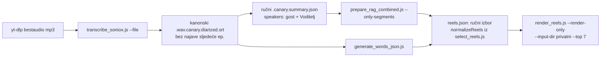

# Reelovi i naslovi za neobjavljenu (unlisted) epizodu, bez objave

12.11.2026. Krunoslav Puškar (re:DEFINICIJA, kanal `muzevni_budite`) poslao je link na
epizodu 11 (`RdEN7Ny1bV8`, gost Ante Lučić, 1:14:36), koja je na YouTubeu **unlisted** do
subotnje premijere. Tražio je naslov do 7 riječi i 7 kandidata za shortse. Dobio je
naslove, time kodove, 7 renderiranih HyperFrames reelova u 1080p, prijepis, titlove i
sve datoteke obrade. **Na CDN i domovina.ai nije otišlo ništa.**

## Zašto ne kroz red (pipeline.domovina.ai)

Puna obrada sad bi epizodu objavila prije premijere, i to pod krivim datumom:

- `bridge/plan.js` svakom jobu fiksno daje `--with-r2-upload` i `reuseArgs`. Opcije
  „obradi, ne objavljuj” nema.
- Katalog ingest (KORAK 13.5) razrješava `_unlisted` epizodu po `channel_id` iz
  `info.json` (`katalog/src/ingest/resolve.ts`, `tier1_channel_id`) i stavlja je na
  `/c/muzevni-budite`. Vidljivost po epizodi ne postoji, samo prekidači kanala
  (`channel_enabled`, `home_featured`). Stara „`_`-prefiks” nevidljivost vrijedi samo za
  Flutter indeks (`generate_channel_index.js`), ne za katalog.
- Datum: `backfill.json` (Data API) ne vidi unlisted videe, pa katalog pada na
  `upload_date` iz `info.json`: epizoda bi tiho završila na `/dani/2026-10-22`.
- Nightly ga ne vidi dok je unlisted (flat popis kanala ne vraća unlisted). Kad postane
  javan, nightly ga pokupi standardnim putem. Lokalna obrada mu ništa ne ubrzava:
  basename nastaje iz naslova i datuma u trenutku fetcha, a Soniox je samo ~2 min / $0,15.

Ako ovakvi zahtjevi postanu česti: zastavica `publish:false` u redu (bez
`--with-r2-upload`, reusea i 13.5), ili oznaka „unlisted” u katalogu koju `/c/` i
`/dani` poštuju. Ništa od toga nije napravljeno.

## Tijek (sve u privatnom direktoriju, ne `storage/output`)



Direktorij mora oponašati raspored kanala: `<root>/muzevni_budite/<base>.*`, gdje je
`<base>` npr. `20261022_redefinicija_11_epizoda_yt_RdEN7Ny1bV8`. Treba i `info.json`
(`yt-dlp --skip-download --write-info-json`). `render_reels.js` traži
`data/branding/<kanal>/brand.json`; s `--video-id` ne treba `reel.auto`.

Naredbe (`$ROOT` = privatni korijen):

```bash
node transcribe_soniox.js --file <ep>.mp3 --no-fallback
node prepare_rag_combined.js --input-dir $ROOT --channel muzevni_budite --only-segments
node generate_words_json.js --input-dir $ROOT --channel muzevni_budite
# reels.json: sirovi {start_seq,end_seq,cards[{type,at_seq,anchor,text,value}]}
#   → require("./select_reels.js").normalizeReels(raw, segs, words)
node render_reels.js --input-dir $ROOT --channel muzevni_budite --video-id <ID> \
  --top 7 --max-renders 7 --since-days 0 --render-only
```

Trenutke sam birao ručno (iz prijepisa, u sesiji), ne `select_reels.js`, da reelovi
budu točno onih 7 iz poruke. `normalizeReels` sidri kartice na riječ: svih 45 kartica
je usidreno. Render traje ~2,5 min po reelu, a izlaz je 35–43 MB, 1080×1920.

## Zamke

- **Kartica `quote` uvijek potpisuje govornika reela** („— Ante Lučić”). Citat treće
  osobe (Kotruljević, „stariji kolega”) mora biti `context` s imenom u tekstu, inače
  reel pripiše gostu tuđe riječi. Uhvaćeno na storyboardu, reelovi 4 i 5 renderirani
  ponovno.
- `normalizeReels` dopušta 25–100 s. Granice su cue-ovi, pa neki trenuci iz prijepisa
  moraju pomaknuti početak ili kraj da ne režu rečenicu (ovdje 3 od 7).
- Završna kartica vodi na `domovina.ai/v/<ID>`, a to radi tek nakon nightlyja.
- Render je usred posla pao s ENOSPC: interni disk je imao 579 MB slobodno, a radni dir
  `~/.cache/domovina-reels/work/<ID>_<rank>` treba ~0,4 GB. Disk nisu napunili ovi
  fajlovi.
- Glasovna kroz `agy_glasovna.sh` je pala dvaput. U sandboxu Claude Codea agy ne smije
  pisati `~/.gemini/antigravity-cli/installation_id`. Drugi poziv je zatim upotrijebio
  mrtvu tmux sesiju `agyg` i zalijepio prompt u bash, pa čekao do isteka vremena.
  Rezerva koja radi: `transcribe_soniox.js --file` na ogg→mp3 (76 s = 13 s, ~$0,0025).

## WhatsApp

- Kruno je u bridgeu pod LID-om `195249397874776@lid`: chat po broju
  (`385917848630@s.whatsapp.net`) završava 11.09. Mapa je u
  `~/.local/share/whatsapp-mcp/store/whatsapp.db`, tablica `whatsmeow_lid_map`.
- Bridge šalje `.mp4` kao `VideoMessage` s originalnim bajtovima, bez transkodiranja
  (`whatsapp-bridge/main.go`). Video stigne u 1080p. Rekomprimira samo mobilna aplikacija
  kad šalje čovjek, pa dokument nije potreban.

## Vezani dokumenti

- `docs/2026-10-25-reels-kandidati.md` (KORAK 9.9, render iza nightlyja)
- `docs/2026-11-06-katalog-ingest-nakon-uploada.md` (zašto `_unlisted` završi na kanalu)
- `docs/2026-10-21-hyperframes-reel-proba.md` (ep. 9 „traktor”)
