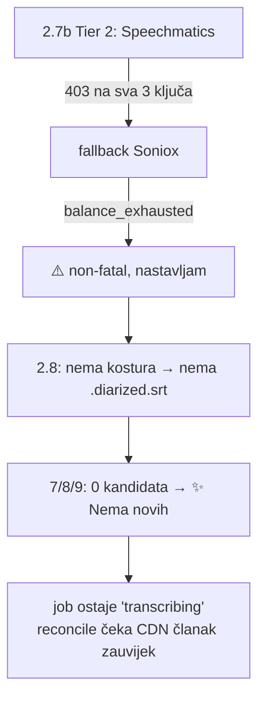

# ASR krediti istrošeni — Tier 2 jobovi tiho stoje u `transcribing` (13.11.2026.)

**Vezani dokumenti:** [`2026-11-02-asr-tier1-soniox-tier2-speechmatics.md`](./2026-11-02-asr-tier1-soniox-tier2-speechmatics.md),
[`2026-10-25-asr-prioritet-soniox.md`](./2026-10-25-asr-prioritet-soniox.md),
[`2026-11-05-queue-reset.md`](./2026-11-05-queue-reset.md),
[`2026-08-05-homily-extraction-nova-eva.md`](./2026-08-05-homily-extraction-nova-eva.md),
[`2026-10-09-ponovna-obrada-epizode.md`](./2026-10-09-ponovna-obrada-epizode.md).

## 1. Što se vidi

U `pipeline.domovina.ai/admin` 15 jobova stoji u stanju `transcribing` 3–5 h.
Prioritetni slot svakih 90 s javlja `📭 Nema prioritetnih jobova`, a reconcile
`⏳ <ID> ostaje transcribing`. Nijedan proces ih ne obrađuje i nitko ih neće ponovno
pokušati: worker je job uzeo, prošao sve korake i završio **bez prijepisa**.

## 2. Uzrok: sva tri ASR/dijarizacijska servisa bez kredita

| Servis | Greška u `automatic/logs/priority_2026-11-13.log` | Od kada |
|---|---|---|
| Soniox | `organization_balance_exhausted — Organization balance exhausted` | 13.11. između ~05:00 i 07:34 (nightly 03:21 je još prošao: 6/6) |
| Speechmatics | `HTTP 403 Forbidden` (nginx HTML) na sva 3 ključa (`79ac6b`, `8fe2f8`, `0dd7f9`) | prije Sonioxa, već u ranim jutarnjim slotovima |
| pyannoteAI | `HTTP 402 — No credit or active subscription` | 12.11. (trial tima italk istekao); proba `POST /v1/diarize` s `media://` = 402 |

403 iz nginxa izgleda kao blokiran/suspendiran račun, ne prazan saldo — provjeriti na portalu.

## 3. Zašto je tiho

Svaki korak je ispravno non-fatal, ali nijedan ne mijenja stanje joba u `failed`.
Admin oznaka `transcribing` zato ne razlikuje „radi” od „gotovo bez rezultata”.
**Otvoreno:** bridge bi trebao job bez prijepisa nakon ASR koraka označiti `failed`
s razlogom (npr. `asr_no_credit`), ili poslati obavijest kad oba ASR-a padnu.

Pogođeno 13.11.: 14 Tier 2 epizoda iz noćnog `enqueue_all_new.js` (Telegram.hr, HRT,
RTL, Jutarnji, LaudatoTV, …) + ponovna obrada `E0AILEwW550`. Nightly Tier 1 (Soniox →
Speechmatics) pada isto dok se Soniox ne nadoplati.

## 4. Oporavak

1. Nadoplatiti Soniox (console.soniox.com, sredstva ili autopay); provjeriti Speechmatics račun.
2. Vratiti 15 jobova u `queued` (admin „requeue” ili D1 `UPDATE jobs SET state='queued' WHERE state='transcribing'`
   kroz `npx wrangler d1 execute pipeline_domovina --remote` iz `../pipeline.domovina.ai/backend`).
   Ovo NIJE „stari retry” iz pravila #4 — jobovi su od 13.11.
3. `E0AILEwW550` (misa Nova Eva 24.7.2026., don Ivan Šibalić): nakon prijepisa ručno
   `node extract_homily.js --input-dir storage/output/_unlisted --video-id E0AILEwW550`,
   pa ako je `confidence=high`, `run_pipeline.sh --reprocess-article E0AILEwW550`.

## 5. Zamka: ponovna obrada briše rez na propovijed

`tools/reprocess_episode.js` (scope `derived`) skloni sve osim izvornih medija, pa i
`.homily.srt` / `.homily.json`. `extract_homily.js` **nije korak pipelinea**, pa bi
ponovna obrada mise dala članak, sažetak i RAG o **cijeloj misi** (~80 % liturgija +
misne nakane s imenima privatnih osoba). Stari fajlovi `E0AILEwW550` su u
`/Volumes/DOMOVINA2TB/fetch_domovina_tv_output/.reprocess_bak/_unlisted/E0AILEwW550_20261113-141555/`;
CDN i dalje servira stari (Canary + homily) članak.

Usput: job s `transcription='soniox'` je u fast-pathu ipak pokrenuo i Modal Canary (2.6)
i ostavio `.wav.canary.srt`, ali lokalna dijarizacija je ugašena (31.10.), pa od toga
nema `.diarized.srt`.
