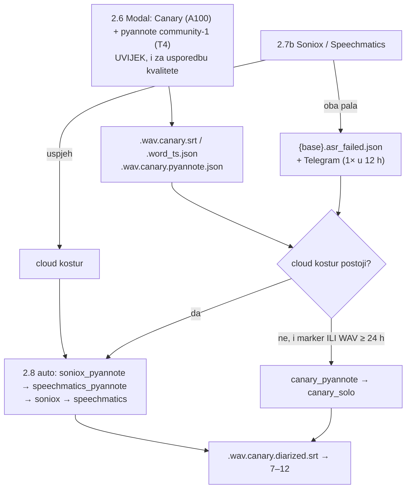

# Canary kao zadnja rezerva: govornici na Modalu, kostur u 2.8 (14.11.2026.)

**Vezano:** [`2026-11-13-asr-krediti-istroseni.md`](./2026-11-13-asr-krediti-istroseni.md),
[`2026-10-31-lokalna-diarizacija-ugasena.md`](./2026-10-31-lokalna-diarizacija-ugasena.md),
[`2026-10-25-asr-prioritet-soniox.md`](./2026-10-25-asr-prioritet-soniox.md).

## Zašto

13. i 14.11. nije prošla nijedna nova epizoda (osim 8 Tier 2 jutra 13.11.): Soniox
`organization_balance_exhausted`, Speechmatics 403 na sva 3 ključa, pyannoteAI 402. Modal
Canary je cijelo vrijeme radio, ali njegov prijepis nije vodio nikamo:

- lokalna dijarizacija (KORAK 6) ugašena je 31.10., pa Canary nije imao govornike;
- KORAK 2.8 `auto` znao je samo za Soniox/Speechmatics kosture.

Na domovina.ai je 14.11. zato falilo 40 epizoda (Tier 1: 6, Tier 2: 34).

## Što je sad

| Dio | Datoteka | Što radi |
|---|---|---|
| Govornici na Modalu | `modal_canary/canary_modal.py` (`Diarizer`) | pyannote 4.0.4 community-1, exclusive, T4, vlastiti image; `::main` ga zove uz Canary; kad `.canary.srt` već postoji radi samo dijarizaciju. Izlaz `{wav}.canary.pyannote.json`. Non-fatal. `MODAL_CANARY_DIARIZE=0` gasi, `MODAL_DIARIZE_GPU` mijenja GPU. Secret `domovina-hf` (HF_TOKEN). |
| Sken 2.6 | `tools/scan_modal_candidates.js` | uz „WAV bez `.canary.srt`” bira i „ima SRT, nema `.canary.pyannote.json`, nema kanonskog SRT-a, ≤ 14 d” (`samo govornici=` u logu) |
| Marker | `transcribe_soniox.js` | pad oba ASR-a → `{base}.asr_failed.json` (razlog, broj pokušaja); uspjeh ga briše; greške računa → Telegram `asr-no-credit` |
| Kostur | `lib/asr/canary_skeleton.js` | `fallbackStatus()` (marker ili ≥ `CANARY_FALLBACK_AFTER_H`=24 h, ≤ `CANARY_FALLBACK_FRESH_DAYS`=14 d, bez cloud kostura i kanonskog SRT-a) i `buildSkeleton()` → `.canary_pyannote.words.json` / `.canary_solo.words.json` |
| 2.8 | `refine_diarized_gemini.js` | `AUTO_ORDER` + `canary_pyannote`, `canary_solo`; `prepareCanarySkeletons()` prije skena. Bez Gemini sluha cap je 200 (`GEMINI_REFINE_PROMOTE_MAX_FILES`), ne 8 |
| Manifest | `lib/processing_manifest.js` | `canonical_srt.origin = canary+pyannote_modal`, `diarization[].provider = pyannote_modal` |
| Telegram | `lib/notify_telegram.js` | `li.domovina.ai/telegram/document`, ograda po ključu u `storage/.telegram_alerts.json`; `TELEGRAM_ALERTS=0` gasi |
| Bridge | `../pipeline.domovina.ai/bridge/priority_poller.js`, `plan.js` | job bez kanonskog SRT-a nakon runa → `failed` („ASR: nema prijepisa…”) umjesto vječnog `transcribing`; tok `transcription='canary'` dobiva `--gemini-refine-promote` + `CANARY_FALLBACK_AFTER_H=0` |

## Brojke

- Dijarizacija na Modalu: 18 min snimke → 43 s na T4, cold start ~7 s, ≈ 1 cent.
- Canary je ~$0,05/ep, ukupno Modal oko $1,5–2/dan uz ~30 epizoda. Krediti 14.11.: **$9,73**.
  Bez nadoplate ili kartice Modal staje za ~5 dana, a s njim i rezerva.

## Zamke

- Canary prijepis nema interpunkciju po rečenici kao Soniox, a segmenti su do 22 s; atribucija
  govornika je pyannote, pa su imena i dalje na koracima 7+8.
- Epizoda promovirana kroz Canary ostaje takva i kad se Soniox vrati (2.8 popunjava samo gdje
  kanonskog SRT-a nema; 2.7b je preskače jer ima kanonski SRT). Nadogradnja na Soniox je zasebna
  odluka (pravilo #4).
- Secret `domovina-hf` mora postojati: bez njega `modal run` ne može stvoriti app, pa pada i Canary.
- 14.11. je 34 Tier 2 joba (13. i 14.11.) vraćeno iz `transcribing` u `queued` (D1, isti UPDATE
  kao admin requeue). To nisu stari jobovi iz pravila #4 (reset 05.11.).

## Prvi dan u radu (14.11. navečer)

- Od 18:02 svaki vraćeni Tier 2 job ide kroz isti put: 2.6 „`.canary.srt` postoji — radim samo
  dijarizaciju” → pyannote na T4 → 2.8 `🛟 Canary rezerva (canary_pyannote, N govornika)` →
  članak. Do 19:10 12 epizoda, 0 „ASR: nema prijepisa”, 0 Tracebacka.
- Modal se pali **po epizodi** (ephemeral app, ~1–2 min, pa se gasi), ne jedan dugi container;
  u `modal app list` jedan novi svakih ~6 min = ritam slota. Ostatak od ~6 min po jobu su
  lokalni koraci 7–13.
- pyannote: 39–233 s po epizodi (medijan 104 s), učitavanje modela 2–26 s. Procjena za 12
  epizoda ≈ **$0,23**.

### Zašto pyannote ostaje na T4, a ne na CPU-u

Stara presuda „G4 ≈ M4 Pro” (CLAUDE.md) uspoređivala je skupi Colab G4 s već plaćenim Macom.
Na Modalu se plaća po sekundi: segmentacija i embeddinzi su neuronske mreže i GPU ih ubrza, a
klasteriranje je za podcast od 1–2 h mali dio. T4 je najjeftiniji GPU (~$0,59/h); CPU
container s 8 jezgri i 16 GB bi po procjeni (nije mjereno) trajao nekoliko minuta i koštao
isto ili više. Lokalna dijarizacija na Macu ugašena je zbog swapa i diska, ne cijene.

### Gemini sluh nije razlika

Gemini preslušavanje (2.8 refine) ugašeno je svugdje od 28.10. (`--no-gemini-ear` u nightlyju i
`bridge/plan.js`). I Soniox + pyannoteAI kostur se samo promovirao. Razlika u kvaliteti Canary
puta je samo ASR (interpunkcija, segmenti) i dijarizacija (community-1 vs precision-3).

### Report (`tools/nightly_step_report/build.py`, d7cdb68a)

Sažetak dobiva red **Modal** (Canary/pyannote broj epizoda, zbroj i medijan sekundi, procjena $
= (učitavanje + inference) × cijena GPU-a; donja granica, bez uploada i pokretanja containera)
i **Canary rezerva** (koje epizode nisu imale cloud kostur). Tablice Tier 2 i nightly imaju
stupce *ASR* i *Modal Canary / pyannote*. Sve iz postojećih linija loga.

Zamka 14.11.: report broji samo jobove s `created_at` između 03:00 i kraja nightlyja + 30 min.
Ručno vraćeni jobovi (UPDATE u 05:12) ispadnu iz te serije, pa je report za taj dan javio
„0 s člankom na CDN-u” iako članci postoje. Normalni dani to nemaju.

## Provjera 15. i 16.11.

- **Nightly 15.11.** (kraj 05:28): 8 Tier 1 epizoda kroz `🛟 Canary rezerva (canary_pyannote)`, među
  njima sve 4 zaostale s 14.11. (`Iyrgbzw_cMI`, `kGDNEWqpFC0`, `xBlx6hd71Ew`, `wuXklBUYCBI`); svih 8
  ima `article.json` na CDN-u. Uzrok u logu: Speechmatics 403 na sva 3 ključa.
- **Nightly 16.11.** (kraj 03:24): 0 novih Tier 1 WAV-ova. Jedina nova epizoda na listama (Ora et
  Labora `WMRZoAFi0Sg`, i `kqD6vhlR7zU` od 15.11.) preskočena je jer je vlasnik povukao kanal u
  postavkama kanala — namjerno, ne rupa.
- **Tier 2** od 13.11.: 64 joba `done` kroz canary, svih 64 članaka na CDN-u (200). Failed: 4 anti-bot
  downloada i `E0AILEwW550` (reprocess starog WAV-a, 14-dnevna ograda).
- Telegram `asr-no-credit` radi (zadnji 16.11. 02:20 UTC, ograda 12 h). Report 15.11. poslan 13:23
  s redom **Modal** (Canary 15 ep., pyannote 19 ep., ≈ $1.00) i **Canary rezerva** (19 ep.).
- Oba nightlyja: `audit_pipeline.js` exit 1 (disk↔CDN drift), ne ruši run.

## Otvoreno

- Modal krediti: ~$1/dan po reportu 15.11. — provjeriti saldo prije ~19.11.
- Modal krediti $9,73 (14.11.) ≈ 5 dana; korisnik kaže da je Modal kao trošak ok.
- agy nudi `gemini-4-hydrogen-*`; Tier 2 i EN su još na `gemini-3.8-flash-low`. A/B prije
  zamjene (vrijeme, kvota, vjernost) — Argon je imao zaseban malen tjedni limit.
  Izmjereno: `docs/2026-11-15-agy-hydrogen-ab.md` (Hydrogen troši isti Gemini prozor, nema zaseban limit).
