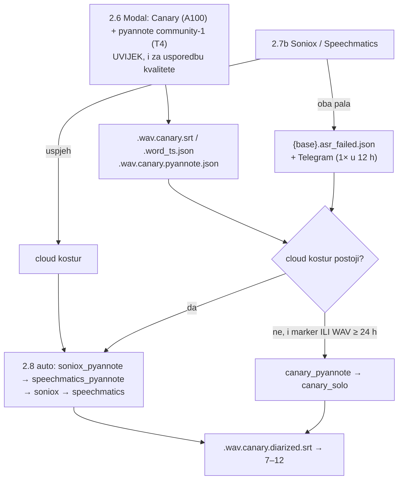

# Canary kao zadnja rezerva: govornici na Modalu, kostur u 2.8 (14.11.2026.)

**Vezano:** [`2026-11-13-asr-krediti-istroseni.md`](./2026-11-13-asr-krediti-istroseni.md),
[`2026-10-31-lokalna-diarizacija-ugasena.md`](./2026-10-31-lokalna-diarizacija-ugasena.md),
[`2026-10-25-asr-prioritet-soniox.md`](./2026-10-25-asr-prioritet-soniox.md).

## Zašto

13. i 14.11. nije prošla nijedna nova epizoda (osim 8 Tier 2 jutra 13.11.): Soniox
`organization_balance_exhausted`, Speechmatics 403 na sva 3 ključa, pyannoteAI 402. Modal
Canary je cijelo vrijeme radio, ali njegov prijepis nije vodio nikamo:

- lokalna dijarizacija (KORAK 6) ugašena je 31.10., pa Canary nije imao govornike;
- KORAK 2.8 `auto` znao je samo za Soniox/Speechmatics kosture.

Na domovina.ai je 14.11. zato falilo 40 epizoda (Tier 1: 6, Tier 2: 34).

## Što je sad

| Dio | Datoteka | Što radi |
|---|---|---|
| Govornici na Modalu | `modal_canary/canary_modal.py` (`Diarizer`) | pyannote 4.0.4 community-1, exclusive, T4, vlastiti image; `::main` ga zove uz Canary; kad `.canary.srt` već postoji radi samo dijarizaciju. Izlaz `{wav}.canary.pyannote.json`. Non-fatal. `MODAL_CANARY_DIARIZE=0` gasi, `MODAL_DIARIZE_GPU` mijenja GPU. Secret `domovina-hf` (HF_TOKEN). |
| Sken 2.6 | `tools/scan_modal_candidates.js` | uz „WAV bez `.canary.srt`” bira i „ima SRT, nema `.canary.pyannote.json`, nema kanonskog SRT-a, ≤ 14 d” (`samo govornici=` u logu) |
| Marker | `transcribe_soniox.js` | pad oba ASR-a → `{base}.asr_failed.json` (razlog, broj pokušaja); uspjeh ga briše; greške računa → Telegram `asr-no-credit` |
| Kostur | `lib/asr/canary_skeleton.js` | `fallbackStatus()` (marker ili ≥ `CANARY_FALLBACK_AFTER_H`=24 h, ≤ `CANARY_FALLBACK_FRESH_DAYS`=14 d, bez cloud kostura i kanonskog SRT-a) i `buildSkeleton()` → `.canary_pyannote.words.json` / `.canary_solo.words.json` |
| 2.8 | `refine_diarized_gemini.js` | `AUTO_ORDER` + `canary_pyannote`, `canary_solo`; `prepareCanarySkeletons()` prije skena. Bez Gemini sluha cap je 200 (`GEMINI_REFINE_PROMOTE_MAX_FILES`), ne 8 |
| Manifest | `lib/processing_manifest.js` | `canonical_srt.origin = canary+pyannote_modal`, `diarization[].provider = pyannote_modal` |
| Telegram | `lib/notify_telegram.js` | `li.domovina.ai/telegram/document`, ograda po ključu u `storage/.telegram_alerts.json`; `TELEGRAM_ALERTS=0` gasi |
| Bridge | `../pipeline.domovina.ai/bridge/priority_poller.js`, `plan.js` | job bez kanonskog SRT-a nakon runa → `failed` („ASR: nema prijepisa…”) umjesto vječnog `transcribing`; tok `transcription='canary'` dobiva `--gemini-refine-promote` + `CANARY_FALLBACK_AFTER_H=0` |

## Brojke

- Dijarizacija na Modalu: 18 min snimke → 43 s na T4, cold start ~7 s, ≈ 1 cent.
- Canary je ~$0,05/ep, ukupno Modal oko $1,5–2/dan uz ~30 epizoda. Krediti 14.11.: **$9,73**.
  Bez nadoplate ili kartice Modal staje za ~5 dana, a s njim i rezerva.

## Zamke

- Canary prijepis nema interpunkciju po rečenici kao Soniox, a segmenti su do 22 s; atribucija
  govornika je pyannote, pa su imena i dalje na koracima 7+8.
- Epizoda promovirana kroz Canary ostaje takva i kad se Soniox vrati (2.8 popunjava samo gdje
  kanonskog SRT-a nema; 2.7b je preskače jer ima kanonski SRT). Nadogradnja na Soniox je zasebna
  odluka (pravilo #4).
- Secret `domovina-hf` mora postojati: bez njega `modal run` ne može stvoriti app, pa pada i Canary.
- 14.11. je 34 Tier 2 joba (13. i 14.11.) vraćeno iz `transcribing` u `queued` (D1, isti UPDATE
  kao admin requeue). To nisu stari jobovi iz pravila #4 (reset 05.11.).
