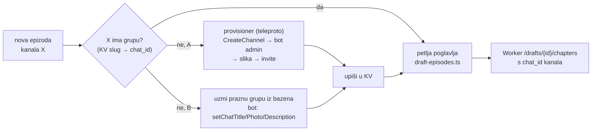

# Telegram grupa po kanalu: lazy stvaranje (istraživanje, 19.11.2026.)

**Status (19.11.2026., popodne): odluke donesene, varijanta A implementirana i pushana
(`linkedin-poster` `74cd2a7`), Worker NIJE deployan, nijedan stvarni kanal nije stvoren.** Pravila „samo nove
epizode” (CLAUDE.md #4) vrijede i ovdje: grupa nastaje kad stigne prva NOVA
epizoda kanala, stari katalog se ne objavljuje.

## Ideja

Svaki kanal dobije vlastitu Telegram grupu (ili kanal). Kad nova epizoda tog
kanala prođe pipeline, u njegovu grupu idu poglavlja, kao što danas idu u jednu
grupu ms-social-poster. Grupa se stvara **lazy**: kod prve epizode kanala. Svaka
sljedeća epizoda ide u postojeću grupu.

## Kako je danas (provjereno u kodu)

- Bot ms-social-poster, token samo u Workeru `li.domovina.ai`
  (`~/git/stepanic/linkedin-poster`).
- `src/telegram.ts` šalje u JEDAN chat: `TELEGRAM_CHAT_ID` ili id iz KV-a
  `telegram:chat-id` (nakon migracije u supergrupu).
- Poglavlja šalje petlja na Macu: `scripts/draft-episodes.ts` →
  `POST /drafts/{id}/chapters`, jedan poziv po poglavlju, razmak 3,5 s, tiho,
  stanje u `.state/drafted.json`
  (`linkedin-poster/docs/2026-09-17-prijedlozi-objava-iz-nightlyja.md`).
- `lib/notify_telegram.js` u ovom repou ide kroz isti Worker
  (`/telegram/document`).

## Ključna činjenica: bot NE može stvoriti grupu

Bot API nema metodu za stvaranje grupe ni kanala. Bot može samo raditi u grupi u
koju je dodan (naslov, slika, opis, invite link). Stvaranje traži MTProto
**korisnički** račun.

## Već postoji gotov provisioner

`domovinatv/novcanik-comms/provision/` (srpanj 2026., commit `dbab473`),
arhiviran na `/Volumes/DOMOVINA2TB/git/domovinatv/novcanik-comms`
(`_ARHIVA-NA-DOMOVINA2TB.md`). „Wrangler za grupe”, TypeScript + GramJS:

- `npm run login`: jednokratna interaktivna prijava → `TG_SESSION` u
  `provision/.env` (gitignoran, postoji od 18.07.)
- `npm run create-group -- <slug> --title "…" [--public <username>] [--no-bot] [--about "…"] [--slow 30] [--remote|--skip-d1]`
- Redoslijed: `channels.CreateChannel(megagroup)` → (`UpdateUsername` za javnu) →
  `TogglePreHistoryHidden(false)` → `EditAdmin` bota → `ToggleAntiSpam` +
  `ToggleSlowMode` → `ExportChatInvite` → upis u D1
- U srpnju njime napravljene `t.me/mpt_hr` i `t.me/airkuna_com`.
- Megagroupa se stvara odmah kao supergrupa, pa nema migracije koja mijenja
  `chat_id` (zamka opisana u `linkedin-poster/docs/2026-08-27-telegram-obavijesti.md`).

## GramJS je arhiviran → teleproto

GramJS (`telegram` na npm, zadnja 2.26.22) arhiviran je **14.07.2026.**, 12 dana
nakon što je provisioner napisan. README upućuje na
[`teleproto`](https://github.com/sanyok12345/teleproto) (MIT, fork iz 2025.,
1.233.0 od 09.11.2026., praktički jedan održavatelj).

Prelazak po njihovom vodiču: `npm uninstall telegram && npm install teleproto`,
importi `teleproto` i `teleproto/sessions`, pa `tsc --noEmit`.
`client.invoke(new Api...)` radi kao prije, a GramJS session string vrijedi bez
nove prijave.

Rizik: paket dobiva punu sesiju Telegram računa. Točno pinana verzija (bez `^`),
commitan `package-lock.json`, nadogradnje namjerno s pregledom diffa. Alternativa
s više održavatelja je Telethon (Python); u srpnju odbijen samo zbog jezika.

## Dvije varijante

| | A) MTProto provisioner | B) bazen unaprijed napravljenih grupa |
|---|---|---|
| Stvaranje | potpuno automatsko | ručno, unaprijed po 10 |
| Ovisnost | korisnička sesija (teleproto) | samo Bot API |
| Limiti | ~500 grupa po računu, ~10 javnih `@username` (20 uz Premium), `FLOOD_WAIT` pri brzom stvaranju (iz pamćenja, provjeriti) | koliko ih ručno napraviš |
| Kad | kad treba puno kanala bez ručnog rada | dovoljno za Tier 1 (~50 kanala) |

## Odluke (19.11.2026.)

| Pitanje | Odluka |
|---|---|
| Grupa ili kanal | **kanal + povezana grupa za raspravu** (`SetDiscussionGroup`); dva objekta po podcastu, strop ~250 podcasta po računu |
| Pristanak | **opt-in**: `telegram.opt_in` (datum) na unosu u `data/podcasts_registry.json`; ime „<Kanal> · domovina.ai” |
| Račun | **zaseban Domovina Telegram račun**; nova `npm run login`, sesija iz srpnja (novcanik) se ne koristi |
| Mapiranje | **KV Workera** `tg:podcast:<UC…>`, ključ YouTube `channel_id` (Tier 2 epizode imaju slug `_unlisted`) |
| Opseg | **Tier 1 + Tier 2** (opt-in ga ionako ograničava) |

## Što je izgrađeno

- `linkedin-poster/scripts/provision/` (teleproto 1.233.0, pinano): `npm run login`,
  `npm run create-channel -- <UC…> --title … --avatar … [--dry-run]`; idempotentan (GET mapiranja prvo).
- Worker: `GET|PUT /telegram/podcasts/{UC…}`; `/drafts/{id}/chapters` prima `youtubeChannelId`
  (bez mapiranja → 404, nikad tihi pad u zajedničku grupu).
- `draft-episodes.ts`: opt-in iz registryja; `--provision` stvara kanal koji nedostaje. Bez
  zastavice poglavlja idu u grupu kao prije; neuspjeli provisioning preskače poglavlja do idućeg runa.
  Draft ostaje u zajedničkoj grupi (tamo se pregledava).

## Otvorene odluke (izvorni popis)

1. **Grupa ili kanal?** Za jednosmjernu objavu 30–46 poglavlja po epizodi bolji
   je Telegram kanal (pretplatnici, bez spama); grupa samo ako ljudi trebaju
   pisati.
2. **Pristanak vlasnika podcasta.** Grupa pod imenom tuđeg podcasta izgleda
   službeno. Prijedlog: opt-in kao reels (`brand.json` `"reel": {"auto": true}`)
   ili kroz vlasnikove postavke (`gate().checkStep`), ime „<Kanal> · domovina.ai”.
3. **Račun vlasnik grupa:** zaseban Domovina račun, ne osobni. Predaja
   vlasništva kanalu kasnije traži 2FA.
4. **Gdje mapiranje:** KV u Workeru ili D1 katalog.
5. **Opseg:** samo Tier 1, ili i Tier 2 (tamo A udara u limit ~500).

## Što treba izgraditi (A)

| Gdje | Što |
|---|---|
| `provision/` → npr. `linkedin-poster/scripts/provision/` | izvući iz arhive, prebaciti na teleproto, upis u KV umjesto D1 `communities`, `channels.EditPhoto` s `cdn.domovina.ai/registry/avatars/<slug>.jpg` |
| Worker `src/telegram.ts` | `chatId` po pozivu; postojeća grupa ostaje default |
| Worker `/drafts/{id}/chapters` | prima `slug` i šalje u grupu tog kanala |
| `scripts/draft-episodes.ts` | prije petlje: grupa za slug, ako je nema poziv provisionera |
| registry/branding | opt-in zastavica po kanalu |

## Vezani dokumenti

- `~/git/stepanic/linkedin-poster/docs/2026-09-17-prijedlozi-objava-iz-nightlyja.md` (petlja poglavlja)
- `~/git/stepanic/linkedin-poster/docs/2026-08-27-telegram-obavijesti.md` (migracija u supergrupu)
- `~/git/docs/memory/claude-sesija-tcc-vanjski-diskovi.md` (zašto se arhiva na DOMOVINA2TB nije dala čitati)
