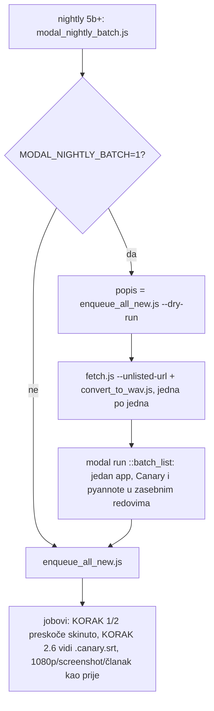

# Noćna Modal serija za Tier 2 (23.11.2026.)

Alternativni način Modal obrade za noćnu seriju Tier 2 epizoda. Uključuje se jednim
parametrom, a postojeći tok se ne mijenja.

```bash
# .env (nightly ga učita sam)
MODAL_NIGHTLY_BATCH=1      # uključeno; bez retka ili 0 = stari put (svaka epizoda zaseban Modal poziv)
```

## Zašto

Mjereno na 599 Modal poziva od 1. do 22.11.2026. (`modal billing report --show-resources`):
$49,62 ukupno, A100-40GB 81 %, T4 12 %. Pojedinačni Canary poziv naplati oko 92 s A100
(medijan), a od toga je samo oko 21 s inference. Ostatak su start containera i učitavanje
modela (oko 35 s, 6,4 GB s Volumea). Batch režim (`::batch`, 29.07.) je izmjerio
$0,009–0,012 po epizodi umjesto oko $0,054.

GPU nije predimenzioniran: L4 je 3,4× sporiji (220 s naspram 64 s za 150 min zvuka) i
staje približno isto (oko $0,06 naspram $0,07 po pozivu), a s 22 GB VRAM-a je blizu OOM-a
na dugim snimkama (vrh 20,6 GB na A100). Jedina poluga je fiksni trošak po pozivu.

## Kako radi



1. **Popis** je točno ono što bi `enqueue_all_new.js` sada poslao: njegov `--dry-run`, dakle
   ista logika (lookback, `process:false`, postavke kanala, kvota, pokušaji). Puni naslov
   dolazi iz `events.jsonl`.
2. **Skidanje** ide istom naredbom kao KORAK 1 joba (`fetch.js --unlisted-url … --unlisted-title …`,
   MP3 + 360p, upis u `_unlisted-state.json`), plus `convert_to_wav.js --channel _unlisted --video-id`.
   Proxy je isti kao u `priority_poller.js` (`~/.cache/domovina-pipeline/youtube_proxy`).
   Između skidanja je nasumična pauza od 20 do 45 s (`MODAL_NIGHTLY_BATCH_GAP_MIN/MAX`): YouTube
   anti-bot gleda broj zahtjeva s IP-a, a ne rezoluciju, pa bi ~35 skidanja u nekoliko minuta
   bilo rizičnije od jobova koji su se prirodno razmicali. Dok je `youtube_antibot.json` svjež
   (isti prozor kao poller, `PRIORITY_YT_COOLDOWN_MIN`, 120 min) ili nakon 2 pada zaredom,
   serija više ne dira YouTube, a ostatak skida job nakon pauze.

   Zašto ne samo MP3: 360p `.mkv` je izvor za `video_h264.mp4` (KORAK 12.5, jedini video u
   appu) i rezerva za screenshotove. Screenshotovi ne skidaju 1080p datoteku, nego iz streama
   čitaju ~16 kratkih isječaka, pa 360p iz 1080p ne bi uštedio nijedno skidanje. Audio-only
   skidanje ima jednako YouTube zahtjeva (player API + potpisani URL) kao audio + 360p.
3. **Modal** se zove jednom, `canary_modal.py::batch_list --manifest`, uz
   `MODAL_CANARY_MAX_CONTAINERS=1`: jedan topli Canary container. Pyannote (T4) ima svoj red
   (`--diar-concurrency 2`), jer A100 ne smije čekati T4: govornici traju ~2,4 s po minuti
   zvuka, Canary ~0,3 s. Izlazi su isti kao kod `::main` (`.canary.srt/.csv/.word_ts.json`,
   `.canary.pyannote.json`).
4. **Jobovi** ostaju isti. Transcribe claim radi kao u KORAKU 2.6.

## Sigurnost

- Epizoda koja u seriji ne uspije (anti-bot, pad na Modalu, WAV > 400 MB) nema `.canary.srt`,
  pa njezin job ide starim putem (`::main`). Serija ne može ostaviti epizodu bez prijepisa.
- Skripta nikad ne ruši nightly (`|| true`, `catch` u `main`).
- RAM klijenta: do 4 WAV-a istodobno kao bytes-argument; test s dva fajla 1 GB RSS.
- Poznati rizik (postoji i bez serije): `fetch.js` i paralelni prioritetni slot oba pišu
  `_unlisted-state.json`. Serija skida sekvencijalno i prije enqueuea, pa je preklapanje
  samo s jobovima prethodnog dana.

## Cijena prekidača

Jobovi se stvaraju tek nakon serije, pa prvi članak kreće kasnije: skidanje ~35 epizoda
plus upload (4–8 GB). Procjena je 30–60 min, nije izmjereno. Jobovi poslije ne čekaju Modal.

## Ručno

```bash
node automatic/modal_nightly_batch.js --dry-run     # popis, bez skidanja i Modala
node automatic/modal_nightly_batch.js --force       # pravi run bez prekidača
node automatic/modal_nightly_batch.js --from-queue  # jobovi koji već čekaju u redu (od kraja reda)
# manifest + rezultat: automatic/logs/modal_batch_<datum>_<vrijeme>.{manifest,result}.json
```

Test 23.11.: 2 epizode (52 + 84 MB) u jednom appu, oba prijepisa i oba skupa govornika
ispravna, 2,2 min wall.
